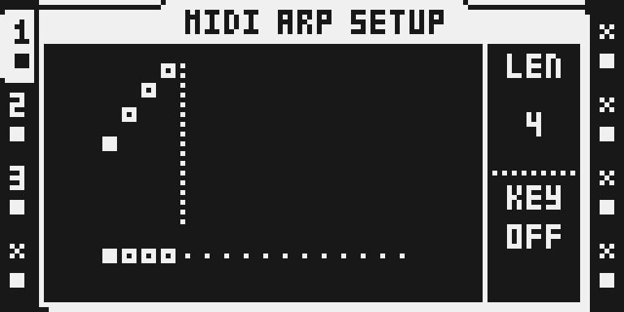
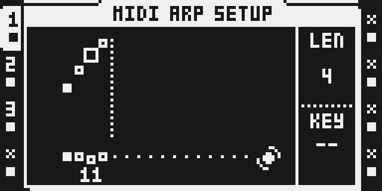
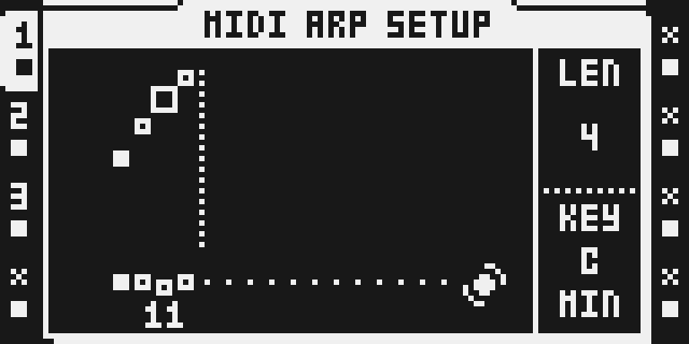
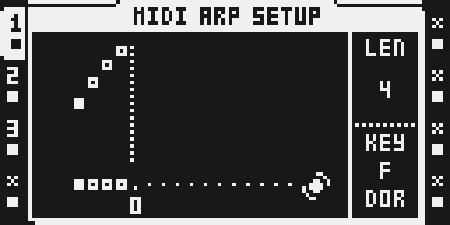
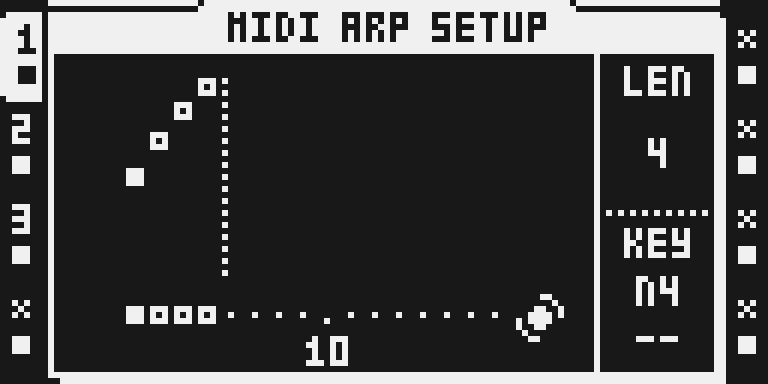
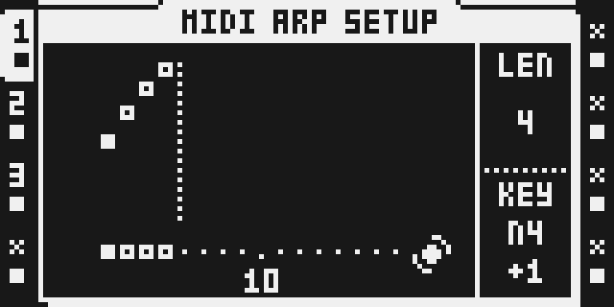

# Arp Key Locks

## Overview

Lock the arpeggiator's KEY on single steps of a MIDI track, the way you lock a parameter. Hold a trig in MIDI ARP SETUP and turn KEY: that step keeps its own key, for example F DORIAN, and the key holds until the next locked step, wrapping at the end of the pattern. The arpeggio keeps running while the key changes under it; only its notes move into the new scale. Seven modes in all twelve roots: MAJOR, DORIAN, PHRYGIAN, LYDIAN, MIXOLYDIAN, MINOR and LOCRIAN. A pattern without a lock plays the track's KEY, as on stock.

It can also move one note of the arpeggio on a trig: hold the trig, pick the arp note with D and move it up or down by steps of the key with E. On that trig's arpeggio, for example, the 4th note plays one step higher; the next trig without a setting plays the arpeggio as it is.

Version `0.1.0-experimental`, for OS 1.40C: over USB on the Modwerk base, and in card builds.

**Hardware status.** Ran on the author's MKII over USB on 24 October 2026, as trials on the Modwerk base with its three events (package `1d086d7b…` in the third session): the per-step keys and the arp note shifts came out right on MIDI and the gestures behaved as described ([evidence/hardware.md](evidence/hardware.md)). On 26 October 2026 the published package `7962c35a…` was kept on the flashed base beside nine other modules, played the tester's locks and stayed kept through a power cycle; one of three base self-tests failed on DSP load. On 27 October 2026 the submitted package `907a03cf…` was kept on the flashed base beside nine other modules: its locks played in their keys before and after saving and reloading the project and after a power cycle, were ignored with the module removed, and it was kept again. Card builds and the MKI are not tested.

## Controls

| Where | Gesture | What it does |
|---|---|---|
| MIDI ARP SETUP (hold trigs, then FUNC + AMP or AMP twice, on a MIDI track) | Hold one or more trigs, turn F (KEY) | Locks a key on each held step. Turning starts from the step's own lock, or from the track's KEY when the step has none. |
| The same | Turn F down past OFF while holding | Removes the step's lock: the step follows the lock before it again. |
| The same | Hold a trig, turn nothing | The KEY box shows the step's lock: root and mode (C / PHR), OFF, or -- for none. |
| The same | Hold a trig, turn D | Picks the arp note to move, N1 to N16 (the arp sequence's notes, as LEN counts them). The first turn starts at the note the step already moves, else N1. Turned below N1: -- removes the step's arp note setting. |
| The same | Hold a trig, turn E | Moves the picked arp note -7 to +7 steps of the key (semitones with KEY OFF); 0 plays it as it is. The KEY box shows N4 over +1. |

Lock values, in turning order: OFF (no correction on that step), then C MAJ, C DOR, C PHR, C LYD, C MIX, C MIN, C LOC, C# MAJ and so on to B LOC. MAJ is MAJOR and MIN natural MINOR, as stock's KEY names them; DOR, PHR, LYD, MIX and LOC are the other modes.

The KEY box shows what was touched last: the key after F, the arp note after D or E. Everything else on ARP SETUP is stock: LEN, the arp note editor (LEVEL), tapping a trig to switch an arp step on or off, and KEY when no trig is held, which sets the track's own KEY (OFF, MAJOR or MINOR in the twelve roots). To give a whole pattern one of the other modes, lock it on step 1: a lock holds until the next one.

## Usage

Program the arpeggio as usual (NOTE and chord notes on the trigs, MODE on the AMP page). The locks decide which scale the notes fall into on each step: an out-of-key note moves one semitone down, the same rule stock's KEY follows for MAJOR and MINOR. A lock affects every note the track sends from that step on: arpeggio notes, chord notes and plain trigs.

### Quick tutorial: a scale that changes every four steps

1. Press [MIDI] and pick a MIDI track that plays an arpeggio (AMP page: MODE UP, a trig with a chord). Press [REC] for grid recording.
2. Hold trig 1, press [FUNC] + [AMP] (or [AMP] twice) to open ARP SETUP and turn KEY to C MIN, then let go: ARP SETUP closes and the pattern's trigs show again. Do the same for trig 5 (F DOR), trig 9 (G PHR) and trig 13 (C MIN). While a trig is held the KEY box shows its lock.
3. Press [PLAY]: steps 1-4 play in C minor, 5-8 in F Dorian, 9-12 in G Phrygian, 13-16 in C minor, and the arpeggio never restarts. To remove a lock, hold its trig and turn KEY down past OFF; with no locks left the track plays its own KEY again.

### Move one arp note on a trig

1. With the arpeggio playing a sequence of at least four notes (LEN 4 or more) and grid recording on, hold the trig of step 9 and press [FUNC] + [AMP] (or [AMP] twice).
2. Turn D to N4, then E one detent up: the KEY box shows N4 over +1. Let go of the trig: ARP SETUP closes.
3. Trig 9's arpeggio now plays its 4th note one step of the key higher; trig 1's plays as before. To remove it, hold trig 9 again, open ARP SETUP and turn D below N1.

### How locks combine

The lock that holds on a step is the nearest one at or before it; before the first lock of a pattern, the last one wraps round. One lock on step 1 therefore sets the whole pattern's key. The pattern's length counts, and each track's own length in PER TRACK mode.

An arp note setting belongs to its trig: it holds from its step until the next step with a trig or a setting of its own, so a trig without one plays the arpeggio as it is. A step keeps one arp note setting; E on another note moves the step's setting to it. Locks are saved with the project (tested in the emulator). They sit among the step's stock locks, so by octabam's firmware notes copying a trig or a pattern carries them, and placing a new trig or clearing a trig's locks removes them, as it does stock's locks; that is not tested here.

### What changes in a stock flow

One stock gesture is touched:

- **What changes and for whom.** In MIDI ARP SETUP, turning KEY while a trig is held stores a lock on the held steps instead of changing the track's KEY, encoders D and E (unused there on stock) set the held step's arp note shift, and the KEY box shows the held step's lock or shift. On the stock OS a held trig makes no difference there: the turn edits the track's KEY. Everyone with the module in their build or module set has the gesture.
- **Why.** A step's key belongs where KEY already is, and the held-trig gesture is how every other value is locked. Stock's own lock storage has no slot for a setup value, so the lock lives in a step's spare lock byte, which stock neither edits, applies nor validates.
- **What you see and do differently.** With a trig held, KEY reads the step's lock (-- for none) and turning it edits that lock; D and E edit the step's arp note shift. Over USB, letting go of every trig after such an edit closes ARP SETUP, as [FUNC] + [AMP] does, and shows the pattern's trigs again, so the next step can be picked there; tapping a trig without turning anything leaves ARP SETUP open, as on stock. A card build stays in ARP SETUP. KEY without a held trig, LEN, the arp note editor, tapping a trig to switch an arp step, and every other page are unchanged.
- **Turning it off.** Let go of the trig: KEY is the track's again. Remove the module and the locks stay in the project, unused: stock never reads them.
- **Neighbouring flows checked** (emulator, MKII panel, against the original OS): KEY without a held trig; a held trig's NOTE and NLEN locks on the NOTE and ARP pages; the trig pattern and the arp's step mask while trigs are pressed and D and E turned in ARP SETUP. Not checked: the MKI panel, LEN or the note editor with a trig held.

## Compatibility and limitations

- OS 1.40C. Card builds patch three stock sites; over USB the Modwerk base shares them as events (`ev_midi_note_key`, `ev_arp_setup_knob`, `ev_arp_setup_text`), so the package patches no stock code. The base must carry those events.
- The track's own KEY stays stock's (OFF, MAJOR or MINOR). The other modes exist only as step locks: a value stock's Part check rejects can lose the bank at power-up, so the module keeps its modes out of the Part.
- A lock acts on the notes as the track sends them, after TRAN (read from the code; the emulator runs used TRAN 0). Notes played into the track from a MIDI keyboard are not tested.
- A trig with negative micro-timing on the first step of a new lock sends its first note before that step begins, so that one note takes the previous step's key; the rest of its arpeggio takes the new one (measured on the MKII).
- KEY moves one key per encoder detent with a trig held, as stock's KEY knob does; on the author's MKII it felt a bit sensitive.
- Upstream octabam's MIDI Scales adds the same modes to the track's KEY by patching the same places; the two are not built together.

## Tests and measurements

See [TESTING.md](TESTING.md). The C core (`akl.c`, compiled to `akl.s` by the reviewed GCC 16.2) is tested on the host for every key and note (`test_akl.c`, run by `verify.py`). In the emulator a card build played a four-lock progression, a single wrapping lock and an OFF lock against the same arpeggio without the module: every note fell into the step's key on exactly the same frame, with no note left on. The hold-trig gesture stored the lock and left the track's KEY alone, and the KEY box showed it. Over the emulated USB link the package installed and kept on the base, and its three events reached it. Performance: [evidence/performance.json](evidence/performance.json) (emulator). On a unit: [evidence/hardware.md](evidence/hardware.md).

## Authorship and licences

Original module by @jopolokk1, MIT ([LICENSE](LICENSE)); code written with Claude Code. The seven modes are common musical knowledge; the idea of offering them on the Octatrack's KEY comes from upstream octabam's MIDI Scales by radiohagen (MIT), whose code is not used here. No Elektron firmware, extracted routines or tables are included: stock sites are named by address, length and SHA-256.

## Screens and audio

Emulator LCD captures of a card build with this module alone; [media/capture.json](media/capture.json) binds them to the build and the panel walk that made them. No audio preview.

| | |
|---|---|
|  |  |
|  |  |
|  |  |
