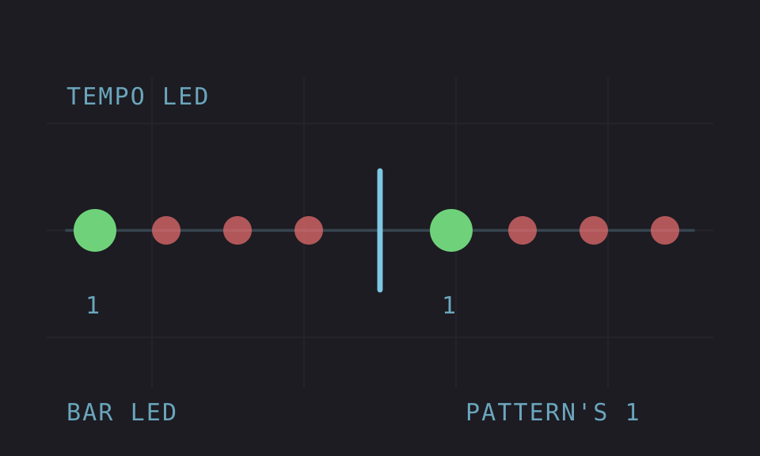

# Bar LED

Version: 0.1.0-experimental · author: @nathangroth

## Overview

While the sequencer plays, the tempo LED flashes **green on the pattern's 1** and red on every other beat, as stock does. It is a visual downbeat for players who can't use the click track: when the cue outputs feed external effects, the click would go with them.

It reads the sequencer's own step, so the green follows the pattern's length. Stopped, the LED is stock. There is nothing to set.

## Controls

None. No menu row, no knob and no effect slot.

## Usage

Install it, press [PLAY] and watch the tempo LED.

### Quick tutorial

1. Press [PLAY]: the first flash is green, then red until the pattern comes round again.
2. Set the pattern's length (FUNC + PAGE, PATTERN SCALE) to 12 or 20 steps: the green still lands on the pattern's first step.
3. Press [STOP]: the LED behaves as stock, and the next [PLAY] starts green again.

## How it works

Stock flashes the tempo LED from its clock-message loop: every 24 clock ticks (one beat) it calls `set_led(38, 3)`, which lights LED id 38, the red half of the tempo LED, for three 120 Hz ticks. The panel numbers each two-colour LED as a red id and the green id after it, as the trig and track LEDs do, so 39 is the green half.

Bar LED takes that one call (`0x40056f24`). While the transport plays it reads the sequencer's master step (`0x800065b4`, the step now playing, which wraps at the pattern's length). A flash that sees a lower step than the flash before is the first since the pattern came round: it passes 39 instead of 38. So does the first flash after [PLAY] from the top; continuing from a pause compares with the step it paused on. Then it calls stock's `set_led` with the same duration. Every other call, stopped included, reaches `set_led` unchanged.

It keeps no clock or count of its own ([sequencing](../../../../docs/module-guides/sequencing.md)): the flash is stock's, so it keeps the project tempo, and the step is the sequencer's.

## Compatibility and limitations

- OS 1.40C. Run on an MKI only; not yet tested on an MKII.
- The tempo LED only flashes on whole beats. When the pattern's 1 falls between beats (say 14 steps at 1x), the green comes on the first flash after it.
- A pattern no longer than one beat (1, 2 or 4 steps at 1x, or 8 steps at 2x) is green only on the first flash after [PLAY], then red on every beat: every flash sees step 0, so the step never drops. 4 steps at 1x was seen under the port (reported in review of octabam's copy); 8 at 2x is inferred, not run. Counting "the same step again" as a new pass would fix it, but would also turn green every flash inside step 0 at a slow scale where one step lasts several beats, so it stays as it is until a fix can tell the two apart.
- Changing the stock flow: the tempo LED is green instead of red on the pattern's 1 while playing. That is the module's whole job; remove it to get the stock LED back.
- Reported on an MKI (card build, 2 November 2026; USB, 4 and 5 November 2026): green on the pattern's 1 in several play modes, with a 17-step master length, on external MIDI clock, through tempo changes while playing, and at pattern scales 3/4, 3/2 and 2X (green on every pass). In per-track mode it follows the master length and master scale, not the selected track's: a track at 2X under a 1X master goes green every other pass of that track. Continuing from a pause keeps the green on the pattern's 1. A pattern change while playing is checked in the emulator only: the green lands on the new pattern's 1. Not yet tested on a unit: a pattern change, MKII, and MASTER LENGTH INF (which would leave only the green after [PLAY]).
- Takes no key, screen or shared site: no other module or the base patches the beat-flash call.
- Stores nothing: projects, Parts and settings are untouched and load the same without it.

## Tests and measurements

See [TESTING.md](TESTING.md).

## Authorship and licences

Original module by @nathangroth, MIT ([LICENSE](LICENSE)). No firmware, extracted stock code or built images are included.

## Screens and audio

It draws nothing on the screen and makes no sound, so it has no screenshots; the tempo LED is the whole interface.
