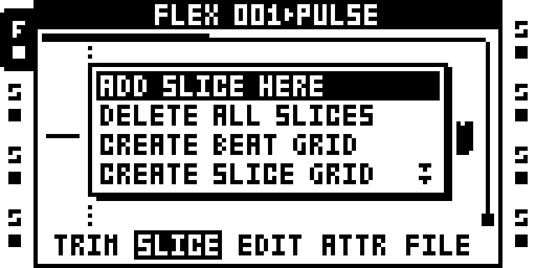
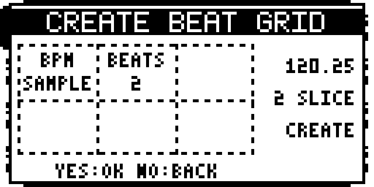

# Beat Slicer

Version: `0.1.66-experimental` · author: @twwwy · beta, over USB only: it runs on the Modwerk base's sample-editor service ([SAMPLE_EDITOR.md](../../../machines/octatrack/SAMPLE_EDITOR.md)).

## Overview

Beat Slicer allows users to record audio freely without having to determine the recording length in advance. You only need to start recording on a downbeat and know the original BPM. There is no need to plan the recording length, stop on a bar boundary, or trim the audio to fit a fixed number of slices.

It adds **CREATE BEAT GRID** to the audio editor's SLICE menu, directly above stock **CREATE SLICE GRID**. It divides the trim range into slices of 1, 2, 4, 16, 32 or 64 beats at the sample's or the project's BPM, and writes them through the stock CREATE/REPLACE SLICES question.

## Controls

Access on the Modwerk beta base: select a Flex/Static sample or recorder buffer → AED → AMP (SLICE) → YES → CREATE BEAT GRID. Playback may continue.

| Control | Behavior |
| --- | --- |
| Encoder A | SAMPLE or PROJECT BPM; refuse missing/invalid tempo, with no silent fallback. |
| Encoder B | 1, 2, 4, 16, 32 or 64 beats per slice. |
| YES | Validate the opening snapshot and request stock confirmation. NO or changing a control cancels a pending request. Markers change only after the stock YES. |
| Encoders C–F | Unassigned; leave the popup and parameters unchanged. |
| NO / BACK | Close the options or decline confirmation without changing markers. |
| After creation | Use stock DELETE SLICE or DELETE ALL SLICES. No separate slice Undo/history is added. |

The right side of the popup shows the chosen BPM, the number of slices and CREATE or REPLACE, or a refusal (SHORT, OVER64, CHECK, REFUSED, EMPTY). In 4/4, choose **16 BEATS** for four bars.

## Usage

1. **Start recording on a downbeat.** Begin recording on the first beat of a bar so the audio is aligned with the musical grid.
2. **Record for as long as you like.** Perform, improvise, or capture live audio without worrying about recording an exact number of bars. Stop recording whenever you're finished, even in the middle of a bar.
3. **Set the original BPM.** Enter the tempo at which the audio was recorded so Beat Slicer can calculate the duration of each beat.
4. **Choose the number of beats per slice.** For example, selecting 4 beats per slice divides the recording into 4-beat segments. Any remaining audio becomes a shorter final slice.
5. **Sequence and play back the slices.** Trigger the slices at the appropriate beat intervals to reconstruct the original performance, preserving its musical timing without manually trimming the recording.

### Quick tutorial: slice a free recording by beats

1. Select a Flex or Static track whose sample (or completed recorder buffer) starts on a downbeat, and check its BPM in AED → ATTR.
2. Open AED, press AMP for SLICE, then YES, and choose CREATE BEAT GRID.
3. Turn encoder A for SAMPLE or PROJECT BPM and encoder B for the beats per slice; the popup shows the tempo and how many slices it will make.
4. Press YES, then YES at the stock CREATE SLICES? (or REPLACE SLICES?) question. The slices appear from trim start; play them back with slice mode on.

### How the grid is placed

The grid starts at trim start; for the workflow above, keep the original downbeat as that start. One beat is a quarter note of the chosen BPM; track speed and swing do not move offline markers. The core accepts 30–300 BPM in 1/24-BPM units. Later tempo changes never rewrite slices.

New boundaries that would leave fewer than the stock minimum of 64 frames at the end are left out; the last slice still ends at the original trim end. An entirely shorter source uses its full length as the minimum; a shorter trimmed range is refused. More than 64 starts are refused, not truncated: choose more beats per slice.

With existing slices, YES opens **REPLACE SLICES?**; NO there leaves every old slice unchanged. Replacing can change the slice numbers locks use on any track sharing the sample, and settings affect every track using that sample slot. Empty recorder buffers show EMPTY, and YES then leaves the popup open without writing.

**Time-stretch when using PROJECT BPM:** the chosen BPM determines grid spacing; stock playback still follows the track's time-stretch setting and sample ATTR BPM. If the sample and project tempos differ, turn off track time-stretch or set the sample ATTR BPM to the audio's actual recorded tempo to avoid unintended stretching. Beat Slicer does not change those playback settings.

The base copies the source's metadata and owns confirmation, publication and rollback of a failed write. The package receives no sample or PCM pointer and contains no sample-writing code. If the source is busy after the stock YES, the base waits and checks again before applying once; NO or another stock gesture cancels that wait.

## Compatibility and limitations

- OS 1.40C, Modwerk beta base over USB with the sample-editor service. Card firmware cannot include it.
- **Recorder Loop Fix 0.1.0:** not offered together. That module alone makes recorder-buffer slice 1 miss with stock CREATE SLICE GRID too, without Beat Slicer ([sambanks/octabam#908](https://github.com/sambanks/octabam/issues/908)). No fix to that module is claimed here.
- Recording must be stopped for the buffer being edited; unrelated recording and pattern playback may continue.
- A grid holds at most 64 slices; recording length stays subject to the Octatrack's memory.
- Exact metadata grid only: no PCM analysis, smoothing or click-free playback claim. No project or sample-settings save is implicit.
- While the popup is open its drawing takes about 6 % of the ColdFire (about 1 ms a screen frame, owner's MKII); the frame interrupt was unaffected and no machine render was skipped.
- Not yet tested on the MKI. Slices kept through a project save and a power cycle are not confirmed on the unit.

## Tests and measurements

- **Owner's MKII, 27 October 2026, this exact package** (`6650ef77…`), on a development twin of the beta base, as two timed trials that rolled back by themselves: 8 and 4 slices on a Flex sample from SAMPLE BPM, a re-slice while the pattern played, PROJECT BPM, NO, a passing base self-test, and a stock menu again after the rollback. The popup's draw cost about 1.1 ms a UI tick while open. Details and what was not run: [evidence/hardware.md](evidence/hardware.md), [evidence/performance.json](evidence/performance.json).
- **The author's MKII, 27 October 2026, an earlier package** on a private build with the event at index 35: self-test, USB Undo, and more than 20 minutes of clean slicing, re-slicing and playback with Flex and Static file slots and a completed recorder buffer. Earlier .66 self-tests passed alone and with fifteen companions, excluding Recorder Loop Fix.
- Host tests of the controller against the base's sample-editor service (sanitizers), and a package rebuilt byte for byte from source: `verify.py`.
- Open: physical short-commit timing, the extended emulator stress cancellation, complete save/reboot qualification. Earlier failed self-test track restorations and unverified historical Undo outcomes stay recorded in [TESTING.md](TESTING.md); they are not relabelled as passing.

The research behind it (planner, PCM reader, recorder boundaries, menu ownership, the editor service's design) is kept in [sdk/drafts/beat-slicer/](../../../drafts/beat-slicer/README.md).

## Authorship and licences

Original module by @twwwy and contributors, MIT ([LICENSE](LICENSE)). The runtime-owner host test in the research includes the repository's unchanged GPL loader fixture; its licence and attribution stay in the original files, and the combined test binary is not published. No Elektron firmware, extracted routines or tables, factory samples, memory dumps or built firmware images are committed.

## Screens and audio

The two captures above are 0.1.66 emulator LCD captures ([capture provenance](media/capture.json)), not hardware audio evidence. The popup layout was approved by the author on 25 October 2026. No audio preview.
