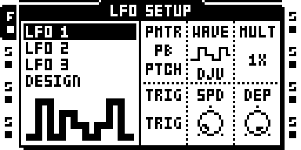
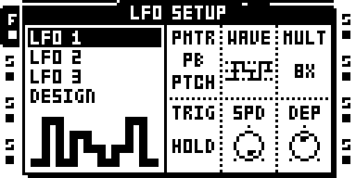
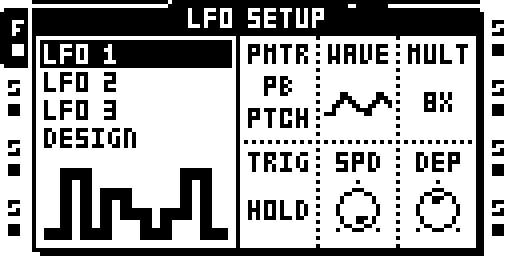

# Deja Vu

Version: 0.1.0-experimental · author: Jan Kolkmeier (@jankolkmeier)

## Overview

Deja Vu adds three waveforms to the audio tracks' LFOs: DJV, DJQ and DJC. Each keeps a loop of LEN remembered random values. Each time a slot of the loop is visited it replays its value or rolls a new one; DEJA sets how often (0 always new, 127 locked). The LFO's TRIG setting decides what moves through the loop: the track's steps, its trigs, or a trig that restarts it. Because DEJA is the LFO's SPD knob, it can be p-locked, put on a scene and swept with the crossfader.

The three waves share one loop per LFO, so switching between them keeps it:

| WAVE | Output |
|---|---|
| DJV | each value as it is, stepped |
| DJQ | on PTCH, root and fifth with their octaves (−12, −5, 0, 7, 12 semitones): each value picks one of the notes in reach, with equal odds, higher values higher notes; on any other destination, whole knob steps |
| DJC | glides from value to value, arriving at each one as the next change comes (one step in FREE, one trig interval in ONE) |

On PTCH a knob step is 1/5 semitone and LFO pitch stops at ±12 semitones, so DEP decides which notes DJQ reaches (5 per semitone): below 25 only the root, 25 adds the fifth below, 35 the fifth above, 60 both octaves. On other destinations DEP is the range in knob steps.

## Controls

On DJV, DJQ and DJC:

| Knob | Meaning |
|---|---|
| WAVE | DJV, DJQ, DJC (the last three waves) |
| SPD | DEJA: the chance a slot replays, SPD / 127: 0 always new, 32 (the default) 25 %, 64 about 50 %, 96 about 75 %, 127 locked |
| MULT | loop length LEN: 1X 2X 4X ... 64X = 1, 2, 4 ... 64 slots |
| DEP | range, as on every wave |
| PMTR | any destination |
| TRIG | what moves through the loop (below) |

| TRIG | DJV |
|---|---|
| FREE | Every step of the track shows its slot (step position mod LEN), trigs or not: a random step sequencer. |
| TRIG | A trig restarts the loop at its first slot; then one slot per step. Silent until the first trig. |
| HOLD | Every step owns a slot (step position mod LEN); a trig plays its step's value and holds it. Adding or removing trigs changes no other step. |
| ONE | One slot per trig; PLAY restarts the loop. |
| HALF | Like TRIG, but one pass through the loop, then the last value holds. |

In FREE and HOLD the step position is the track's own: with LEN at or above the track length the loop is the track (set a track to 5, 7 or 12 steps for odd loops); a shorter LEN repeats within the track. Changes land with the step's trig (one sequencer tick after the step counter moves).

### Which trigs count

A trig moves or restarts the loop (ONE, TRIG, HALF) and makes HOLD play its step's value when the LFO engine sees it as a trig. That is a sample trig, and also a trigless trig once the track has played a sample trig since PLAY (the sample need not still sound); before that, trigless trigs do nothing. Trigless locks never count. So trigless trigs can step a DJV melody over a held or finished sample without retriggering it. A trig whose condition fails, or a spent one-shot trig, is expected not to count (not tested): in ONE the loop then shifts against the bar, in HOLD and FREE nothing shifts.

## Usage

On an audio track, hold [FUNC] and press [LFO] to open LFO SETUP, then turn B (WAVE) to DJV, DJQ or DJC, the last three waves. Set PMTR and DEP as for any wave; SPD is DEJA, MULT the loop length and TRIG what moves through the loop. A good start is PMTR = PTCH, MULT = 64X, TRIG = HOLD and DEP up, then turning SPD from 0 (fresh) to 127 (locked).

## Quick tutorial

1. On a FLEX track with trigs, hold [FUNC] and press [LFO]; set WAVE to DJV, PMTR to PTCH, MULT to 64X, TRIG to HOLD, DEP to about 30.
2. Set SPD to 127: every trig plays its step's note, the same each bar. Add or remove trigs: the others keep their notes. Lower SPD to let notes mutate.
3. Switch WAVE to DJQ and set DEP to 60: the line now jumps between root, fifths and octaves. DJC turns it into smooth glides.
4. P-lock SPD to 0 on one trig to make that step new every time, or DEP to 0 (with a PTCH lock) to pin it to a fixed note.
5. Put SPD 127 on scene A and 0 on scene B: the crossfader becomes a mutation fader. Try TRIG FREE for a melody on every step, ONE for one note per trig.

## Compatibility and limitations

Audio-track LFOs only. DJQ's notes are fixed to root and fifth (no scale or chord setting). DJV values are continuous (not quantized to semitones). Every LFO starts from the same random sequence after a power-on. In HOLD, a trig nudged early by microtiming may play the previous step's value (not tested). FREE, TRIG, HOLD and HALF follow the stock step counter, so with the Play Modes module (reverse, pingpong) they follow the stock order, not the played one. A project using DJV, DJQ or DJC opened without the module plays SAW and draws a garbage WAVE icon (not yet run on hardware). Tested on one MKII over USB; the card build was not flashed.

## Tests and measurements

On the owner's MKII over USB, the exact 0.1.0 package installed, kept and passed the self-test on the flashed beta base, came back after a power cycle and passed it again, and was removed. On a development twin the three waves appeared on the WAVE list, a locked loop held its value, SPD 0 took a new value every step, and DJQ on PTCH played only root, fifths and octaves ([evidence/hardware.md](evidence/hardware.md)). The host gate `verify.py` checks the loops, the replay chance, DJQ through the engine's own arithmetic and set-up from garbage memory; in ot_emu all 24 LFOs on one wave cost 0.15-0.17 % of the ColdFire, less than stock RND. Not tested on hardware: the HOLD, TRIG, ONE and HALF modes, p-locks and scenes on SPD or DEP, trig conditions, listening. Details in [TESTING.md](TESTING.md).

## Authorship and licences

Original work by Jan Kolkmeier (@jankolkmeier). No Elektron code or tables; patched sites are listed in manifest.py by address and hash.

## Screens and audio

Captured in the headless emulator (white palette):

No audio preview yet.
