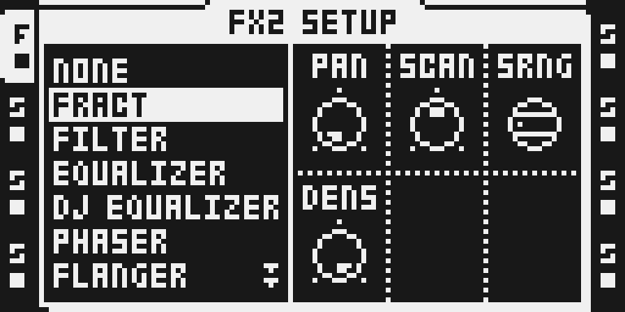
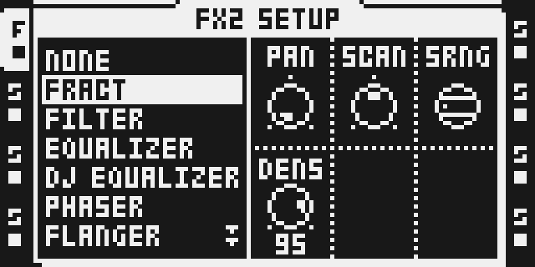
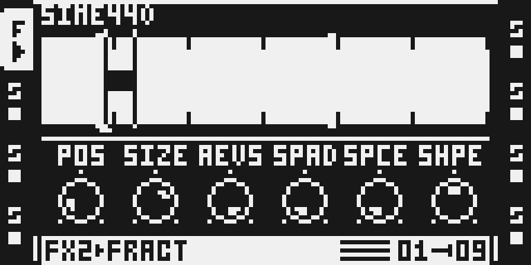
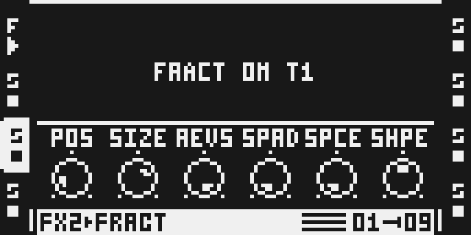

# FRACT 0.10.0-experimental

Two rules come first:

- **Set TSTR to OFF.** FRACT granulates only a Flex sample that plays
  without timestretch. On the Flex track, hold FUNC and press SRC (SRC
  SETUP) and turn encoder E, TSTR, to OFF (not AUTO: AUTO follows the
  sample's own TIMESTRETCH setting in the audio editor). With TSTR on, the
  granulator stays off by design, FRACT seems to do nothing, and its page
  shows `TSTR OFF` in the top line as a reminder.
- **FRACT runs on one track at a time.** Only one track's FX2 can have the
  granulator working. FRACT on a second track plays that track's sample dry,
  with no SPACE, and its page shows only `FRACT ON T<n>`, the track that has
  it. Press STOP to free it: on the next PLAY the lowest-numbered track with
  FRACT takes it.

## Overview

FRACT is a granulator on FX2 for the Octatrack MKII (OS 1.40C). It reads the
Flex sample loaded on its track and plays it as three overlapping grains:
short slices, each faded in and out by a window, born one after another at
the position you choose. You set where the grains start (POS), how long
they last (SIZE), whether they play forwards or backwards (REVS), how far
their start positions scatter (SPRD), the shape of their window (SHPE) and
how much of a diffused stereo reverb, SPACE, follows them (SPCE). The SETUP
page adds a random stereo position per grain (PAN), a slow travel through
the sample (SCAN), the range of the scatter (SRNG) and how often grains are
born (DENS).

Pitch is the track's own: turn PTCH on the Flex track's SRC page. The
Octatrack applies it to FRACT's output like tape speed, so pitched up the
grains get shorter and SCAN faster, pitched down the opposite.

The FX2 page shows the sample's waveform with the region POS and SIZE pick,
a small square for each grain as it plays, and the sample's name above it.

FRACT is installed as a Modwerk runtime package through the Modwerk base over
USB. Its grains run on the Octatrack's ColdFire processor from the base's
memory pool; SPACE runs on the DSP in the FX2 slot's own buffer, separately
on every track. This is an experimental release: see
[Tests and measurements](#tests-and-measurements) for what has run on a unit
and what has not.

## Controls

Main page (FX2), encoders A-F. These take parameter locks, LFOs and scenes
like any stock FX2 control; the granulator reads the values the Octatrack
publishes, so a lock or an LFO reaches each new grain at its birth.

| Encoder | Control | Default | What it does |
|---|---|---|---|
| A | POS | 18 | Where new grains start, across the whole loaded sample: 0 its beginning, 127 its end. Each grain keeps the start it was born with. |
| B | SIZE | 86 | Grain length, from 10 ms (0) to 2 s (127) in 64 steps; 86 is about 372 ms. Turning it changes how fast the grains already playing fade, without restarting them. |
| C | REVS | 127 | Grain direction: 127 plays every grain forwards, 0 every grain backwards (from the end of its slice). In between each grain is reversed by chance: about half at 64. |
| D | SPRD | 0 | Scatter of the start positions around POS: 0 starts every grain exactly at POS; turning up spreads them further, slowly at first. At 127 the scatter covers the whole sample (SRNG FULL) or about one second either side (SRNG LOCAL). |
| E | SPCE | 0 | SPACE, a diffused stereo reverb behind the grains: 0 is dry, higher adds more reverb with a longer decay. Above 96 the tail grows darker and the reverb drives its soft limiter half as hard, so loud sustained material stays clean; above 96 linked stereo envelope smoothing reduces repeated pluck swells. At 127 the reverb is fully wet with a long ambient tail (about 15 s in the bass); individual attacks can remain audible depending on the source and controls. Up there the reverb is quieter than the dry it replaces: raise the track's level if needed. |
| F | SHPE | 64 | Grain window: 64 is a smooth Hann bell. Lower values widen it to a flat top with short fades (the level stays within about 1 dB); higher values give a fast attack and a steep decay, more percussive and up to about 4 dB quieter. Each grain keeps the shape it was born with. At the shortest SIZEs the sharpest shapes are softened so no grain clicks. |

SETUP page: hold FUNC and press FX2, the dials on the right of the effect
list. On OS 1.40C SETUP controls take no parameter locks, LFOs or scenes
(Elektron manual, section 11.4); set them per Part.

| Encoder | Control | Default | What it does |
|---|---|---|---|
| A | PAN | 0 | Random stereo position for each grain: 0 keeps the sample's own stereo image; higher spreads grains further across the field, 127 over all of it. Never louder than the source. |
| B | SCAN | 64 | Travel through the sample: 64 holds the grains where POS puts them; above 64 the start point moves forwards (96 at normal speed, 127 about four times), below 64 backwards (32 at normal speed, 0 four times). STOP returns it to POS. |
| C | SRNG | FULL | The range of SPRD: FULL lets the scatter reach across the whole sample; LOCAL keeps it within about two seconds around the start point, useful on long samples. |
| D | DENS | 127 | How often grains are born: 127 is full density, three grains overlapping, each a third of a grain after the last. Lower values space them further apart: twice as far at 95, one grain at a time from about 76 down, about 16 times as far at 0 (one grain every 2 s at SIZE 86). Sparser grains are quieter on average, since each keeps its own level. |

SETUP E and F are not used. Choosing FRACT in the FX2 list writes all the
defaults above (checked in the emulator; the unit check is pending).

## Usage

Start with a sample you know well, on a Flex track, and keep SPCE at 0 for
the first minute to hear the grains themselves.

### FRACT quick tutorial

1. On a Flex track with a sample loaded, hold FUNC and press SRC and turn encoder E (TSTR) to OFF. Then hold FUNC and press FX2, turn LEVEL to FRACT and press YES, press FX2 for its page and press PLAY. FRACT works on one track at a time: if another track already has it, this page shows FRACT ON T<n> and the track plays dry.
2. Turn POS (A) to move the grains through the sample and SIZE (B) to make them shorter or longer; open SPRD (D) to scatter them and turn REVS (C) down for reversed grains, about half at 64 and all at 0. In SETUP (hold FUNC, press FX2) turn SCAN (B) above 64 to travel forwards, PAN (A) up to spread grains across the stereo field and DENS (D) down for sparser grains.
3. Raise SPCE (E) to 64-127 for a long stereo tail, then return it to 0 for the dry grains. To bypass FRACT, choose NONE in the FX2 list; on PLAY the track plays its sample normally, and another track can take FRACT.

### More to try

- A long pad or field recording, SIZE around 100, SPRD 40-80 and SRNG
  LOCAL: a slowly shifting cloud around one place in the sample.
- A drum loop, SIZE 30-50, SHPE 100-127, DENS 95: separated, percussive
  grains; REVS 64 reverses about half of them.
- Lock POS on a few steps for jumps through the sample, or put a slow LFO on
  POS or SPRD.
- Turn the track's PTCH (SRC page) down an octave for a deeper, slower
  texture.

### Projects saved before this version

Choosing FRACT writes its defaults, so a new assignment needs nothing. A
Part saved with an earlier FRACT build (0.9.x, or an earlier 0.10.0
development build) keeps the bytes those builds stored, and three controls
read them differently now:

- REVS (main C) holds the old SCAN value (64 if never turned) or 0, which
  now reverse about half or all of the grains: set REVS to 127.
- SCAN (SETUP B) holds 0, which now scans backwards at four times speed:
  set SCAN to 64.
- DENS (SETUP D) holds 0, the sparsest density: set DENS to 127.

A Part saved by an early 0.10.0 development build also holds 0 in SHPE, the
softest window: set SHPE to 64. Or simply choose NONE in the FX2 list and
then FRACT again, which writes every default. Locks, scenes and LFO routes on
the third main slot (formerly SCAN) now move REVS. FRACT does not rewrite
saved projects.

## Compatibility and limitations

**One track at a time (owner review requested).** FRACT has one granulator:
three grain readers and one 128-byte state, shared by all eight tracks, in
the single copy of FRACT's code the base loads into its pool. The first track
whose FRACT plays takes it; FRACT on any other track is a plain bypass, dry
with SPACE off, its page showing `FRACT ON T<n>`. The reason is processor
time and that shared state. The Octatrack's ColdFire, which runs the
granulator, already spends 48 to 66 % of its time on the stock firmware
(MODWERK STATUS on the user's MKII, M0 session, 2026-10-18), and one
granulator at its dearest (shortest grains at the track's maximum pitch) is
predicted to cost 24.8 more points (`make cost-check`; the unit read up to
+22 on an earlier build). A second granulator would double that and pass
100 %. The DSP side, SPACE, is per track and is not limited.

**Sources.** A normal loaded Flex sample with TSTR OFF, read whole (SRC trim
and slices are not applied to where grains start), 16-bit precision from
16- and 24-bit files, mono or stereo. On a Static track, a recorder buffer or
live input the granulator does not engage; the page asks for a Flex sample
(`LOAD FLEX SAMPLE`). Thru and Neighbor machines are not tested: a track
whose audio never passes the Flex fetch would keep SPACE on FRACT's slot.

**SETUP controls are not modulated.** PAN, SCAN, SRNG and DENS take no
parameter lock, LFO or scene on OS 1.40C; the six main controls take all
three.

**What FRACT changes in stock behaviour, and only while it plays a track.**

- *The trig declick on FRACT's own track.* At every trig the stock DSP adds
  a decaying copy of the track's last output to the new start, which
  smooths a sample's restart. FRACT's grains do not restart, so on its
  track that copy was a click at every trig. FRACT clears that trigger on
  the track that has the granulator, and only there; every other track,
  a track whose FRACT is bypassed and FX2 NONE keep the stock declick. Why:
  the click came from the stock behaviour, not from the grains; no other
  route reaches it. Checked: the emulator A/B pair against 0.9.6 (0.9.6
  clicks at every trig, this build does not) and on the user's MKII on
  2026-10-20 (an earlier build): no click and no change at FRACT's trigs.
  Not separately checked on the unit: another track's retrigs while FRACT
  plays.
- *FX2 page.* FRACT's own FX2 page draws the overview above the six stock
  dials through the base's `module_draw`; the dials, the footer and every
  other page are stock. FRACT claims no key or encoder gesture.
- *The audio of other tracks.* A track without FRACT is not changed:
  FRACT's hook only reads one record word for it and returns
  (`make cost-check`: 54 cycles a call).

**Other modules.** FRACT patches six bytes of stock code at `0x400041cc`,
just after the stock fetch call at `0x400041c4` that POLY8 patches, so the
two can be installed together: POLY8's call continues into FRACT's site, and
Modwerk's loader admission test passes for the pair in both install orders
(on the host; not tested on a unit). FRACT on a POLY8 track granulates the
primary voice's sample, so the chord is lost there. SPACE writes and reads
only `+0..+$3DA2` of its FX2 slot buffer (15,779 of 16,384 words, the most
any stock effect writes), so it leaves Sidechain Compressor's key window
(`+$3DFE..+$3FFF` of the T3/T7 slots) alone. FRACT is a USB runtime
package. The browser's card builder was compared with native octabam over
158 selections: 56 images match outside declared platform writes and 102
refusals agree, including combinations that cannot fit beside Analog BD.
This is build evidence; the resulting card images were not tested on a unit.
FX2 only: FRACT's effect id is 7. Its
development builds used 9, which LOFI2 holds since 2026-10-21: a Part saved
with FRACT at 9 does not bring FRACT back, so choose FRACT again on that
FX2. Over USB, remove an earlier FRACT and load a project that never had it
before installing this one: while the loaded project's module map still
names FRACT at 9, the base refuses FRACT at 7, and loading a project saved
with the earlier build takes FRACT out until it is installed again.

**If the module is missing.** On the user's MKII (2026-10-20, earlier
build), with FRACT skipped at start-up the base reported `MISSING MODULES:
FRACT 1 NOT INSTALLED`; tracks that name a missing module run dry and keep
their stored values (the base's behaviour). Do not save a project while a
module is missing.

**Not verified on a unit for this build:** everything added after
2026-10-20 (the sample's name, the second-track bypass, SHPE, REVS, DENS,
SCAN on SETUP, the span kernel, SPACE's top range and output-envelope smoothing; the effect id 7 installed
and survived a power cycle on base `d6bfff70`), two instances with different settings,
Part and project save and reload, a power cycle, a busy project, PAN 127,
SPACE on T3/T7 and POLY8 installed alongside. See [TESTING.md](TESTING.md).

## Tests and measurements

The current output-envelope implementation (2026-10-25) is based on parent
`8ffef0f`, package `fract-0.10.0-dev.mwrm` (22,148 bytes), SHA-256
`fef9db2b444dcac1d796f5920ea36448a6a16089a0e5f6801f7fcd4faf23120a`. This exact package was installed on the owner's
Octatrack MKII on 2026-10-25; attacks softened, but individual grains remained countable at SPCE 127. Only SPACE differs from installed
variant A (`62672f6f`): SPCE 0–96 and every grain source file stay exact.
The independent Q23 oracle covers every amount and call pattern. Four core
synthetic guitar/pad cases reduce envelope periodicity by 2.6–7.4 dB and CV
by 15–21%; a broader 26-case grid bounds level change to -.45..+.10 dB,
without establishing inaudible attacks at every setting. See
[the research report](../../docs/DISSOLVE_RESEARCH.md). CHECK, RENDER and
PORT below describe software evidence; HARDWARE means observed on a unit.

- **Sound.** At SHPE 64, REVS 127 and DENS 127 the grains are bit-exact to
  FRACT 0.9.6 (`make check`: 449 scenarios, 242,439 calls, 0 mismatches
  against the frozen 0.9.6 units), apart from the trig declick above.
- **ColdFire (the granulator), RENDER.** `make cost-check` runs every unit
  on QEMU against the host build and prices it with the cost metric measured
  on the user's MKII (958 cycles = 1 point of the base's CPU meter for a
  16-frame block): 7.3 points a block at track pitch 0 and SIZE 86, 16.3
  to 19.5 at the track's maximum pitch, 12.3 and 24.8 at minimum SIZE (budgets
  15 and 30), 0.06 for a track without FRACT, at most 1.9 for the overview
  while it fills. Stack: 630 of a 636-byte bound from the hook. These are
  predictions; on the unit an earlier build read at or below them.
- **DSP (SPACE), RENDER.** 512 cycles a sample static (the per-sample
  loop), 407.38 executed instructions a sample at worst with a trig split
  (405.06 unsplit); SPRING REV 314.2, PLATE REV 218.3 and DJ EQ 330.9, the
  dearest stock effect, in the same cases. Four instances fit a core (2,048
  of 3,120 static cycles). Eight instances with CHORUS on every FX1, three
  LFOs a track and 18 changed slots a step for 4 s: no stray write, no
  clobber, no hang ([performance record](evidence/performance.json)).
- **Memory.** 19,316 bytes of code and data in the base's pool, the
  stock FX2 buffer and 64 X words a track for SPACE, no heap, no copy of the
  sample ([memory](evidence/memory.md)).
- **HARDWARE.** An earlier build (`72b10956…`, 2026-10-20) ran on the
  user's MKII: install, the one-track rule, a Part switch, a power cycle
  with MODULES LOADED, the missing-module path, the base self-test and
  removal behaved as designed, with no exception and no click at trigs.
  `ff7332b4…` (2026-10-23) and `55f0fdff…` (2026-10-24) installed on base
  `d6bfff70`, the first with a power-cycle restore; the user's listening on
  them led to SPACE's top range. Variant A (`62672f6f`) installed on 2026-10-24, where guitar triggers remained audible. The unit check of this build is pending
  ([hardware](evidence/hardware.md)).
- **Sound quality (`fx:audit`):** not tested.

Commands, the exact revision and every result: [TESTING.md](TESTING.md).

## Authorship and licences

FRACT's granular engine, controls, overview, tests and documentation: toli
(`ex1010`), MIT ([LICENSE](LICENSE), [CREDITS.md](CREDITS.md)). SPACE
adapts Jannik Aßfalg (repeat98)'s Mini Verb, MIT; its permission notice,
which credits Sam Banks and Maxolydian, is in
[THIRD_PARTY_NOTICES.md](THIRD_PARTY_NOTICES.md). The screenshots are
original captures of the firmware's own LCD; Elektron's interface keeps its
owners' rights ([media/LICENSE.md](media/LICENSE.md)). No Elektron firmware,
stock code, samples or dumps are distributed.

## Screens and audio

Hold FUNC and press FX2, turn LEVEL to FRACT and press YES. The SETUP dials
appear on the right: PAN, SCAN, SRNG (FULL) and DENS.

Turn encoder D to change DENS: at 95 grains are born twice as far apart as at
127. The other SETUP dials work the same way.

Press FX2 for the main page and PLAY. The waveform shows the region POS and
SIZE pick and a square for each grain; the dials are POS, SIZE, REVS, SPRD,
SPCE and SHPE.

FRACT on another track while T1 has it: the page shows `FRACT ON T1` and
that track plays dry until T1 lets go (STOP).

Emulator captures (octemu, the UI probe build of this source); capture
record and hashes in [media/capture.json](media/capture.json) and
[media/README.md](media/README.md). No audio preview is included;
`make demo` renders original synthesized examples locally.
