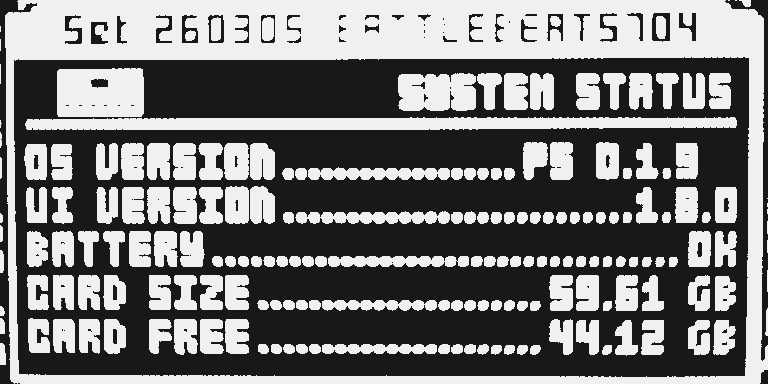
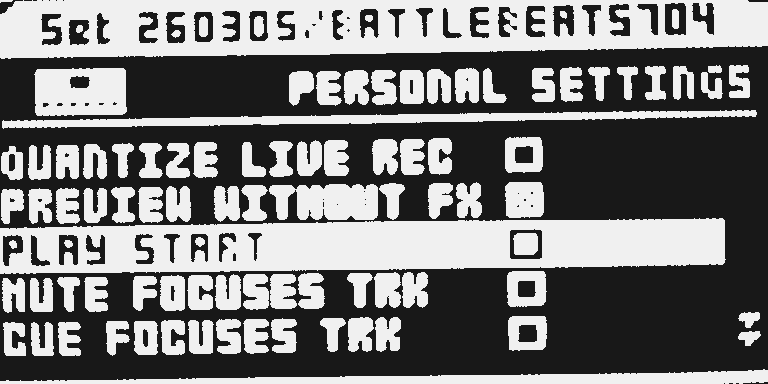
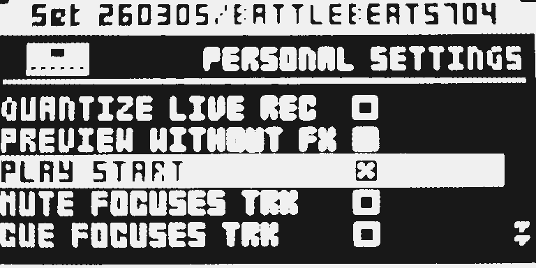

# Play Start

Version: `0.1.10-experimental` · author: [@jonathanwardle1992-beep](https://github.com/jonathanwardle1992-beep)

A global sequencer setting: **[PLAY] always starts from the beginning and never pauses.** Tick it in PERSONALIZE. Default **empty** is stock play/pause, so installing the module changes nothing until you enable it.

**Experimental.** `0.1.10` makes PLAY START empty unless the stored word is MAGIC_ON, so leftover SRAM does not show X, and one YES ticks it. `0.1.9` card: with X, every [PLAY] starts from step 1, but PERSONALIZE began ticked. USB Keep/Undo and `ot_emu` are untested.

## Overview

On the stock OS, [PLAY] starts, pauses, or continues. With PLAY START **ticked**, a press of [PLAY] that would have paused or continued instead starts the sequencer from the beginning of the current pattern. [STOP] is still [STOP]. MIDI START / CONTINUE / STOP are unchanged (they do not go through the panel [PLAY] handler). [REC] + [PLAY] still starts live recording.

No effect slot and no extra project bytes. The setting is PERSONALIZE (battery SRAM), not a Part or project field, so a saved project reloads unchanged on stock firmware.

## Controls

| Control | Default | Values |
|---|---|---|
| PLAY START | empty box | Empty = stock play/pause; ticked (X) = [PLAY] always starts from the beginning |

No knob. In PERSONALIZE this is a stock checkbox: **only [YES] ticks or unticks**, like every other PERSONALIZE checkbox. Arrow keys must not change PLAY START.

## Usage

Tick PLAY START in PERSONALIZE when you want [PLAY] to start from the beginning instead of pausing. Leave the box empty for stock play/pause. The setting is global, not a Part or project field.

### Quick tutorial

1. Press [PROJ], open SYSTEM, then PERSONALIZE, and scroll to PLAY START.
2. Press YES so the box shows X. Cursor up/down must not change it. Close the menu.
3. Press [STOP], then [PLAY]: the sequencer starts. Press [PLAY] again while it runs: it starts from the beginning instead of pausing. [STOP] still stops.

To restore stock play/pause, clear the box, or leave the module out of the build.

### What changes in a stock flow

- **What changes and for whom.** While PLAY START is ticked, [PLAY] never pauses and never continues from a pause point. Everyone with the module in the build can turn that off in PERSONALIZE.
- **Why.** A live global restart on the same key. A new page would cost more presses than PERSONALIZE.
- **What you see and do differently.** With the box ticked, a second [PLAY] restarts; [STOP] is the only stop. With the box empty, [PLAY] behaves as on stock.
- **Turning it off.** PERSONALIZE → PLAY START → empty box, or omit the module. Empty is the default.
- **Neighbouring flows.** [REC] + [PLAY] is left to stock (and to Quant Live Rec if that module is also installed). MIDI transport is not taken. Mute Modes cannot be chosen together: both grow the PERSONALIZE tables.

## Compatibility and limitations

- OS 1.40C. Hardware: `0.1.9` card (`PS 0.1.9`) on one unit: with X, [PLAY] starts from step 1, but the PERSONALIZE box began ticked and needed two YES to clear. `0.1.10` is packed, not yet flashed. Earlier cards failed as in [TESTING.md](TESTING.md).
- **Conflicts with Mute Modes** (`mute-modes`): both relocate the PERSONALIZE label/getter/setter arrays and poke the ANDY restore length. The configurator will not offer both until a base-owned PERSONALIZE table exists (that would be a separate owner-reviewed change, not this module).
- Quant Live Rec can sit beside it: that module detours [PLAY] at `0x40061778`; this one detours after the [REC]-held branch (`0x40061822` and the SEQ pause/start at `0x4006187c` / `0x4006188a`).
- MIDI START does not follow PLAY START. Not tested: pickup machines, chained patterns, live recording while PLAY START is ticked, an MKI panel, USB Keep/Undo.
- An OS upgrade resets PERSONALIZE, including this row.

## Tests and measurements

See [TESTING.md](TESTING.md) and [evidence/hardware.md](evidence/hardware.md). `0.1.9` same-unit card: with X, every [PLAY] starts from step 1. `0.1.0`–`0.1.8` failed as listed there. Static ColdFire size/cycle bounds are in TESTING; they are not chip wall-clock.

## Authorship and licences

jonathanwardle1992-beep: behaviour, ColdFire source, PERSONALIZE row and documentation. MIT, [LICENSE](LICENSE). No firmware, stock code, built image or card is included.

## Screens and audio

Hardware LCD photographs, 25 October 2026. SYSTEM STATUS shows the card stamp; PERSONALIZE is where PLAY START is ticked. The module makes no sound of its own.

