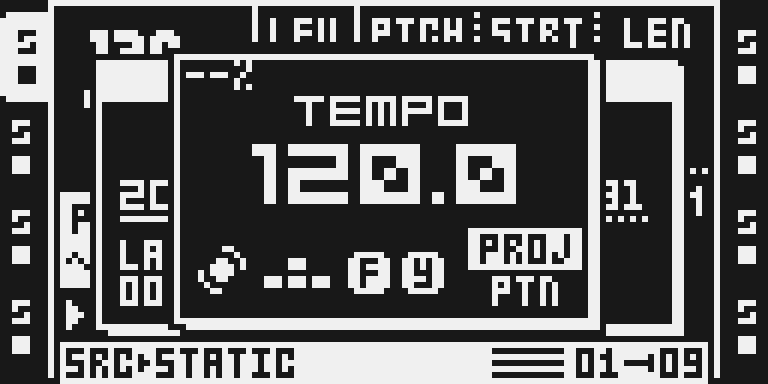
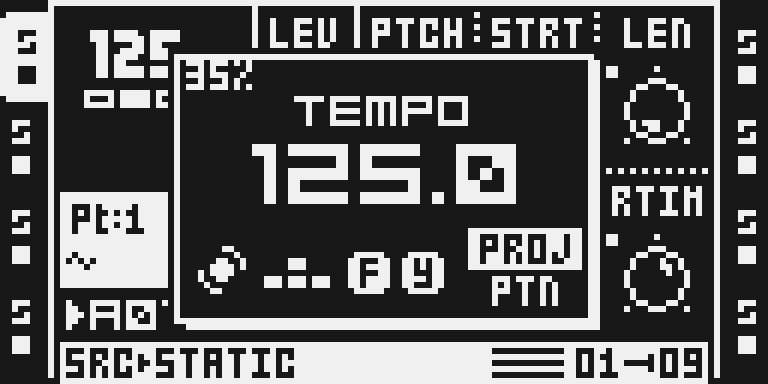
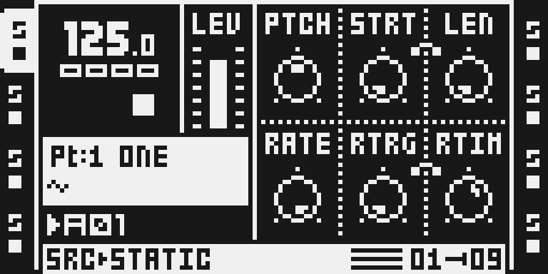

# Processor Load

Version `0.1.0-experimental` · author [@timhastie](https://github.com/timhastie) · source [timhastie/octatrick-modules](https://github.com/timhastie/octatrick-modules/tree/v2.12/processor-load), tag `v2.12` (`ca13ed85547790f788ceaaada5df3cdd31508441`); `processor-load/` is unchanged since `v2.11` (`5f3d745`)

## Overview

How busy the Octatrack's ColdFire processor is making audio, as a number in the stock TEMPO popup. Press TEMPO and the popup's top left corner shows the load:

| shows | means |
|---|---|
| `47%` | the mean load over the last quarter second |
| `73%!` | the same, 70 % or more |
| `--%` | no fresh reading (the first moment after start-up, or a window with no valid reading) |
| `W112` (FUNC held) | the longest single audio block of the last quarter second, in % of one block's time |

The number updates about four times a second while the popup is open. It is a measurement of what the processor is doing now, not a prediction of whether something more will fit.

### How it works

The Octatrack makes audio in blocks of 16 samples: 362.8 microseconds each at 44.1 kHz, about 2,756 blocks a second. Every block starts the ColdFire's **frame interrupt**, the routine that runs the sequencer step, the LFOs, the parameter records for the DSPs, the sample streaming set-up and any ColdFire machine, and hands the block to the two DSPs.

Processor Load times that interrupt from its first instruction to its return, every block, with **DMA timer 3 (DTIM3)**, a counter the stock OS already runs freely at the 132 MHz bus clock. The module only reads it; it never programs a timer.

- At the interrupt's entry (main's install of the frame vector names the module's entry instead of the stock handler) it stores DTIM3, then runs the stock handler unchanged.
- At the interrupt's one exit (the epilogue every path of the handler reaches) it reads DTIM3 again, adds the difference to a running sum, counts the block and keeps the longest block, then does the stock restore and return.

Nothing else runs in the interrupt: no division, no drawing, no waiting. About sixty times a second the UI task (the stock loop that runs the screen and the keys) calls the meter; at most once every quarter second (33,000,000 DTIM3 ticks) it takes a snapshot and computes

```
load = (busy ticks in the window) / (ticks the window lasted) x 100, rounded
```

The snapshot is read without stopping interrupts: a sequence counter that the interrupt makes odd while it updates tells the UI whether a block ended while it read; if one did, that window gives `--%` rather than a torn reading. A window longer than four seconds, a window in which no block completed, and the first window after the meter starts give `--%` too. Timing starts at the first block after the stock OS has set its "startup complete" flag, so the boot logo's reset of DTIM3 is never inside a window; a single body longer than about 127 ms is discarded for the same reason.

**What the number means.** The share of real time the ColdFire spends inside the frame interrupt: the sequencer, LFOs, parameter records, sample set-up and ColdFire machines, plus higher-priority interrupts that land inside it and the waits for the DSPs. On hardware the stock OS alone already takes about a third with the transport stopped: Sam Banks's CF METER probe measured the frame interrupt at 123.1 us stopped and 213.5 us playing on his MKII (a fresh project with samples on tracks 1–4), about 34 % and 59 % of a block.

**What it cannot see.** The two DSPs (the effects and the DSP side of every voice), the UI task, card loading and saving, USB work outside the interrupt. A single block that took longer than its 362.8 us can hide in a mean of 40 %: hold FUNC to see the longest block.

## Controls

Processor Load has no control, setting or page of its own and hooks no key; it is part of the firmware you build. Everything happens in the stock TEMPO popup:

- **TEMPO** opens the popup; the reading is in its top left corner. TEMPO (or NO) closes it as on stock.
- **FUNC held** while the popup is open shows `W` and the longest block of the last quarter second; releasing FUNC returns to the mean at once.
- The BPM, tap tempo and every other part of the popup are the stock ones.

## Usage

Open the TEMPO popup while you build up a project and watch the reading: it shows how much of each audio block the ColdFire already spends. A jump from the high 30s to the high 40s can be the stock eDMA chain's delay routine starting to fall inside the timed interrupt (see the limits), not a sudden heavy load. Readings of 70 % or more (`!`) are a warning to back off: on the author's MKI the unit stopped responding above about 75 %. Hold FUNC from time to time: a run of `W` values over 100 means blocks are running long.

### Quick tutorial: read the processor load

1. Build a firmware with Processor Load in the Modwerk configurator and install it. It has no setting: the meter is part of the firmware you built.
2. Press TEMPO. The top left corner of the TEMPO popup shows the ColdFire load, for example 34%: the share of time the processor spends making audio blocks, updated about four times a second. It reads --% for the first moment after start-up.
3. Press PLAY and watch the number follow the project; hold FUNC to see W and the longest single block of the last quarter second in percent of one block (over 100: that block ran long). 70% or more shows a !.
4. Release FUNC to return to the mean, and press TEMPO again to close the popup. To remove the meter, build and install a firmware without Processor Load.

## Compatibility and limitations

OS 1.40C only. MKI and MKII share the hook sites; the author's MKI report for this exact image is in TESTING.md (2026-10-10), and no MKII has run it.

- **Always on.** The meter is chosen when the firmware is built; there is no OFF setting on the unit, because there is nothing to turn off but the number in one popup. A firmware without Processor Load is exactly stock. If the owner prefers an OFF switch, it would be a PERSONALIZE row; it is not in this version.
- **One change to a stock flow (minor).** In the TEMPO popup the TEMPO / EXT SYNC / PICKUP SYNC header draws two pixels lower than stock, to leave the reading its 18 x 6 pixel band above it. *Who:* everyone who opens the TEMPO popup on a firmware with this module. *Why:* the popup has no free space for the number; an own page or a new gesture was considered and rejected because the TEMPO popup is where tempo and timing are already looked at and it needs no new key. *What a musician sees:* the number, and the header two pixels lower; the BPM, tap tempo, sync settings and keys behave as stock. *Off:* build without the module. *Checked:* the popup and the BPM encoder, the screen after closing it, PLAY / STOP, a project load (TESTING.md, Stock flows).
- **Nothing is saved.** No Part, project, card file or battery-RAM byte is written; a project saved on a firmware with the module loads unchanged on one without it, and the other way round.
- **Sample memory.** Like every module with a DRAM unit it brings the shared platform reserve: about 10 MB of Flex sample RAM (sample pages 14,602 → 12,895). Beside other DRAM modules (FM Synth, for example) the reserve is shared, not added again.
- **ColdFire only.** The DSPs, the UI task, card and USB work outside the interrupt are not in the number. A project can be fine here and full on a DSP.
- **The eDMA jump.** The stock eDMA chain runs at a higher interrupt level and calls a delay routine about 127 us into each block (inferred from the author's logs). Once the interrupt body is longer than that, the routine lands inside it and is counted: between about 36 % and 48 % the number climbs faster than the work, then flattens about 10 to 12 points higher.
- **The clock.** 132 MHz is the bus clock measured on Sam Banks's MKII (the frame period read 362.8 us on DTIM3) and on the author's MKI. A unit with another bus clock would scale every reading.
- **The `!` at 70 %** is one unit's experience, not a guarantee either side of it.
- **Emulator numbers are not hardware numbers.** On the emulator the meter reads about 35 % stopped (its ColdFire does not run at the unit's speed); only a unit's reading says what a unit does.
- **Conflicts.** Processor Load uses the same two interrupt sites as octabam's CF METER (`cfmeter`) and draws into the TEMPO popup that octabam's TEMPO BUS (`tempo-bus`) replaces; both are declared, neither is in this catalogue today. It needs no other module and builds beside the others; their work is part of the blocks it times.

## Tests and measurements

All on the pinned ColdFire emulator with the image Modwerk's exporter builds from this folder alone (MAIN OS `f3ebd1c5…`); emulator readings and instruction counts, never hardware times. Details, commands and the tables are in [TESTING.md](TESTING.md).

- **Cost.** 12 instructions at the interrupt's entry (16 on the one block that arms the meter) and 17 at the exit (19 when the block is the longest of the window so far), counted over about 4,400 blocks, the same on an empty project and on the author's project, stopped and playing, against a stock interrupt of about 22,000 to 33,000 instructions in the same runs. In the UI task: 23 instructions on each of about 60 ticks a second, 607 (the stock drawing included) on the about four a second that take a reading.
- **Memory.** An 884-byte DRAM unit (800 B code, 84 B state), 34 B of hook sites, a 930-byte appended loader and packed unit, the shared platform reserve; stack at most 8 B in the interrupt and 104 B in the UI task.
- **Readings.** Empty project: `35%` stopped and playing, FUNC `W35`; the author's project: `36%` stopped, `40%` playing, FUNC `W47`–`W55`. Start-up: `--%` for the first windows, then a reading (`35%` about 0.6 s after the emulator starts). With the tail's timer-reset limit forced to 0 in emulator RAM no block is counted and the popup reads `--%` / `W--` within half a second; restored, one window reads low and the next reads `35%` again.
- **Smoke.** `verify.py` (12 checks: arming, block count, the header poke, the popup, the mean stopped and playing, FUNC, `--%` and recovery, closing) passes on this image ([evidence/native-smoke.json](evidence/native-smoke.json)).
- **Stock flows.** On the empty project the screens outside the popup are pixel-identical to the stock image's and the popup differs only in the meter's band and the header's two pixels; the BPM encoder changes the tempo as on stock.
- **Builds beside the others.** Native octabam and Modwerk's browser builder agree on 124 of 126 selections in the coverage set; the two that differ differ the same way without Processor Load (TESTING.md). All 286,208 allowed selections with it pass the native declaration checks.
- **Hardware.** The author's MKI report of this exact image (2026-10-10): see TESTING.md.

## Authorship and licences

Tim Hastie: Processor Load (loadmeter.s, its manifest and README in [`upstream/processor-load/`](upstream/processor-load/), byte-identical to octatrick-modules v2.12 (and v2.11: the folder did not change between them) except the manifest's stock spans, written as `stock_guard` fingerprints) and this Modwerk package, MIT ([LICENSE](LICENSE); [upstream/LICENSE](upstream/LICENSE) unchanged). Sam Banks: octabam's CF METER probe, which found the two interrupt sites (the vector install and the universal epilogue) and the method of timing the frame interrupt on DTIM3, and octabam itself, MIT. The meter is the TEMPO meter of the Octatrick diagnostic build, stripped of everything USB and diagnostic and made standalone. Exact pins and per-file hashes: `sdk/imports/processor-load-ca13ed8.json`. No Elektron firmware, extracted routine or table is included; the five stock spans the module touches are address / length / SHA-256 guards read from your own OS file when you build.

## Screens and audio

Real LCD captures from the emulator ([media/capture.json](media/capture.json) records the image, emulator, panel plan and PNG hashes), MKII panel, empty card. They show where the reading is and what it looks like; they do not establish hardware behaviour. No audio: the module makes none.







