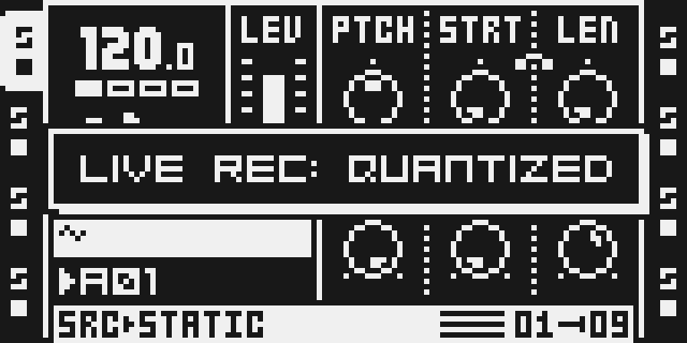
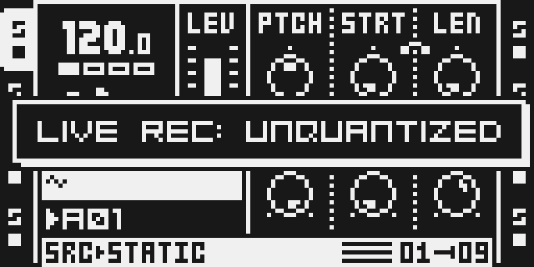
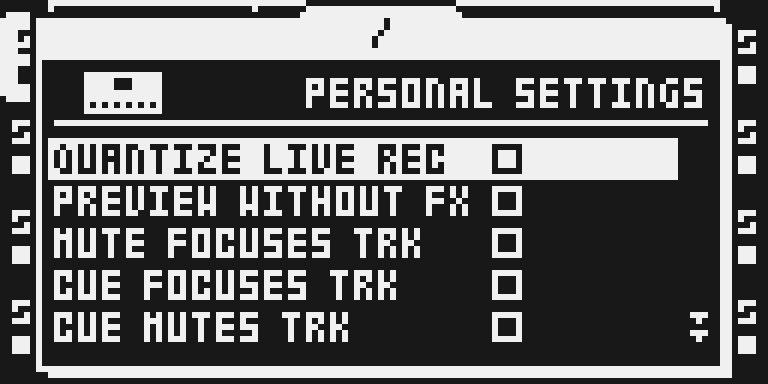

# Quant Live Rec

## Overview

QUANTIZE LIVE REC decides whether live-recorded trigs snap to the steps. Stock keeps it in PROJECT > SYSTEM > PERSONALIZE. This module shows it on the gesture that starts live recording and lets a second tap switch it, without leaving the page you are on.

Version `0.1.1-experimental`, for OS 1.40C card builds and, for beta testers, over USB on the Modwerk base. Zac Kyoti's octabam module `quantize-live-rec-toggle`, which he named Quantize Live Rec Toggle; Modwerk lists it as Quant Live Rec, the 15-character name a USB package can carry. The ColdFire source, including the `LIVE REC:` toasts and the PERSONALIZE redraw, is his, unchanged.

**Hardware status: tested by the author on an MKI.** On 23 October 2026 he flashed this version from the card (this module alone) and reported the gesture, the PERSONALIZE redraw and a power cycle working. Version 0.1.0, with the same gesture, ran on an MKII from the card and over USB. See [TESTING.md](TESTING.md).

## Controls

| Gesture | What it does |
|---|---|
| Hold [REC], tap [PLAY] | Shows the setting in a toast, `LIVE REC: QUANTIZED` or `LIVE REC: UNQUANTIZED`. If live recording is not running, it starts, as on the stock OS. |
| Tap [PLAY] again while the toast is up | Inverts the setting and reopens the toast with the new value. Each further tap inverts it again. |
| Tap [PLAY] after the toast has gone (about 1 s) | Only shows the setting again. |
| Release [REC] | Closes the toast at once. |

QUANTIZED is the ticked QUANTIZE LIVE REC box in PERSONALIZE, UNQUANTIZED the empty one. There is no new menu row, page or knob.

## Usage

The setting is QUANTIZE LIVE REC, the global switch that snaps live-recorded trigs to the steps. It is not the per-track TRIG QUANT. The module changes nothing until you use the gesture, and the setting keeps whatever value the unit already had.

### Quick tutorial: check and switch live-record quantize

1. Hold [REC] and tap [PLAY]: a toast shows LIVE REC: QUANTIZED or LIVE REC: UNQUANTIZED, the current setting, and live recording starts as on the stock OS.
2. While the toast is still on screen (about one second), keep [REC] held and tap [PLAY] again to invert the setting; the toast reopens with the new value.
3. Tap [PLAY] once more while it is up to switch back, or release [REC] to close the toast; the setting stays as last shown.
4. Press [STOP] to end live recording. PROJECT > SYSTEM > PERSONALIZE > QUANTIZE LIVE REC shows and edits the same setting.

### What changes in a stock flow

One stock gesture is touched, and nothing else:

- **What changes and for whom.** [REC] + [PLAY] also opens a one-second toast with the setting. On the stock OS a [REC] + [PLAY] while live recording already runs does nothing; here it shows the setting, or inverts it while the toast is up. This applies to everyone who has the module in their build.
- **Why.** The gesture has to sit on keys already under the hands while recording, and the setting belongs to live recording. A PERSONALIZE visit is what the module is there to save, and an own page would cost more key presses than the menu does.
- **What you see and do differently.** A toast on the first press, which stock does not show. To leave the setting alone, press once, as before.
- **Turning it off.** There is no switch: build without the module. The setting it wrote stays valid on the stock OS, which stores it in the same place.
- **Neighbouring flows checked** (emulator, MKII panel, against the original OS under the same keys): the first [REC] + [PLAY] starts live recording on both; [PLAY] without [REC] opens no toast and changes nothing; [STOP] ends live recording; releasing [REC] clears stock's held flag. Not checked: [REC] + [PLAY] with no project loaded on a real card, grid recording mode, MIDI tracks, an MKI panel in the emulator.

## Compatibility and limitations

- OS 1.40C only. The author tested this version from the card on his MKI (23 October 2026): the gesture, the PERSONALIZE redraw and a power cycle. 0.1.0, with the same gesture, ran on an MKII from the card and over USB.
- The first [REC] + [PLAY] still starts live recording, as on stock. While live recording runs, further [REC] + [PLAY] presses do nothing on stock; here they show or invert the setting.
- If a stock notification happens to be on screen while [REC] is held, the first [PLAY] inverts the setting instead of only showing it; the toast then shows the new value.
- The setting is the stock global PERSONALIZE value in battery-backed memory: not saved per project or Part, and reset by an OS upgrade like the rest of PERSONALIZE.
- With PROJECT > SYSTEM > PERSONALIZE open, a flip redraws the list so the box follows at once (emulator and MKI). Other PROJECT pages are not redrawn by a flip. The author noted an occasional small empty box where the toast was right after it closes.
- This is the all-or-nothing QUANTIZE LIVE REC setting, not the per-track TRIG QUANT. No effect slot, menu row or project data is added.
- Over USB for beta testers: one ColdFire package with its two jmp sites; it adds no effect row or project data, so a project never names it as missing. This version's package has not run over USB on a unit (0.1.0's did, on an MKII, 15 October 2026).

Hook sites, both in key handlers: the first instruction of the [PLAY] handler at `0x40061778` and the instruction that clears the [REC]-held flag at `0x4004883a`. Each is replaced by a `jmp` into the module, which replays what it displaced. The engine frame handler at `0x400522ca` is deliberately left alone: an earlier version of the author's patch hooked it and hard-crashed his MKI (see [upstream/README.md](upstream/README.md)). The gate refuses an image of this module in which that site differs from the original OS.

No conflicts with other catalogue modules are known: none claims either site.

## Tests and measurements

[TESTING.md](TESTING.md) has the commands and every result: the unit's bytes, the image gate, the executed-instruction counts, the memory figures and what was not tested. The emulator results say nothing about a real unit's timing, battery or audio path.

## Authorship and licences

Zac Kyoti wrote the gesture and its ColdFire source (MIT, [LICENSE](LICENSE)); Sam Banks integrated it into octabam (MIT, [upstream/OCTABAM_LICENSE](upstream/OCTABAM_LICENSE)). The author's own description is kept in [upstream/README.md](upstream/README.md) and octabam's wrapper page in [upstream/OCTABAM_README.md](upstream/OCTABAM_README.md). `../../../imports/quantize-live-rec-toggle-8ffec2b.json` records each copied file with its source pin: `patch_qlrec.s`, `manifest.py`, `LICENSE` and `upstream/README.md` are the author's files byte for byte, the first two from his Modwerk copy of this module (`modwerk-modules/quantize-live-rec-toggle/`); `manifest.py` declares the cave and detours with SHA-256 guards in place of stock bytes. The Modwerk gate (`verify.py`), documentation and thumbnail are GPL-3.0-or-later. No firmware, stock code, built image or card is included.

## Screens and audio

Captured from the real LCD in the headless emulator, MKII panel; provenance is in [media/capture.json](media/capture.json). They show the emulator, not a unit. The module makes no sound of its own, so there is no audio preview.

