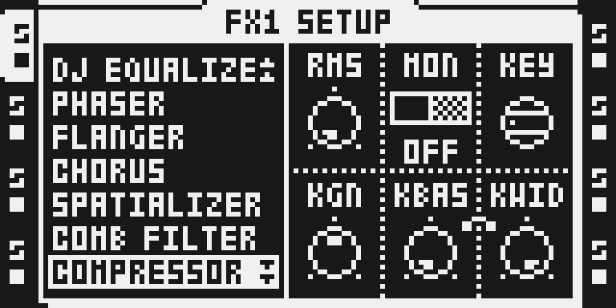
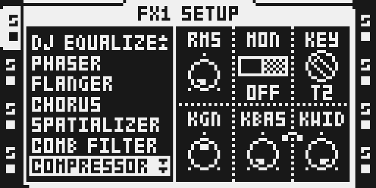

# Sidechain Compressor

## Overview

Drive the Octatrack stock **COMPRESSOR** detector from any audio track. A kick on T1 can duck a loop on T5, even though the tracks run on different DSP cores. MON, KEY, KGN, KBAS and KWID join RMS on page 2; all seven stock compression controls keep their stock behavior.

Version **0.2.0-experimental** is built by Modwerk's firmware builder together with the other modules you select, and over USB it is part of the beta base. It replaces 0.1.x's one-knob key filter (KFLT) with a base-width pair: KBAS, a high-pass in Hz, and KWID, a low-pass a set number of octaves above it. The pair isolates the key better (a kick's fundamental without its sub-sonic rumble, say), which keeps the compression smooth at short attack and release times. A COMPRESSOR saved before the module was installed comes up with its side-chain off, so nothing changes until you set a KEY. The results, the cycle figures and the exact memory accounting are in [TESTING.md](TESTING.md).

**Changed in 0.2.0.** Page 2 was RMS · (blank) · KEY · KFLT · KGN · MON; it is now RMS · MON · KEY · KGN · KBAS · KWID. A COMPRESSOR saved with 0.1.x keeps its KEY, but its other page-2 values land on different knobs: KGN takes the old KFLT, KBAS the old KGN, KWID the old MON, and MON comes up OFF. It sounds different until KGN, KBAS and KWID are set again.

## Controls

Values below are raw parameter values, rather than milliseconds or ratios. Stock defaults were read locally from the fingerprinted 1.40C descriptor. Native compression parameters stay inherited; the five added defaults are declared in manifest.py.

| Control | Default | Range | Behavior |
| --- | --- | --- | --- |
| ATK | 64 | 0-127 | Stock attack control. |
| REL | 64 | 0-127 | Stock release control. |
| THRS | 127 | 0-127 | Stock threshold; lower it until the selected key causes gain reduction. |
| RAT | 0 | 0-127 | Stock compression ratio. |
| GAIN | 0 | 0-127 | Stock output make-up gain. This is distinct from KGN, which changes the detector input. |
| MIX | 127 | 0-127 | Stock dry/wet balance; 127 is fully processed and 0 is dry. |
| RMS | 0 | 0-127 | Stock RMS detector control, unchanged. |
| MON | OFF | OFF / ON | ON plays the processed key on this receiving track instead of its output, after both effects. OFF is on the left of the switch, ON on the right. Switching it, or changing KEY while it is on, crossfades over 256 samples instead of clicking. A COMPRESSOR saved with an earlier version comes up with MON OFF. |
| KEY | OFF | OFF, T1-T8 | OFF restores self-keyed stock detection; T1-T8 selects that track, including tracks on the other DSP core. A rotary switch on the LCD that moves one position per detent, also with the encoder pressed. |
| KGN | 64 | 0-127 | The key's gain before the detector, about -24 to +24 dB; 64 is unity. The LCD shows the stock bipolar offset, not dB. |
| KBAS | OFF | OFF, 20 Hz-19.6 kHz | The key's high-pass, 18 dB/oct Butterworth, on a 1/16-octave grid. The LCD shows Hz. |
| KWID | OFF | 0.5-9.9 oct, OFF | The key's low-pass, 12 dB/oct Butterworth, set as a distance above KBAS (above 20 Hz with KBAS OFF). The LCD shows octaves, and a link clip ties it to KBAS. The two cannot cross. |

Page 1 uses encoders A-F for ATK, REL, THRS, RAT, GAIN and MIX. The SETUP page (page 2) uses A for RMS, B for MON, C for KEY, D for KGN, E for KBAS and F for KWID.

KBAS and KWID filter only the detector key. KGN changes the key level, while GAIN changes output make-up gain. With both filters OFF the key reaches the detector unfiltered. The filters' state lives in stock COMPRESSOR's own per-instance memory and starts over whenever an instance is assigned the effect.

MON replaces the receiving track's committed output after its whole FX1/FX2 chain. Turn it off for normal listening. With KEY OFF, MON has no external key to audition.

## Usage

Select an audio track, hold FUNC and press FX1 or FX2 for SETUP, turn LEVEL to **COMPRESSOR**, then press YES. The effect name and ID remain stock COMPRESSOR. Press the FX button for the main page; hold FUNC and press it to return to SETUP (page 2), which also contains the chooser.

Keep levels low while auditioning the key. Restore self-keying with KEY OFF and MON OFF. Use MIX 0 for a dry comparison or select NONE to remove the effect. Back up projects before switching builds. With Keep stock FX2 effects on, SPRING REV gives up its code space for this module; reassign any slot that used it.

### Quick tutorial: duck T5 from a T1 kick

1. Back up the project, work on a disposable copy, and put a kick on T1 and a sustained sample or loop on T5.
2. Select T5, hold FUNC and press FX1, turn LEVEL to COMPRESSOR and press YES. Press FX1 for the main page; hold FUNC and press FX1 to return to SETUP with the key controls.
3. Set KEY to T1 and leave KGN at 64, KBAS and KWID OFF and MON OFF. On the main page, keep MIX at 127, raise RAT and lower THRS until T5 dips when the T1 kick plays; adjust ATK and REL for the envelope you want.
4. To duck from the kick's fundamental only, set KBAS to about 30-40 Hz and KWID to about 1.2-1.5 octaves. Set MON to ON to hear what the detector hears, then back to OFF.
5. Return KEY to OFF and MON to OFF to restore self-keyed stock compression, or select NONE to remove the effect.

## Compatibility and limitations

It takes COMPRESSOR's row on FX1 and in the FX2 chooser, keeps stock COMPRESSOR's dispatch and carries its code in four guarded hooks per core, so it sits beside other effects without a row of its own. Native octabam and the Modwerk composer were compared on every selection that contains it, with and without the stock FX2 effects.

### Using it with other modules

- **Every other module.** It builds beside each other module on its own, in both menu modes.
- **Larger selections.** 618 of the 1,024 selections of the nine visible modules other than Analog BD that contain it build (786 with 0.1.2). 0.2.0's two ColdFire units (1,314 B, 0.1.2's was 338 B) leave less effect-menu and cave space, so 168 more selections are refused; the smallest is Euclid with Scale Quantizer. The selection checker tells you which applies; removing one module resolves it.
- **Analog BD.** 146 of the 212 Analog BD selections build (162 with 0.1.2): its larger DSP section (677 words a core) no longer fits core A in 16 of them, the smallest Analog BD with Airwindows Chorus.
- **MIDI Scenes** is standalone firmware and combines with nothing.
- **The paused modules.** Spectrum, Modulation and Character are not offered; with them the module needs more of core A's DSP code space than is left in many selections.
- **Stock FX2.** With Keep stock FX2 effects on, SPRING REV gives up its code space for this module; PLATE and DARK REV stay. With it off, every stock FX2 effect leaves the FX2 chooser and the stock FX1 effects stay.

Every download carries Modwerk's core logger; the module's pages are identical with and without it.

### Limitations

- Original OS **1.40C**, Octatrack MKI/MKII; the captured panel is MKII.
- Its core-private keybus and cross-core window overlap BusDelay and BusVerb, which Modwerk does not carry; the native resource ledger refuses them beside it.
- A COMPRESSOR whose KEY holds a value above T8 is treated as never set up and reset to the side-chain defaults (MON OFF, KEY OFF, KGN 64, KBAS OFF, KWID OFF). Only stock firmware leaves such a value; a KEY of OFF or T1-T8 is never changed.
- Over USB it needs the beta base that carries 0.2.0's engine; that base also recognises 0.2.0's page 2 at power-up, so a bank holding a side-chain COMPRESSOR is restored as saved.
- The DSP figures are emulator measurements of whole core loops on a real project, not chip timing; see TESTING.md.
- Firmware, private project/card state and extracted stock bytes stay local.

## Tests and measurements

[TESTING.md](TESTING.md) gives the source, tool and image identities and the actual results. The two ColdFire units (`sc_cf`, 698 B: the MON/KEY/KBAS/KWID formatters, MON's switch, the MON and KEY step handlers and `sc_norm`; `sc_ui`, 616 B: the KEY switch and KWID's clip) match their author references; `sc_norm` is reached by two guarded `jsr` detours over the first instruction of the page-2 copiers. Both cores place 612 DSP code words and its two tables (16 KEY GAIN words, then 49 key-filter words), the author's instructions with their documented per-core values.

Exact accounting for sixteen instances is **26,288 logical bytes**, including inherited instance/scratch/stack capacities and all authored code/tables, Y windows, descriptor, chooser and extra ColdFire stack. No new heap, SDRAM or delay buffer is allocated. In the emulator, eight keyed compressors on one core (filters on, MON ON) peak at **1,743 modelled cycles a sample** for the whole core loop against **4,535** (stock COMPRESSORs: 1,298). `sc_norm`'s static ColdFire bound is unchanged at **8,192 cycles per 362.8 µs frame** against a **9,577**-cycle allowance. These are emulator and software figures; silicon timing is unmeasured.

On the author's Octatrack MKI (26 October 2026) Modwerk's native image of the module alone ran as reported: KBAS and KWID, MON's switch, KEY's pressed turn, the fades and a power cycle ([evidence/hardware.md](evidence/hardware.md)). The USB beta base and selections with other modules are not hardware-tested.

## Authorship and licences

Zac Kyoti and the OT Kyoti FW contributors wrote the sidechain source, table generators and standalone build. Sam Banks integrated it into octabam. This import pins the author's Modwerk copy of the module, [`modwerk-modules/sidechain-compressor`](https://github.com/Zac-Kyoti/octatrack-kyoti-fw/tree/74bf186/modwerk-modules/sidechain-compressor) at 74bf186: every source file and `manifest.py` byte for byte.

[LICENSE](LICENSE) and [upstream/LICENSE](upstream/LICENSE) preserve the full MIT terms, copyright and exclusions. Modwerk's original documentation/thumbnail uses MIT. Per-file provenance is in [the import record](../../../imports/sidechain-compressor-74bf186.json).

No Elektron firmware or private project/card is part of this source distribution. LCD captures have a separate rights declaration; underlying Elektron rights remain reserved.

## Screens and audio

These unedited MKII framebuffer captures, taken on Modwerk's build of the module, show selection/SETUP, the main page and KEY T2 chosen with encoder C. [Capture provenance](media/capture.json) preserves the exact panel plan, source/image/emulator/card hashes and setup. [Media rights](media/LICENSE.md) reserves underlying Elektron rights. No audio is included.

The routing thumbnail above is an illustration, not OT UI evidence.

## Developer build

Modwerk builds the module with the rest of its firmware: `scripts/build-module-packages.py` compiles the authored source in the pinned container (`sdk/build/Dockerfile`), and the browser rebuilds the guarded stock fields from the visitor's own 1.40C. To compare it with native octabam yourself, put your own original MAIN OS in a private copy of `sdk/octabam`, run `scripts/export-composition-proofs.py --suite sidechain` (or `sidechain-visible`), and run `node scripts/verify-sidechain-native.mjs` on your 1.40C update; TESTING.md has the steps. Keep out/ images and every generated firmware container private.
