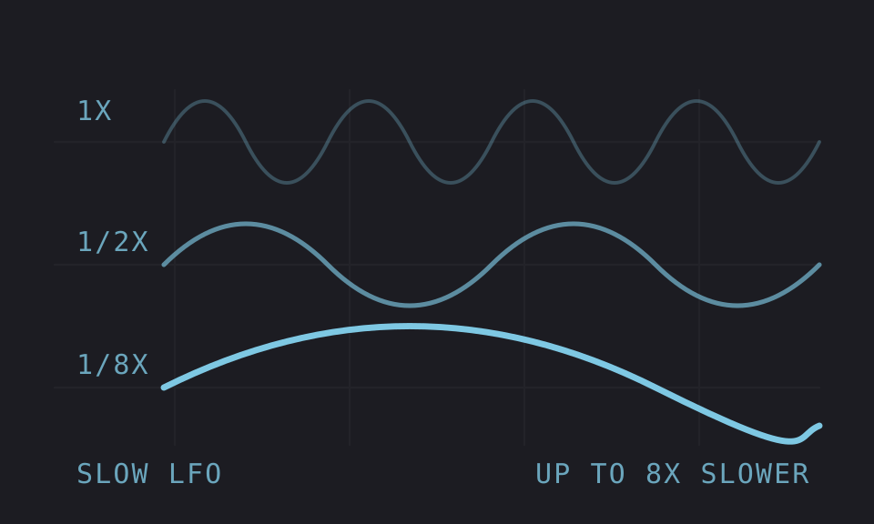
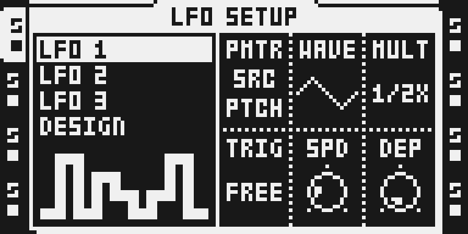

# Slow LFO

Version: 0.1.0-experimental · author: @nathangroth

## Overview

Stock LFO MULT runs from 1X to 64X, so the slowest an LFO can go is SPD 1 at 1X. Slow LFO adds three values after 64X: **1/2X, 1/4X and 1/8X**, which run at a half, a quarter and an eighth of 1X. They work on every LFO of the audio tracks and the MIDI tracks, follow the project tempo as stock does, and are saved in the Part like any MULT value.

## Controls

| page | knob | values | what it does |
|---|---|---|---|
| LFO SETUP | MULT | 1X, 2X … 64X, **1/2X, 1/4X, 1/8X** | stock's rate multiplier; the last three run at a half, a quarter and an eighth of 1X |

## Usage

Slow LFO has no page or setting of its own: it adds three values to MULT on LFO SETUP, the page stock already has for every audio and MIDI track. Pick one for a sweep that lasts several bars, such as a slow filter or volume swell. It is stored in the Part like any other MULT value.

### Quick tutorial

1. On a track, hold [FUNC] and press [LFO] to open LFO SETUP, and turn MULT past 64X to 1/2X, 1/4X or 1/8X.
2. Set SPD as usual: the LFO now takes 2, 4 or 8 times longer than at 1X, still in time with the tempo.
3. Turn MULT back to 1X..64X for stock rates.

## How it works

Each frame the LFO engine adds SPD × tempo to a phase accumulator, counts how many times the accumulator wrapped, and doubles that count MULT times: MULT is stored as a shift count, 0 to 6. Slow LFO gives MULT three more stored values, 7, 8 and 9. For those it halves the engine's step once, twice or three times before it is added, and skips the doubling. Values 0 to 6 run stock's instructions unchanged.

The audio-track engine (`0x4000cfa8`) and its MIDI-track copy (`0x40003c0e`) each get the same two hooks. Both LFO pages' MULT counts go from 7 to 10, and the MULT label code, which both pages share, prints the three new labels.

It keeps no clock of its own ([sequencing](https://github.com/repeat98/modwerk/blob/main/docs/module-guides/sequencing.md)): the step is stock's SPD × tempo, so tempo changes and external MIDI clock move the LFO as they do in stock.

## Compatibility and limitations

- OS 1.40C, MKI and MKII.
- Changing a stock flow: MULT on LFO SETUP (audio and MIDI tracks) has three more values after 64X. Nothing else changes; values 1X to 64X behave as stock. Remove the module to get stock's seven values back.
- The new values sit after 64X on the knob, not below 1X: keeping stock's stored values for 1X to 64X keeps every saved project the same.
- A project saved with 1/2X, 1/4X or 1/8X opened without the module shows 128X and runs that LFO very fast (stock reads 7 to 9 as shift counts).
- On Deja Vu's waves (DJV, DJQ, DJC) MULT is the loop length; Deja Vu reads 1/2X to 1/8X as 64.
- No other module or the base patches these sites. Takes no key or screen.
- Tested on an MKI over USB on audio and MIDI tracks: all three LFOs of a track at different slow values, several tracks, a tempo change while playing, external MIDI clock and a power cycle. MULT cannot be locked or reached by scenes or the crossfader, as on stock. Not yet tested: a project with a slow value opened without the module, Deja Vu's waves, MKII.

## Tests and measurements

See [TESTING.md](TESTING.md).

## Authorship and licences

Original module by @nathangroth, MIT ([LICENSE](LICENSE)). No firmware, extracted stock code or built images are included.

## Screens and audio

LFO SETUP ([FUNC]+[LFO]) with MULT turned one step past 64X to 1/2X.

MULT at 1/8X, the last value: the knob stops here.

Headless `ot_emu` captures of a build with Slow LFO; the record is in [media/capture.json](media/capture.json). No audio preview.
