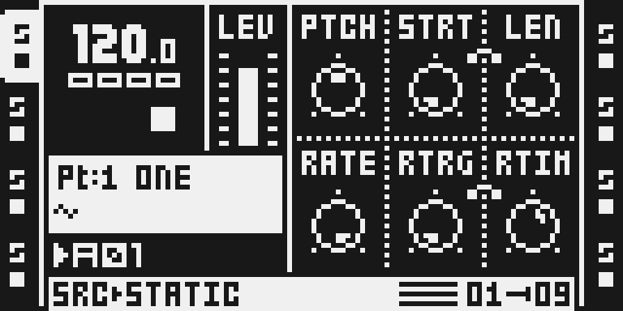
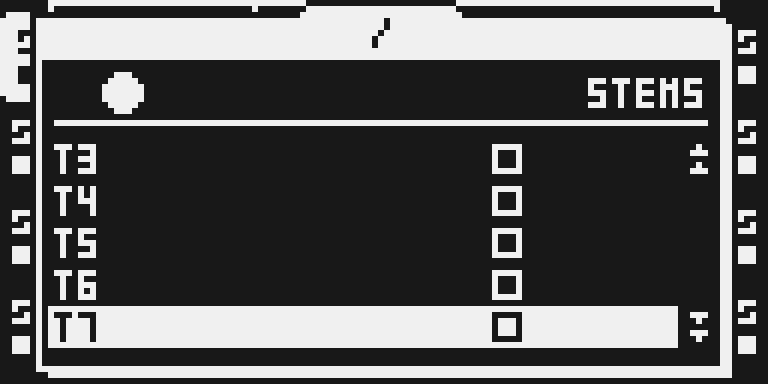
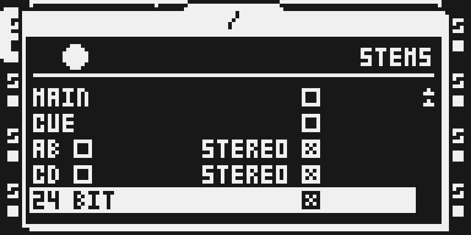
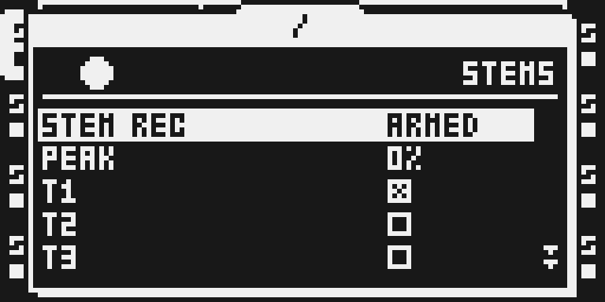

# Stem Rec

Version 0.1.0-experimental, a card build. Reported working on Yves's MKII on 5 November 2026 (image STEMMW1, [TESTING.md](TESTING.md)).

## Overview

Stem Rec records stems to the card while the sequencer plays: every track after its fader, the main mix (MAIN), the cue mix (CUE) and the four inputs, as 16-bit or 24-bit WAV files at 44,100 Hz, for up to 60 minutes. The take is written while it records, so it is ready when the sequencer stops.

Each take gets its own folder in `AUDIO/!STEMS/` (first in the file browser), named after the take, `YYMMDD-HHMM`. Each source is a file in it: `YYMMDD-HHMM-T1.wav` to `-T8.wav`, `-MAIN.wav`, `-CUE.wav`, and the inputs as `-AB.wav` and `-CD.wav` (stereo) or `-A.wav` to `-D.wav` (mono). A second take in the same minute is `YYMMDD-HHMM-2`, so no take overwrites another. Each take also writes a short log, `/BRAIN/STEMS/<take>.TXT`, and an `.ot` file beside each WAV.

A track's file is its share of MAIN: the track's audio times the gain the mix gives it, so the track's level, MAIN LEVEL, the scenes and the crossfader are in it. MAIN and CUE are recorded as mixed; the inputs as they arrive. It uses no effect slot.

**Card builds only.** Over USB a module lives in the base's 768 KiB ColdFire pool, and Stem Rec needs an 8 MiB ring and runs a writer task of its own for each take.

## Controls

| Action | Result |
| --- | --- |
| Hold UP first, then press REC | Opens STEMS, or closes it. REC alone stays stock grid recording. |
| UP and DOWN in STEMS | Move the cursor. |
| YES in STEMS | Changes the value under the cursor. |
| LEFT and RIGHT on an input row | Pick the row's checkbox. |
| NO in STEMS | Closes STEMS. A take keeps recording. |

STEMS looks like SYSTEM > PERSONAL SETTINGS: five rows at a time, each a name and a value.

| Row | Shows | YES |
| --- | --- | --- |
| STEM REC | `READY`, `ARMED`, the time (`01:23`), `SAVING`, `DONE` or `NO CARD`; a failed take's error stands in for `STEM REC` | arms, cancels or stops the take |
| PEAK | the take's highest ring fill (`12%`) | skipped by the cursor |
| T1 to T8 | a checkbox each | turns the track on or off |
| MAIN, CUE | a checkbox each | turns the source on or off |
| AB, CD | `AB` and `STEREO`, or `A`, `B` and `STEREO` with STEREO off | toggles the checkbox LEFT and RIGHT picked |
| 24 BIT | a checkbox | 24-bit or 16-bit files |

At boot T1 alone is on, at 24 bits, both pairs stereo. Nothing is saved. The source rows are locked while a take records or saves.

## Usage

Choose the sources, arm, and play. The take starts on the first frame the sequencer plays and stops when it stops.

### Quick tutorial: record your tracks as stems

1. Include Stem Rec in a card build. Hold UP first, then press REC: STEMS opens.
2. Choose the sources with UP, DOWN and YES: T1 alone is on at boot, at 24 bits.
3. Press YES on STEM REC: it arms, and the take starts when the sequencer plays (at once if it already does). Stop the sequencer to end it.
4. Wait until STEM REC reads DONE before you pull the card or power off. The files are in AUDIO/!STEMS/<take>/.

The take also stops on YES, after 60 minutes, or when the card falls behind (`RING FULL`; the files still play). The status updates by itself while STEMS is open.

## Screens and audio

Emulator captures of this card build (MAIN OS SHA-256 `9a7e1784…`, MKII panel, transport stopped):

| | |
| --- | --- |
|  |  |
|  |  |
|  | |

No audio examples.

## Compatibility and limitations

- **No YES double tap.** A second YES within 0.5 s on the main page doesn't arm a take in this version: APPLY SCENE patches that stock site, and a card build has no key bus. Arm from STEMS: UP + REC, then YES on STEM REC.
- **Nothing is saved.** The sources and the format reset at every boot. Stem Rec writes nothing into projects.
- **Pull the card or power off only when the status reads `DONE`.** A power cut or a card pull before then leaves the take's files at 0 bytes: each file's length is set only at the end. The folder appears when the take starts, so it is not a signal.
- **The card must keep up.** A 24-bit stereo file needs 264,600 bytes a second, a mono file half that. When the card falls behind, the ring fills and the take stops with `RING FULL`. On Yves's MKII, eleven 24-bit stereo files kept up, the ring at most 32% full.
- **MASTER TRACK.** With MASTER TRACK on, T8 reads `MASTER` and a take leaves it out, MAIN is T8's output, T1 to T7 and CUE are 32 samples (0.73 ms) early against MAIN, and the track files do not sum to MAIN.
- **Sample memory.** A card build with Stem Rec gives up the 10,487,808-byte DRAM platform reserve from Flex sample RAM, shared with any other DRAM module; the 8 MiB ring sits inside it.
- **Errors:** `RING FULL`, `SAME MINUTE` (99 takes in this minute already), `WRITE FAILED`, `OPEN FAILED`, `PATH FAILED`, `SEEK FAILED`, `CLOSE FAILED`, `TASK FAILED`.

## Tests and measurements

[TESTING.md](TESTING.md) has every result. In short:

- On Yves's MKII (5 November 2026, image STEMMW1): two takes of eleven 24-bit files, both `OK`, every file whole. The frame hook took 28 to 29 µs on average and 53 µs at most (13,992 of the block's 95,782 core cycles); with the stock frame routine, 104 µs at most.
- Every source at 24 bits (fourteen files), priced from that measurement and the emulator's instruction counts: about 59 µs, 15,505 cycles.
- Memory: 8,436,254 bytes of its own (the 8 MiB ring, the writer's stack, the sector copies, the 23,210-byte unit, the loader and hook sites), inside the shared 10,487,808-byte platform reserve.
- `verify.py` builds this card alone and beside APPLY SCENE, TUNER and USB AUDIO OUT, boots two of them under `ot_emu`, and checks the DRAM read-back, the gain table's fill from the OS and the regions' placement.

## Authorship and licences

Stem Rec is by Yves Rosius. `upstream/` holds its manifest, source and README unchanged from `yvesrosius/octabam` at `00a23502`; `manifest.py` is Modwerk's card-build adapter, changed four ways, each named in `sdk/imports/stem-rec-00a2350.json`. MIT ([LICENSE](LICENSE)); the licence grants no rights to Elektron firmware. Thanks to OctaBam for the toolchain that made it possible.
