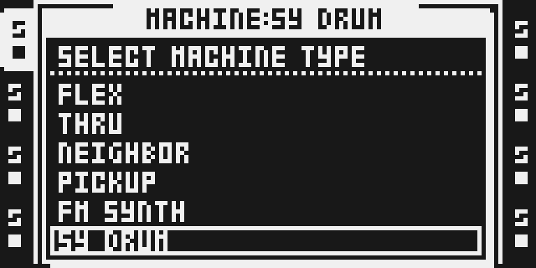
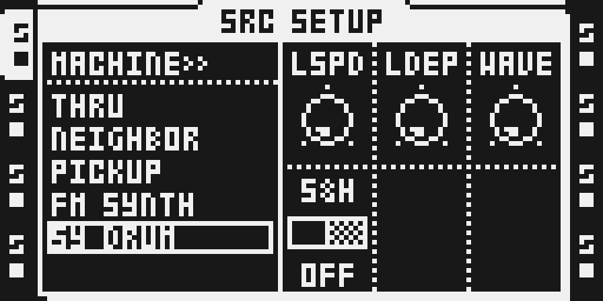
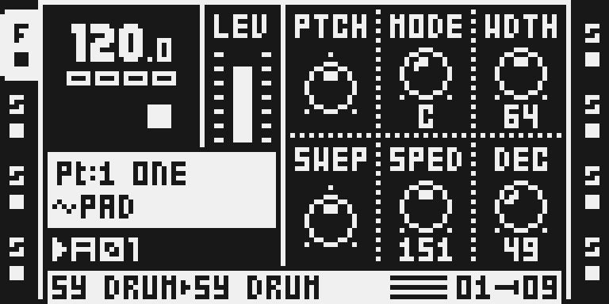
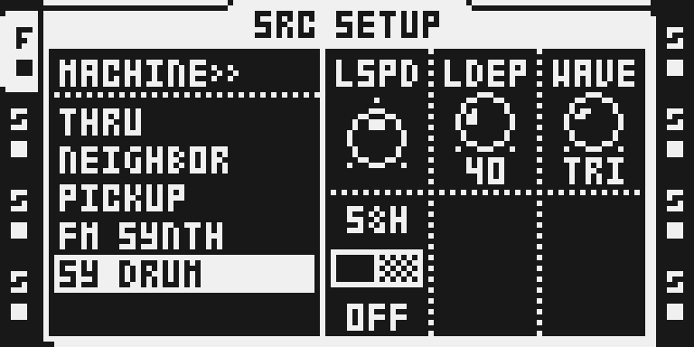
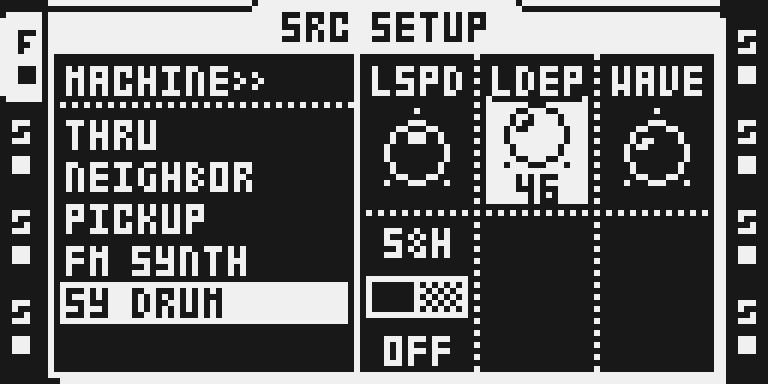

# SY DRUM — 0.1.0 experimental

## Overview

SY DRUM is a drum machine for audio tracks: a new row in the track machine list, after FM SYNTH. Each SY DRUM track is one voice — two oscillators, a pitch sweep, a two-pole low-pass filter opened by the decay envelope, six modes and a dedicated LFO with sample-and-hold. It plays without a sample. It is Tim Hastie’s octatrick 2.14 module (`timhastie/octatrick-modules` at `39dc5d8`, tag `v2.14`); FM Synth 0.1.5, which it needs, stays on his `v2.13` (`48b89e7`), since 2.14 changes only this folder.

SY DRUM is modelled on the 1979 Pearl Syncussion SY-1, written from a study of that unit's circuit. It is not affiliated with or endorsed by Pearl or Behringer. Syncussion is a trademark of its owner.

**It needs FM Synth.** SY DRUM runs on FM Synth’s engine: the machine list, the sample-free voice, the engine-owned AMP envelope, the CHROMATIC keys, MIDI IN, LEG and the live recorder are FM Synth’s. With SY DRUM selected, FM Synth’s engine is built with SY DRUM’s row and calls; without it, FM Synth is unchanged. The configurator refuses SY DRUM on its own and offers to remove it; native octabam refuses the same selection.

The four LFO controls on the setup page can be locked per step, as on the author’s development builds, and those locks are saved beside the project in `sylock01`–`sylock16` files. Worst-case ColdFire cost, exact memory and the Part, project and two-instance checks were measured in the emulator for this build; see TESTING.md. The hardware report for this exact build is pending.

## Controls

| Page | Control | Initial value / range | Function |
| --- | --- | --- | --- |
| SRC A | PTCH | raw 64 = 0; −64…+63 semitones | C4 at 0. CHROMATIC keys, MIDI notes and FM Synth’s bundled scale quantizer use semitones. |
| SRC B | MODE | A; A…F | A triangle, B exponential FM, C mixed oscillators, D independently swept oscillators, E FM pseudo-saw, F noise. The six choices are spaced evenly across the dial. |
| SRC C | WDTH | 64; 0…127 | How far the decay envelope opens the two-pole low-pass filter. Turn left for a darker attack and tail. |
| SRC D | SWEP | raw 64 = 0; −64…+63 | Negative starts above PTCH and sweeps down; positive starts below and sweeps up. |
| SRC E | SPED | 64; 20 ms…1.1 s | The sweep’s time constant; clockwise is longer and slower. |
| SRC F | DEC | 64; 6 ms…2.5 s | The amplitude decay’s time constant at C4; higher tuning shortens it. |
| FUNC+SRC A | LSPD | 64 = 4.56 Hz; 0.40…200.0 Hz | The free-running LFO’s speed (raw 0…64 is 0.40…4.56 Hz, above it exponential to 200 Hz). |
| FUNC+SRC B | LDEP | 0; 0…127 | Continuous LFO depth on the tuning, nominally ±24 semitones at 127. |
| FUNC+SRC C | WAVE | OFF; OFF TRI SQR RND | The LFO waveform. RND steps to a new random value each cycle when S&H is off. |
| FUNC+SRC D | S&H | OFF; OFF ON | Capture the waveform at each hit, with its own fixed ±24-semitone range (independent of LDEP); RND draws a fresh value per hit; WAVE OFF samples the triangle. |

PTCH…DEC are the FLEX PLAYBACK bytes, so stock p-locks, the three LFOs and scenes reach them as on any FLEX track. A pressed encoder moves by seven; with FUNCTION held a detent moves PTCH 12, MODE 1, WDTH 16, SWEP 12, SPED 16, DEC 16. AMP ATK, HOLD, REL, VOL and BAL work as on FM Synth: the engine runs the envelope; a CHROMATIC key sustains while held and sequencer trigs use HOLD. LEG (FUNC+AMP F) offers OFF and MONO: a legato key recharges the envelopes when its pitch arrives, without a new start. Choosing SY DRUM on a track that does not play it yet sets PTCH 0, MODE A, WDTH 64, SWEP 0, SPED 64, DEC 64 and LSPD 64, LDEP 0, WAVE OFF, S&H OFF; choosing it again keeps the patch.

**A machine change resets the track’s machine parameters** (2.12). When a track changes to or from SY DRUM (or FM SYNTH), in either machine list, its PLAYBACK, PLAYBACK SETUP, AMP, LFO and their SETUP pages get the new machine’s init: SY DRUM’s values above, FM SYNTH’s, or a stock machine’s as on a new project. Nothing of the old machine’s settings carries over. Step locks and scene locks are kept, as in the stock firmware, and so are SY DRUM’s own setup-LFO step locks: they play again when the track returns to SY DRUM. The FX1 and FX2 slots are kept. A change between two stock machines is unchanged.

The setup controls (LSPD LDEP WAVE S&H) are the **Part’s defaults**, saved with the Part. **Each can be locked per step:**

- In GRID RECORDING, hold a trig and turn A–D: the step gets a lock, starting from its own lock or the Part’s value. Several held trigs move together. While trigs are held, a control locked on a held step is drawn inverted, showing the lowest such step’s value.
- Press and release an encoder without turning it: on an unlocked control every held step gets a lock at the Part’s value; on a locked control the untouched locks are removed.
- With no trig held, turning edits the Part’s value; while a locked step plays, that edit releases the step’s lock until the next step so the new value is heard.
- In LIVE RECORDING, turning A–D records locks at the playing step with the stock recording’s timing and quantization. An empty step gains a lock trig.
- A step’s lock applies from its own start until the next step. A step whose only locks are these is a lock trig: it changes the values without a new note. The locks belong to bank, pattern, audio track and step, and travel with the step in every stock sequence edit: copy, paste, clear and their undo for a held trig, a page, a track or a pattern; the shift of a track’s trigs; page duplication; GRID and LIVE RECORDING erase.

The ordinary three LFOs work on PTCH…DEC as on any track; the LFO page is the stock one. SY DRUM has no VOIC or CHRD: it is one voice a track. The [author’s documentation](upstream/sy-drum/README.md) describes the model, the step locks and the card files in full.

## Usage

Start with one audio track and a trig on every other step; the tutorial below selects the machine, shapes it, locks its LFO and stops it.

### Quick tutorial: play SY DRUM

1. Open a disposable project with FM Synth and SY DRUM firmware. Select an audio track, hold FUNC and press SRC, go DOWN past FM SYNTH to SY DRUM and press YES. No sample is required.
2. Press SRC. Turn MODE for one of the six voices A–F, DEC for the decay, WDTH for the filter and SWEP/SPED for a pitch sweep. Place trigs and press PLAY; PTCH is in semitones.
3. Hold FUNC and press SRC for the setup half: set WAVE to TRI and turn LDEP up for a pitch LFO; LSPD sets its rate and S&H holds one value per hit. In GRID RECORDING, hold a trig and turn A–D to lock these per step.
4. Press STOP twice to silence it. To return to a sample machine, hold FUNC and press SRC, choose FLEX or STATIC and press YES: the track starts from that machine’s init (the step locks stay).

SY DRUM is also the seventh row of SELECT MACHINE TYPE: press the track key twice quickly, press LEFT on `<< MACHINE`, go DOWN to SY DRUM and press YES. That window shows six rows and scrolls to the seventh. Notes, trigs and stops come from the instrument’s own sequencer, keys and MIDI; the LFO runs free between hits at the LSPD in force and is not a second sequencer clock. Tempo changes, non-default track speed and swing were not exercised beyond the instrument’s defaults.

### Changes to stock flows

These apply only while SY DRUM is in the build, and the owner reviews each one:

- **Machine lists.** SELECT MACHINE TYPE and SRC SETUP gain the SY DRUM row after FM SYNTH; SELECT MACHINE TYPE scrolls (FM Synth 0.1.5 provides the scrolling list and the row table; SY DRUM adds one row). Stock rows and their order are unchanged.
- **Machine change.** A change to or from SY DRUM sets the track’s PLAYBACK, PLAYBACK SETUP, AMP and LFO pages and their SETUP pages to the new machine’s init (FM Synth 0.1.5’s machine list does this for both of its rows). The stock firmware keeps those bytes on a machine change; step locks, scene locks and the FX slots are kept as in stock. Changes between stock machines are unchanged.
- **The PLAYBACK SETUP page of a SY DRUM track** is SY DRUM’s (LSPD LDEP WAVE S&H) instead of FLEX’s sample settings, and on that page a held trig records a step lock of these four controls (a stock FLEX setup page does not lock per step). Every other track’s pages are stock. Stock parameter locks reach only the main pages’ parameters, not a setup page’s values, so SY DRUM keeps its own per-step rows for these four.
- **Project files.** SAVE PROJECT, SAVE BANK, the background save, SYNC TO CARD, RELOAD, SAVE TO NEW, EXPORT and DELETE also write, restore, copy or remove the `sylockNN.work` / `.strd` pairs of banks that hold SY DRUM locks. A project without SY DRUM locks gets no file; the stock bank files keep their format; a project without these files loads as before. This is a file format of the author’s (version 2, read by his development builds as well); the module guides ask not to invent one, so it is listed here for the owner’s decision. The stock files and the companion files are separate writes, so a save is not one atomic step across a power loss. The `.work` file follows lock edits within about 1.2 s (60 UI ticks on the emulator), while the sequencer is stopped (stock’s own background save) and, since 2.14, while it plays (a write of the module’s own at most every 60 UI ticks, only while a lock edit is unwritten; stock’s background save skips playback because stock keeps its current bank in battery-backed memory, which the step locks do not share). A power-off without SAVE PROJECT less than about 1.2 s after a lock edit can bring that step back without the edit; SAVE PROJECT closes that. Since 2.14 the companion files are also read when one of the project’s stock bank files is missing or damaged at load (stock shows its own message and starts that bank empty); before, that left every bank without its step locks.
- **Sequence edits** (copy, paste, clear, shift, duplicate, undo, GRID/LIVE erase) carry the companion locks with the step; the stock operation itself is unchanged.
- **Trig LEDs** in GRID RECORDING show a step that has only SY DRUM locks as a locked step.

The stock flows exercised on the emulator with SY DRUM in the build, and those not tested, are listed in TESTING.md ("Stock flows compared").

## Compatibility and limitations

OS 1.40C only. Needs FM Synth in the same build. A track is stored as FLEX with `S`, `Y`, 1 in unused NEIGHBOR PLAYBACK bytes (in the live Part and its battery-RAM shadow), the same mechanism as FM Synth’s `F`, `M`, 1. A build without SY DRUM reads such a track as an empty FLEX track (silent) and the stock loader then clamps its bytes into FLEX’s ranges: choose a stock machine and SAVE before flashing a build without it.

SY DRUM inherits FM Synth’s exclusions (Analog BD, VECTOR, the public Scale Quantizer) and is not built with POLY8, which owns the machine list itself. The author also declares conflicts with three octabam modules this catalogue does not carry: KITS and PLOCKS P2 (the same project-file, clipboard and lock-queue hooks) and STEM REC (SY DRUM’s 2 MiB lock table and STEM REC’s buffers do not fit the platform reserve together).

Emulator measurements, the maximum over five runs of each load, price 2 SY DRUM tracks at their worst (a trig on every step, LFO, locks, p-locks, LFOs, scenes) inside every audio block including the first START. 3 tracks also stay inside the block in every run, but by 311 instructions, less than the 418-instruction spread between runs seen on this frame-interrupt code, so they are not qualified; 4 tracks reach 1.110x and 8 tracks reach 1.560x the block on their START blocks (not shown to fail on a unit). Mixed FM Synth and SY DRUM loads were not measured.

Keep the `sylockNN` files with a project when copying or backing it up on a computer. A damaged WORK file with a good STRD loads the saved locks and shows `LOCKS RECOVERED; SAVE TO REPAIR`; a file this module cannot read is preserved and that bank’s locks are disabled with `SY LOCK FILE ERROR`. The setup controls are not in scenes and are not LFO destinations (the author’s development builds have both; they may follow). A power-off without SAVE PROJECT was walked on an emulator build that carries the battery-backed memory over and loads the project at power-on as the unit does (TESTING.md); the same on a unit with this exact build, usable audio on hardware and long runs are pending the author’s report.

## Tests and measurements

See [TESTING.md](TESTING.md). The native image used for the captures and measurements is built by Modwerk’s own exporter from this source together with FM Synth 0.1.5. Worst-case ColdFire instruction counts come from the pinned emulator and are converted at the CF METER calibration; they are not chip wall-clock measurements. Exact memory comes from the image’s link map. The module’s native Part smoke, the machine-list walk, the 2.12 machine change, two-instance isolation, the Part, project-load and RELOAD checks and the power-off walks pass on that image; 126 native/browser selections match. The hardware report fields stay pending until the author’s MKI test of this exact image.

## Authorship and licences

Tim Hastie: SY DRUM — the engine, its pages, the setup LFO, the step locks and their card files — pinned to `39dc5d8ca285c14674b66a452f58a5a0364efb96` of [timhastie/octatrick-modules](https://github.com/timhastie/octatrick-modules) (tag `v2.14`), and this Modwerk packaging. MIT; full terms in [LICENSE](LICENSE), the author’s original in [upstream/LICENSE](upstream/LICENSE). The import inventory is [sy-drum-39dc5d8.json](../../../imports/sy-drum-39dc5d8.json).

No firmware, extracted stock byte blobs or tables, cards, RAM dumps or compiled images are distributed. Stock expectations resolve lazily from the verified developer-owned OS by address, length and SHA-256 ([stock-guards.json](stock-guards.json)).

## Screens and audio

These five captures are actual monochrome emulator LCD exports of the native 0.1.0 image on a disposable project card, visually reviewed and bound to it in [media/capture.json](media/capture.json). They are emulator evidence; no hardware capture is claimed. See [media/LICENSE.md](media/LICENSE.md) for the interface rights declaration and [presentation/thumbnail.svg](presentation/thumbnail.svg) for original art.

No audio files are retained in this module.
