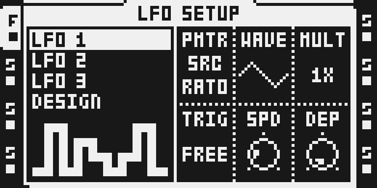
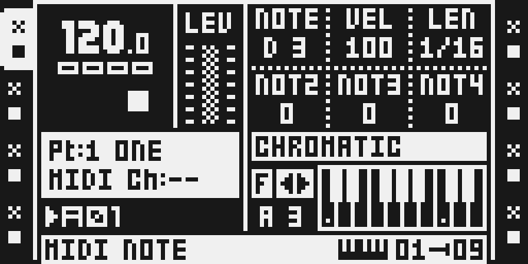

# FM Synth — 0.1.5 experimental

## Overview

FM SYNTH is a dedicated track machine beside FLEX, STATIC, THRU, NEIGHBOR and PICKUP. It uses Tim Hastie’s two-operator FM engine from octatrick 2.12: a sine carrier with a sine modulator, feedback and an index-decay envelope. One to four paraphonic voices feed the track’s existing AMP, filter and effects. The machine plays without a sample.

Version 0.1.5 brings the author’s 2.13 quantizer (`timhastie/octatrick-modules` `48b89e7`, tag `v2.13`): **SCALE and ROOT act on MIDI tracks too.** With a scale on, a MIDI track’s NOTE knob and NOTE locks step through the scale’s notes from ROOT, and the MIDI CHROMATIC keys play the scale from ROOT: key 1 sounds the root, and the number beside the keyboard reads the root and the octave (“A 3” with ROOT A). Chord offsets (NOT2–NOT4), TRAN, the arpeggiator and MIDI IN are unchanged, and SCALE OFF is stock. The CHROMATIC drawer fix for #264 is now the author’s own: his 2.13 quantizer takes the form of Modwerk’s 0.1.2 fix (credit: the Modwerk contributors). The FM engine, the chooser and the page are unchanged from 0.1.4.

Version 0.1.4 moved the module to the author’s 2.12 line (`timhastie/octatrick-modules` tag `v2.12`, `ca13ed8`). The FM SYNTH chooser is now the author’s own: his `machine.s` is adapted from Modwerk’s 0.1.1 chooser and keeps the same Part signature (FLEX plus `FM`, 1 in unused NEIGHBOR bytes). It replaces Modwerk’s `machine.s` / `registration.s`. The update brings the four 2.10 synth changes, the fixes from the author’s hardware test of the first 2.10 build, the 2.11 machine list and the two 2.12 changes:

- **DEC puts HOLD at 127.** 127 holds the modulation index for the whole note; 0 is the shortest decay. Values 1–126 are unchanged.
- **No click at note start.** Every attack lasts at least one carrier period and is S-shaped, so low notes (RATO down, C1–C3) start without a tick. Attacks below C3 are slightly slower (C1 reaches full level in about 31 ms).
- **The LFO destination list speaks FM.** On an FM track, LFO SETUP’s PMTR lists PTCH RATO INDX FINE FDBK DEC, then AMP, SPD1 SPD2 DEP1 DEP2, FX1 and FX2, and skips SPD3/DEP3 (VOIC/CHRD).
- **A held CHROMATIC key is the gate.** A key sustains while it is held and releases on key-up; HOLD applies to sequencer trigs.
- **A machine list shared with SY DRUM (2.11).** The rows after PICKUP are a table in `machine.s`, so the author’s SY DRUM machine can add a row of its own without hooks of its own. The six row-count and row-bound constants that 2.10 patched became detours that read the table, and SELECT MACHINE TYPE now scrolls like SRC SETUP. This package carries FM SYNTH alone: the list has the same six rows as before and behaves as before.
- **The metronome no longer cuts a held note (2.12).** The engine had hooked the frame builder’s clear of the metronome’s click word, taking it for a STOP word, so with CLICK ON every beat released held notes and chords. 2.12 removes that hook; STOP still ends the engine’s voices through the stock voice kill.
- **A machine change resets the track to init (2.12).** Changing a track to or from FM SYNTH, through SRC SETUP, SELECT MACHINE TYPE or the file browser, sets its PLAYBACK, PLAYBACK SETUP, AMP, AMP SETUP, LFO and LFO SETUP to the new machine’s init: FM SYNTH’s own seeds, or a stock machine’s defaults as the stock Part initialiser writes them. Step and scene locks are kept and apply by position, as at a stock machine change; FX1 and FX2 stay.
- **8 October fixes.** A note restarted while it still sounds no longer clicks at a short DEC; a fast run of keys at VOIC 2–4 no longer loses notes; a live-recorded legato phrase no longer goes silent at its first trigless step. FM SYNTH chosen on a track that played a sample now plays C4 at FINE 0c, as its page reads.

0.1.4 kept 0.1.2’s MIDI chromatic drawer fix in the bundled quantizer; since 0.1.5 the quantizer carries the author’s own form of it. **The engine leaves 6 dB of headroom** (the author’s decision): the mono voice and each paraphonic voice are 6.02 dB below his earlier 2.10 builds, so AMP VOL 0 is the reference and VOL up to about +6 stays clean. This replaces 0.1.2’s 18.06 dB `OUTPUT_SHIFT`: at the same mixer settings 0.1.4 plays about 12 dB louder than 0.1.2. Lower track LEVEL or AMP VOL if a mix clips.

Worst-case ColdFire cost, exact memory and two-track Part/project save and reload are measured in the emulator for this build; see TESTING.md. The hardware report for this exact build is pending.

## Controls

| Page | Control | Initial value / range | Function |
| --- | --- | --- | --- |
| SRC A | PTCH | raw 64; −64…+63 semitones | Carrier pitch; chromatic and scale edits constrain notes. |
| SRC B | RATO | raw 12 = 1; 32 ratios 0.25…16 | Modulator/carrier frequency ratio; four raw values per position. |
| SRC C | INDX | 32; 0…127 | FM depth; 0 gives the unmodulated carrier. |
| SRC D | FINE | raw 64 = 0; −64…+63 cents | Fine pitch tuning. |
| SRC E | FDBK | 0; 0…127 | Modulator feedback. |
| SRC F | DEC | raw 40 ≈ 198 ms; 0 shortest … 126 ≈ 1.9 s, 127 HOLD | Decay of the modulation index, separate from amplitude. |
| LFO C | VOIC | effective 1; 1…4 | Paraphonic voices. Inherited raw values outside 1…4 normalize to 1. |
| LFO F | CHRD | ----; 32 shapes × 4 inversions | Chord shape and inversion; raw `shape<<2 | inversion`. |
| FUNC+AMP F | LEG | OFF / MONO / POLY | Retrigger or overlapping mono/paraphonic legato. |
| FUNC+LFO PMTR | LFO destination | PTCH … DEC, AMP, SPD1/2, DEP1/2, FX1, FX2 | The FM page’s names on an FM track; SPD3/DEP3 are skipped. |
| PROJECT > CONTROL > SEQUENCER | SCALE | OFF; 24 scales | Scale quantization of pitch edits and chromatic playing; on MIDI tracks of the NOTE knob, NOTE locks and CHROMATIC keys. |
| Same menu | ROOT | C; 12 roots | Key of the active scale; key 1 of the CHROMATIC keyboards (audio and MIDI tracks). |
| Same menu | GLIDE | OFF; raw 0…127 | Pitch slide time, interpreted with LEG. |

AMP ATK, HOLD and REL are Part values and shape the engine’s own gain envelope; HOLD ends sequencer notes, a held key ends its own note. Choosing FM SYNTH on a track that had another machine sets the track’s PLAYBACK, PLAYBACK SETUP, AMP, AMP SETUP, LFO and LFO SETUP to init (the values in the table, the stock new-track AMP and LFO values); reselecting FM SYNTH on an FM track keeps its controls. Step and scene locks and FX1 / FX2 are kept. LFO3’s speed and depth become VOIC/CHRD; its depth contribution is muted. Four voices share the track’s filtering and envelope path. The [author documentation](upstream/synth/README.md) describes chord shapes, MIDI, keyboard recording, envelope details and every 2.10 change with its measurements.

## Usage

Start with one audio track and a simple trig pattern; the tutorial below selects the machine, shapes its sound and stops it.

### Quick tutorial: play FM Synth

1. Open a disposable project with FM Synth firmware. Select an audio track, hold FUNC and press SRC, select FM SYNTH with UP/DOWN and press YES. No sample is required.
2. Press SRC. Set RATO to 1 and turn INDX from 0 upwards to hear a sine tone acquire FM harmonics. PTCH transposes it; FINE tunes it in cents; FDBK adds feedback; DEC shortens the modulation envelope.
3. Place a trig and press PLAY. Press LFO to set VOIC to 2–4 and CHRD to a chord if wanted. AMP ATK/HOLD/REL shape the gain envelope; FUNC+AMP exposes LEG.
4. Press STOP twice to silence the voice. To return to a sample machine, hold FUNC and press SRC, select FLEX or STATIC and press YES; PLAYBACK, AMP and LFO return to the init values of that machine (step and scene locks stay, as in stock). Assign the desired sample in the normal way.
5. For scales and glide, open PROJECT > CONTROL > SEQUENCER. Select SCALE, ROOT or GLIDE with UP/DOWN and turn LEVEL. SCALE OFF restores unquantized pitch. With a scale on, a MIDI track's NOTE knob and NOTE locks step through the scale from ROOT, and its CHROMATIC keys (FUNC + DOWN on the NOTE page) play the scale from ROOT.

FM SYNTH is also the sixth row of SELECT MACHINE TYPE: press the track key twice quickly, press LEFT on `<< MACHINE`, go DOWN to FM SYNTH and press YES. Turn DEC fully right for HOLD (the index does not decay). A FLEX slot holding a file named `FMSYNTH*.wav` or `SYNTH*.wav` still plays FM as in earlier versions.

**MIDI tracks (0.1.5).** On a MIDI track with a scale on, one NOTE click steps to the next note of the scale in the turn direction (from C3 up in MINOR with ROOT A: D3, E3, F3 …); a note between scale notes, set while the scale was off, goes to the nearest scale note in the turn direction. A NOTE lock (a TRIG key held, or a turn during LIVE RECORDING) does the same. In CHROMATIC mode every key plays a note of the scale: the key’s note plus ROOT, then the nearest scale note (the lower one on a tie); the note-on, the note-off at the key’s release, the arpeggiator fed by the keys and LIVE RECORDING all carry that note. The chord a trig plays is still NOTE plus NOT2–NOT4 in semitones, TRAN transposes in semitones and the arpeggiator’s own notes are stock in this version; an option for them to follow the scale, and a per-track switch that exempts a MIDI track from the scale, are planned. Until then a drum track is programmed with SCALE OFF: stored notes are never changed, only the NOTE knob, the locks and the chromatic keys snap while a scale is on. Stock’s ARP SETUP > KEY still forces everything a MIDI track sends into a key, per track. The author’s [quantizer documentation](upstream/quantizer/README.md) (“MIDI tracks (2.13)”) has the details and his measurements.

Trigs, note starts and stops come from the instrument’s existing sequencer and panel/MIDI paths. The audio oscillator advances at the audio sample rate, including live playing while transport is stopped; it is not a second sequencer clock. Tempo changes, non-default track speed/length, swing and loop/pattern transitions are not tested in this version.

## Compatibility and limitations

OS 1.40C only. Parts store internal FLEX kind 1 plus `FM`, 1 in unused NEIGHBOR bytes, in both the live Part and its battery-RAM shadow. This is the same signature as 0.1.1 and 0.1.2, so their projects open as FM tracks. The chooser keeps the ordinary sample slots unchanged. A machine change to or from FM SYNTH resets the track’s machine parameters to init and keeps its step and scene locks, as a stock machine change does; a lock made for one machine applies by position to the next. A stock build reads the track as FLEX and cannot synthesize FM; select a stock machine explicitly before downgrading.

The matching quantizer is bundled privately because FM shares its mailbox and scale accessor. Do not combine with the public Scale Quantizer or Analog BD: their hooks/caves overlap. POLY8’s shared chooser is reviewed against 0.1.2’s chooser hooks, which this version replaces; until that bridge is updated, a build with POLY8 and FM Synth 0.1.4 or 0.1.5 stops at POLY8’s seam check (TESTING.md). On MIDI tracks the quantizer acts on the NOTE knob, NOTE locks and the CHROMATIC keys only: NOT2–NOT4, TRAN, the arpeggiator’s notes, MIDI IN, LFOs on NOTE and scene locks are not quantized, and a NOTE set before the scale was on plays as stored until it is turned.

Emulator measurements price one FM track at VOIC 4, or three at VOIC 1, inside every audio block including the first START after boot. Larger loads (two or more tracks at VOIC 4, eight tracks) exceed the conservative per-block budget on their START blocks. They are not shown to fail on the unit, only not qualified. See TESTING.md for the table.

External MIDI note/CC traffic, Part/project reloads and a power cycle on hardware, neighbouring sample playback under load and the reported hardware static (#273) are not qualified. Two FM tracks survive Part save/reload, project save/reload and a fresh project load in the emulator. The output level is the author’s, 6 dB of headroom in the engine, about 12 dB above 0.1.2.

## Tests and measurements

See [TESTING.md](TESTING.md). The native image used for the captures and measurements is built by Modwerk’s own native exporter from this source. The author’s page links byte for byte to the bytes he ratified. Worst-case ColdFire instruction counts and exact memory come from the pinned emulator and the image’s link map. The hardware report fields stay pending until the author’s MKI test of this exact image (MAIN OS `37661aee…`). Release notes are in [release-notes.json](release-notes.json).

## Authorship and licences

Tim Hastie: FM engine, voices/chords, MIDI/legato, the FM SYNTH chooser (2.10, adapted from Modwerk’s), its 2.11 machine-list table and 2.12 machine-change init, and the matching quantizer (2.13: MIDI tracks), pinned to `48b89e7e5315971bf5c29a3fd86183abe8df48f3` (tag `v2.13`; the engine, page and chooser files are the same bytes as `v2.12` `ca13ed8`) of [timhastie/octatrick-modules](https://github.com/timhastie/octatrick-modules). Sam Banks: octabam wrapper/platform, pinned to `949f3be15eae5d3d16a7682b9e3218d42f6c1284`. Modwerk contributors: the original dedicated chooser and Part validation (0.1.1), the quantizer drawer fix (0.1.2, #264; the author’s 2.13 quantizer takes its form), verification, docs and original SVG. Full MIT terms are in [LICENSE](LICENSE), with the author originals retained. The import inventories are [synth-949f3be.json](../../../imports/synth-949f3be.json), [synth-fixes-273-264.json](../../../imports/synth-fixes-273-264.json) [synth-ca13ed8.json](../../../imports/synth-ca13ed8.json) (0.1.4) and, for this version, [synth-48b89e7.json](../../../imports/synth-48b89e7.json).

No firmware, extracted stock byte blobs/tables, cards, RAM dumps or compiled images are distributed. Stock expectations resolve lazily from the verified developer-owned OS by address, length and SHA-256.

## Screens and audio

**Audio preview.** [Listen](media/audio-preview.mp3). A Vector-generated minor synth phrase at 128 BPM, entered as FM note locks. INDX sweeps 44→92 and FDBK 0→28, with Mini Verb in FX2 (DECAY 96, DAMP 58, MIX 36). One common gain, no added gaps or external samples. Captured from FM Synth 0.1.2 and Mini Verb 0.2.1 running in Octemu on a computer; no physical-hardware recording. VECTOR’s generator supplies the notes offline; the instrument sequencer plays the FM locks. Exact sequence, settings, image identity, panel walk and render details are in [audio-preview.json](media/audio-preview.json); [media rights](media/LICENSE.md) covers the generated audio.
These seven captures are actual monochrome emulator LCD exports of the native 0.1.5 image, visually reviewed, bound to it in [media/capture.json](media/capture.json). They are emulator evidence; no hardware capture is claimed. See [media/LICENSE.md](media/LICENSE.md) for the interface rights declaration and [presentation/thumbnail.svg](presentation/thumbnail.svg) for original art.

Only sanitized audio measurements are retained. The temporary Octemu WAV, card, battery file and firmware remain local and are excluded from the submission.
