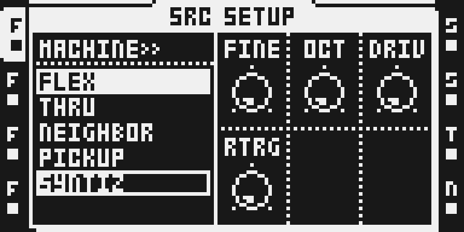
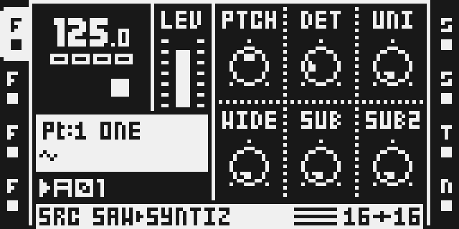
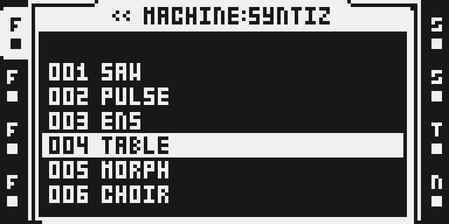

# SYNTIZ

Version: `0.1.0-experimental` · author: @stigmagit · beta, over USB only: it is a track machine of the Modwerk base's
machine chooser (`ot_machines`, [HOOKS.md](../../../machines/octatrack/HOOKS.md)).

## Overview

SYNTIZ is a synthesizer you choose for an audio track, as you would choose FLEX or STATIC. It has six models: stacked
and detuned saws, a pulse with width modulation, an ensemble of up to four notes, 32 single-cycle tables, a morph
between two tables, and a choir that plays chords on a table. Its sound goes through the track's own filter, AMP
envelope, LFOs and effects, like a sample's, and PTCH plays like FLEX's, so chromatic keys, scales and locks work as
you know them.

Choose SYNTIZ in the machine list, then tap the track key twice to pick a model. Every model has DRIV, a smooth
saturator, and RTRG, which restarts the oscillators on each trig; most add a square an octave down and a sine two
octaves down.

## Controls

The SRC page (A-F) changes with the model; SRC SETUP's A-D are the same in every model.

| | SRC A | B | C | D | E | F | SETUP A | B | C | D | E | F |
| --- | --- | --- | --- | --- | --- | --- | --- | --- | --- | --- | --- | --- |
| SAW | PTCH | DET | UNI | WIDE | SUB | SUB2 | FINE | OCT | DRIV | RTRG | | |
| PULSE | PTCH | PW | PWM | PWS | SUB | SUB2 | FINE | OCT | DRIV | RTRG | DET | UNI |
| ENS | PTCH | NOT2 | NOT3 | NOT4 | SHAP | CHOR | FINE | OCT | DRIV | RTRG | SUB | SUB2 |
| TABLE | PTCH | TABL | MORF | MSWP | SYNC | SUB | FINE | OCT | DRIV | RTRG | SUB2 | |
| MORPH | PTCH | WAV1 | MIX | WAV2 | WID | TIME | FINE | OCT | DRIV | RTRG | BIT1 | BIT2 |
| CHOIR | PTCH | NOT2 | NOT3 | NOT4 | TABL | CHOR | FINE | OCT | DRIV | RTRG | SUB | SUB2 |

- **PTCH**: the note, on FLEX's scale (an octave down to an octave up). **FINE**: ±64 cents. **OCT**: moves the two
  octaves you play from three octaves down to three up (C3 at PTCH 0 and OCT 0).
- **DET, UNI, WIDE** (SAW): the detune of the inner pair, its level, and an outer pair at twice the detune.
- **PW, PWM, PWS** (PULSE): pulse width, the depth and the speed of a triangle sweep of the width; **DET, UNI**: a
  detuned pair.
- **NOT2-4** (ENS, CHOIR): three more notes, -24 to +24 semitones, or OFF; **SHAP** (ENS): saw, square or narrow
  pulse; **CHOR**: the chorus.
- **TABL**: one of the 32 tables, its name on screen; **MORF**: a crossfade toward the next table, **MSWP** sweeping
  it by itself; **SYNC**: hard sync.
- **WAV1, MIX, WAV2** (MORPH): two tables and the mix between them; **WID**: WAV2 up to two octaves higher; **TIME**:
  the glide when a table changes; **BIT1, BIT2**: each table's resolution, 12 bits down to 1.
- **SUB**: a square an octave down; **SUB2**: a sine two octaves down (silent below 25 Hz). **DRIV**: drive into the
  saturator. **RTRG**: OFF lets the oscillators run free; ON restarts them on each trig.

OCT, NOT2-4 and other controls with fewer than 128 values move about one step every three or four encoder detents.

## Usage

SYNTIZ is a machine you assign to an audio track, then play and shape like any sample track. The tutorial below takes
you from the machine list to a first note; the models follow it.

### Quick tutorial: play a SYNTIZ track

1. Select an audio track, hold FUNC and press SRC: SRC SETUP's machine list opens. Go DOWN to SYNTIZ and press YES.
2. Tap the track key twice quickly: the model list opens, 001 SAW to 006 CHOIR. Pick one with the arrows and YES; LEFT goes back to the machine list.
3. Press SRC for the model's page and turn the encoders; FUNC + SRC again shows SETUP, where OCT moves the register and DRIV adds drive.
4. Place trigs or play the trig keys in chromatic mode: the track's filter, AMP envelope, LFOs and effects shape the sound as they would a sample's.

### The models

- **SAW**: a band-limited saw with an inner detuned pair and an outer pair at twice the detune, for wide leads and
  pads.
- **PULSE**: a pulse whose width can sweep by itself, with a detuned pair.
- **ENS**: up to four notes of one shape and a chorus: chords from one trig.
- **TABLE**: one of 32 single-cycle tables of the author's own, computed from formulas (geometric, additive,
  digital, resonant; VOWA to VOWI are vowel-like), read raw for their grain, with a crossfade to the next and hard
  sync.
- **MORPH**: two tables mixed, the second up to two octaves higher, each at its own bit depth.
- **CHOIR**: ENS with a table for the shape, VOWA at first.

## Compatibility and limitations

- OS 1.40C, MKII. The Modwerk base over USB, in a version that knows SYNTIZ: it keeps a SYNTIZ track's settings at
  power-on before the module reloads, and has room for eight machines in the chooser (POLY8, Analog BD, VECTOR and FM
  Synth fill four). Card firmware cannot include it.
- On a base that does not know SYNTIZ, do not switch the unit off with SYNTIZ tracks in the current project: the
  power-on restore would refuse the bank. Load a project without SYNTIZ tracks first.
- Chromatic keys, MIDI notes and recorded notes cover two octaves, as on FLEX; OCT moves those two octaves. OCT is a
  SETUP control, so it is set for the track, not per step.
- Before it starts a note, SYNTIZ asks the base which trigs a mute module drops (`ev_trig_muted`), so a muted trig
  starts no note. Not yet tried with a mute module.
- At most three SYNTIZ tracks in a Part: choosing SYNTIZ for a fourth track is refused, and that track stays what it
  was. On the author's MKII one render takes up to 37 % of a frame: three heavy tracks holding long notes make the
  base drop renders, a crackle, while two heavy tracks with filter and chorus play clean beside a THRU, three
  samples, a NEIGHBOR and a master compressor ([TESTING.md](TESTING.md)). A Part saved with more plays on as it was,
  and may crackle. Not yet tested on the MKI.
- If SYNTIZ crackles on a set that should fit, look at the other modules kept on the unit: on the author's MKII,
  another installed module that was never played made the SYNTIZ tracks crackle lightly and took a sample track's worth of margin;
  removing it cured both (7 November 2026, one A/B, cause unknown).
- Its levels differ by model: CHOIR on VOWA is lower than the others, as the shape itself is sparse.

## Tests and measurements

- **Host**: 5,376 extreme renders of the six models under UBSan/ASan with no report; levels, DC and aliasing; the
  pitch within 1.5 cents of stock's curve; every knob byte reaching its control; MORPH at MIX 0 and 127 equal to
  TABLE, sample for sample. `verify.py` runs them and rebuilds the package byte for byte.
- **ColdFire, under qemu**: instruction counts for a 16-sample frame, defaults / heavy, from 1,931 / 4,044 (SAW) to
  3,274 / 6,372 (ENS). Counts, not time on the unit.
- **Emulator**: the chooser, the six pages, the model list, LEFT and RIGHT, sequenced notes for every model, and
  SYNTIZ installed beside POLY8, Analog BD, VECTOR and FM Synth on the last chooser row.
- **The author's MKIIs**, 28 October to 7 November 2026, on private bases that know SYNTIZ: the six models over USB,
  reported as working well by the author and a friend who played it; projects saved with SYNTIZ tracks came back
  whole after power cycles. This package (`f501a6a4`) has been on his MKII since 31 October: a fourth SYNTIZ track
  is refused, and on 7 November the base's frame guard measured his live set (two SYNTIZ tracks with filter and
  chorus, a THRU, three samples, a NEIGHBOR with flanger, a master compressor) at 74 % of each frame against 36 %
  without SYNTIZ, about two renders a second dropped and nothing heard; with two samples, 69 % and none dropped.
  The figures come from the author's own development twin of his base, one run each, and a render after stock's
  trig work costs up to 2.4 times a first one, for a reason not found. Details: [TESTING.md](TESTING.md),
  [evidence/hardware.md](evidence/hardware.md), [evidence/performance.json](evidence/performance.json).

## Authorship and licences

Original module by @stigmagit, MIT ([LICENSE](LICENSE)). The 32 tables are the author's own, computed by
`tools/make_tables.py` from formulas; none is taken or fitted from any instrument. The model list is adapted from
Analog BD's engine browser (MIT), and LEFT follows VECTOR's pool choice (MIT); [INTEGRATION.md](INTEGRATION.md)
cites the stock RAM both read the same way. The saturator's anti-aliasing follows Parker, Zavalishin and Le Bivic
(DAFx 2016). No code, table or recording of any other product, no Elektron firmware, extracted routines or tables,
factory samples, memory dumps or built firmware images are included.

## Screens and audio

The captures are emulator LCD captures of this version ([capture provenance](media/capture.json)), not hardware or
audio evidence: [the machine list](media/ot-chooser.png), [the model list](media/ot-model-list.png),
[SAW's page](media/ot-saw-src.png) and [TABLE's page](media/ot-table-src.png). No audio preview.
