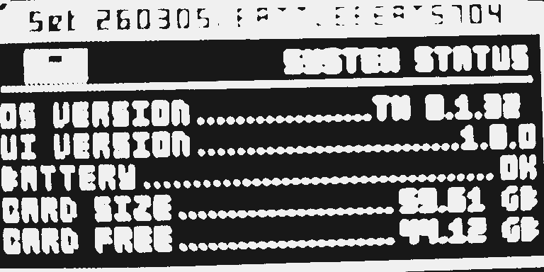
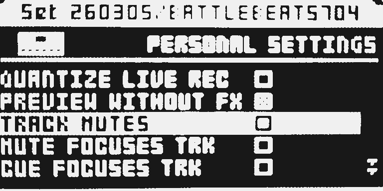
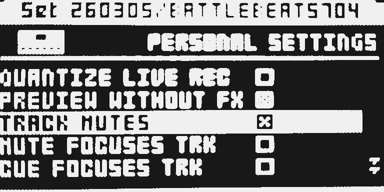

# Track Mutes

Version: `0.1.32-experimental` · author: [@jonathanwardle1992-beep](https://github.com/jonathanwardle1992-beep)

A global panel setting: **T1-T8 mute and unmute (several at once); FUNC + a track button selects that track for editing.** Tick it in PERSONALIZE. Default **empty** is stock (T selects, FUNC+T mutes), so installing the module changes nothing until you enable it.

**Experimental.** `0.1.32` card: FUNC+T AED waveform follows the selected track (reported, one tester). Stress of that follow is not verified. USB Keep/Undo and `ot_emu` are untested.

## Overview

On the stock OS, T1-T8 select the track for editing, and FUNC+T mutes or unmutes. With TRACK MUTES **ticked**, a press of T1-T8 mutes or unmutes that track on the **current** page (audio tracks, or MIDI tracks after MIDI) — including holding several T keys together — and FUNC+T1-T8 selects it so the knobs and pages edit that track. Audio mutes and MIDI mutes stay separate. CUE+T is unchanged.

No effect slot and no extra project bytes. The setting is PERSONALIZE (battery SRAM), not a Part or project field, so a saved project reloads unchanged on stock firmware.

## Controls

| Control | Default | Values |
|---|---|---|
| TRACK MUTES | empty box | Empty = stock T=select / FUNC+T=mute; ticked (X) = T=mute / FUNC+T=select |

No knob. In PERSONALIZE this is a stock checkbox: **only [YES] ticks or unticks**, like every other PERSONALIZE checkbox. Arrow keys must not change TRACK MUTES.

## Usage

Tick TRACK MUTES in PERSONALIZE when you want T1-T8 to mute and FUNC+T to select. Leave the box empty for stock T=select / FUNC+T=mute. The setting is global, not a Part or project field.

### Quick tutorial

1. Press [PROJ], open SYSTEM, then PERSONALIZE, and scroll to TRACK MUTES.
2. Press YES so the box shows X. Cursor up/down must not change it. Close the menu.
3. Press T1, or several T keys together: those tracks mute or unmute. Hold FUNC and press T3: track 3 is selected for editing. Hold FUNC and double-tap T3: browse and assign a sample on an audio track.

To restore stock T=select / FUNC+T=mute, clear the box, or leave the module out of the build.

### What changes in a stock flow

- **What changes and for whom.** While TRACK MUTES is ticked, T1-T8 mute instead of selecting, and FUNC+T selects instead of muting. Everyone with the module in the build can turn that off in PERSONALIZE.
- **Why.** Live mute on the track keys without holding FUNC. A new page would cost more presses than PERSONALIZE.
- **What you see and do differently.** With the box ticked, tap a track button to mute; hold several to mute them together; hold FUNC and tap to edit that track; hold FUNC and double-tap T to browse and assign a sample on an audio track. With the box empty, the keys behave as on stock.
- **Turning it off.** PERSONALIZE → TRACK MUTES → empty box, or omit the module. Empty is the default.
- **Neighbouring flows.** CUE+T is left to stock. Mute Modes, Play Start and Play Modes cannot be chosen together.

## Compatibility and limitations

- OS 1.40C. Hardware: on the `0.1.32` card, FUNC+T AED follow is reported as desired (one tester). Not verified; USB Keep/Undo and `ot_emu` untested.
- **Conflicts with Mute Modes** (`mute-modes`) **and Play Modes** (`playmodes`): PERSONALIZE tables / ANDY restore, and Play Modes also owns the TRACK key handler. Play Start occupies the same PERSONALIZE site but is still a draft, so it is named here until that module is listed. The configurator will not offer the listed pair together until a base-owned PERSONALIZE table exists (that would be a separate owner-reviewed change, not this module).
- CUE+T is not taken. Audio-page mutes and MIDI-page mutes are independent. Not tested: MKI panel, USB Keep/Undo, `ot_emu`.
- An OS upgrade resets PERSONALIZE, including this row.

## Tests and measurements

See [TESTING.md](TESTING.md) and [evidence/hardware.md](evidence/hardware.md). Same-unit cards of `0.1.0`–`0.1.31` failed as listed there. `0.1.32` is packed (ELEK `TM 0.1.32`) and has not been flashed. Static ColdFire size/cycle bounds are in TESTING; they are not chip wall-clock.

## Authorship and licences

jonathanwardle1992-beep: behaviour, ColdFire source, PERSONALIZE row and documentation. MIT, [LICENSE](LICENSE). No firmware, stock code, built image or card is included.

## Screens and audio

Hardware LCD photographs, 25 October 2026. SYSTEM STATUS shows the card stamp TM 0.1.32; PERSONALIZE is where TRACK MUTES is ticked. The module makes no sound of its own.

