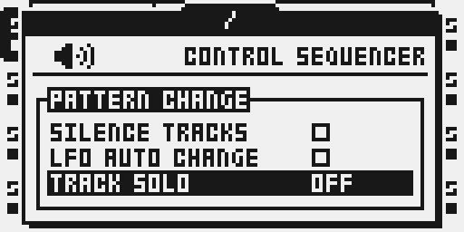
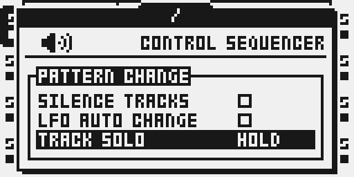

# Track Solo

Version `0.2.3-experimental` · author `twwwy`.

**Evidence:** package `1895ceec…` was tested by the author on a real Octatrack
over USB on 6 November 2026: the setting, the hold, join and leave, audio, lamps
and editing all worked, and the rollback was read back from the unit. That is a
functional report on Track Solo alone, not a stress or timing run. The control
and audio emulator suites passed on `0.2.3`; the wider emulator results are for
the `0.2.2` package, which differs in one detour site. See [TESTING.md](TESTING.md).

## Overview

Hold an audio TRACK button alone for 0.5 seconds to solo it temporarily. Keep
that original button held and tap other TRACK buttons to add or remove them.
Release the original button to end the entire operation.

Category: **system**. This is a compositional audition control for audio tracks, with no FX
slot, DSP engine, MIDI generator, parameter lock or scene parameter of its own.

## Controls

| Control | Behavior |
| --- | --- |
| PROJECT > CONTROL > SEQUENCER > TRACK SOLO | OFF / HOLD; OFF by default. This setting is session-only. |
| A TRACK button held alone | The original press passes to stock; temporary solo after 30 instrument UI ticks, approximately 0.5 seconds. |
| Another TRACK button pressed during solo | Toggle that track once. Its release does not toggle it. |
| Original TRACK button released | End solo, including every joined track; reveal the latest underlying mute/solo state. |
| Pages, SETUP, parameter encoders and MIXER navigation | Continue auditioning; keep actual parameter edits. |
| Mixer/quick mute, stock solo, MIDI and arranger mute/solo changes | Update underlying state without changing or canceling the temporary group. |
| TRACK lamp brightness | Normal in the temporary group; dim but visible outside it. MIXER indicators show underlying state. |
| PLAY, STOP and stock shortcuts | Use normal actions with the held anchor hidden from combinations. |
| PROJECT/save workflow, project load, MIDI editing mode | Cancel the audition; require release and a fresh hold before reactivation. |

The original track stays in the group. Further tracks can be released after
joining. They do not become new anchors. A repeat of a held key never toggles
membership. All eight audio-track buttons can join one operation.

## Usage

Track Solo contributes its setting through the existing shared
`ot_sequencer_rows` table. It uses no private PERSONALIZE table or settings file.
The proposed shared PERSONALIZE table is not a dependency.

### Quick tutorial: audition tracks while editing

1. Install Track Solo over USB. Open PROJECT > CONTROL > SEQUENCER, set TRACK SOLO to HOLD, close the menu, and let any stock notification clear.
2. Hold T2 alone for 0.5 seconds. While continuing to hold T2, press and release T3: T2 and T3 are now in the temporary group. Press T3 again to remove it.
3. Release T2. The underlying mute and solo state applies again. Select OFF to disable the gesture completely.

## Compatibility and limitations

- OS 1.40C. Functional hardware report on one unit recorded as MKII; MKI is
  untested. MIDI mode is excluded.
- OFF is the initial state on boot, installation and package replacement. The
  enable setting and temporary group are never saved in a Part or project.
- During each normal audio-frame interrupt, the live mute/solo word shows
  the temporary group. It is restored before the interrupt returns to tasks.
  The temporary word preserves cue bits; this code does not edit Part, pattern
  or battery-backed fields. Exact-package standalone and paired emulator
  save/reload each preserved 52 project files, exercised guarded project
  reload, and loaded the saved project on original stock firmware. These are
  emulator results; physical save, reload and reboot remain unqualified.
  A muted track can be auditioned; previous mutes and solos apply again on
  release. Each frame takes a fresh snapshot, so it does not restore a stale
  snapshot from the start of the hold. Emulator checks cover specific MIDI
  mute/solo/cue edits and an external chromatic-note case in all four Mute Modes;
  those older external-note results belong to the earlier packages listed in
  TESTING.md. Complete external-MIDI and hardware qualification remain pending.
- Short presses remain stock. Initial arming requires a lone TRACK hold. Once
  active, pages, knobs, ordinary editing popups, transport, scenes and same-project
  pattern/Part/bank navigation continue without canceling the audition.
- The anchor's stock shortcut layer is retired when solo activates. Held-key and
  held-row readers hide it while the physical matrix remains intact for release
  recovery. The later physical release is consumed, avoiding duplicate stock edges.
- Unmodified non-anchor TRACK presses toggle membership. Deliberate native
  modified TRACK operations pass through, including quick mute and cue. Joining
  does not select an editing track: release the anchor to select another track.
  Exact-package controls passed FUNC/CUE modifier-first and TRACK-first order
  comparisons against the no-module stock route. Other modifier combinations
  and physical-panel behavior remain unqualified.
- TRACK LEDs use native levels 15 (members) and 3 (excluded tracks), preserving
  native color channels where present. Otherwise dark tracks receive channel A.
  The transmitted row is filtered without modifying canonical on/blink bitmaps.
  The exact-package removal fixture restored all 16 captured stock LED levels
  before anchor release. Lamps were judged correct by eye on hardware.
- MIXER continues to show underlying state. Panel, MIDI and arranger mute/solo
  changes operate underneath the audition; release reveals their latest ordinary
  result. No state is inherited from the temporary group and no commands replay.
- Cue routing and recording retain native semantics. Recording MAIN can capture
  the audition; the temporary nature of solo does not undo recorded audio.
- PROJECT/save entry, project-load entry and MIDI mode cancel the audition. A
  canceled held anchor stays hidden until release, without automatic rearming.
- Earlier-package emulator comparisons covered Neighbor, Pickup recording/playback,
  Thru, Static, short one-shot/retrigger, recorder-buffer playback, normal/Studio
  cue routing and master groups. Each result stays with its package/base identity
  in TESTING.md. Exact-package controls also passed tested automatic
  Part/pattern/bank transitions. The later exact-package emulator runs passed
  Neighbor and Pickup playback and six T8 Master anchor/group cases; Pickup
  recording/source routing, active arranger rows and other routing cases remain
  open. With T8 configured as master, include it with the source tracks in the
  group; T8 alone has no source audio. This follows native solo routing.
  There is no custom chain or master processing; the stock level builder still
  runs.
- Track Solo does not select or replace a Mute Mode. With unchanged Mute Modes,
  OT should cut excluded tracks, OTFX/OTFX-T should retain FX tails, and DT-T
  should let already sounding voices finish while suppressing new trigs. A
  looping voice can therefore keep sounding in DT-T. In either -T mode, a
  stopped voice added to the group resumes at its next programmed trig; Track
  Solo does not create a new trig. Exact-package paired audio passed for OT,
  OTFX, OTFX-T and DT-T; the separate active-policy probe used synthetic mode
  writes. Physical behavior remains unqualified. Compatibility with any Track
  Mutes proposal needs a deliberate gesture review before publication.
- Native card settings and common-companion hardware runs remain open. Over USB
  it installs beside every active module (`npm run modules:compat`), but it has
  only run alone on hardware. Self-test, Keep, project save and power-cycle
  behavior are untested on hardware. Frame load and stress were not measured.

## Tests and measurements

See [TESTING.md](TESTING.md). Host, compiled-code emulator, panel, DSP audio and
hardware results are recorded separately. A package that links is not a release.

The hold uses the instrument's UI tick because it is a wall-time button gesture,
including while transport is stopped. It creates no musical clock and changes
no sequencer timing, tempo, track speed or swing.

## Authorship and licences

Original module source by **twwwy**, under [MIT](LICENSE). Generation, packaging,
fixture creation and emulation use the existing Modwerk/Octabam/Elekloader SDK
and their existing licences. Generated test tones contain no factory samples.
No firmware, stock instructions, extracted tables, projects, card images or raw
memory dumps are distributed with this module.

## Screens and audio

The two actual MKII emulator LCD captures document the enable row only. Their
capture metadata records module version `0.1.0-experimental`; this provenance is
preserved, and they are not presented as 0.2.2 captures or behavior evidence.
They do not establish hardware or audio qualification. A user-facing audio
example is pending.

Choose HOLD with YES, then close the menu before using the hold gesture.

The thumbnail is a conceptual diagram, not an instrument screenshot or measurement.

## Revised interaction contract

The 64 agreed interaction cases are copied into the module-local
[case matrix](INTERACTION_CASES.md), based on `docs/TRACK_SOLO_INTERACTION_SPEC.md`
from case-spec commit `cd1d8469`. The matrix updates the hold to 30 instrument
UI ticks (about 0.5 seconds) and separates host/source checks, historical
emulator evidence and current-package gaps. `ux_test.py` is the focused runtime
fixture; its scoped exact-package results and remaining gaps are recorded in
TESTING.md. Older prototype results do not qualify the revised input and LED
paths.

Mute Modes is optional. Changing its setting through PROJECT naturally cancels
the audition when PROJECT opens. A live processing-policy change outside that
workflow is read normally by Mute Modes; Track Solo does not watch its private
setting or add cross-module coordination.
