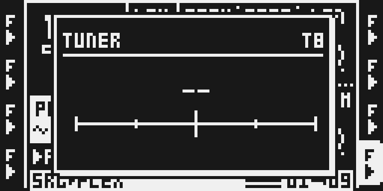
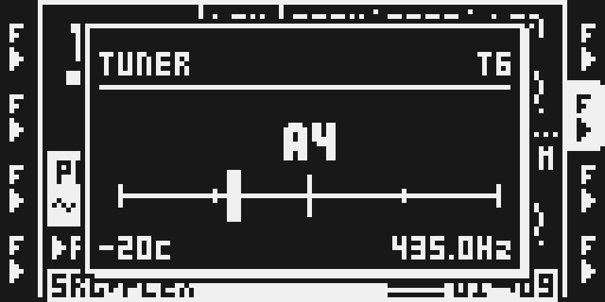
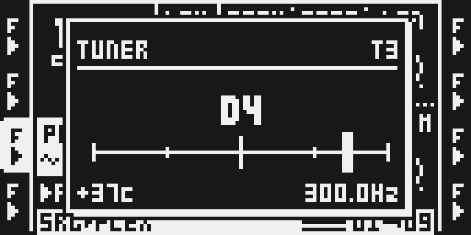
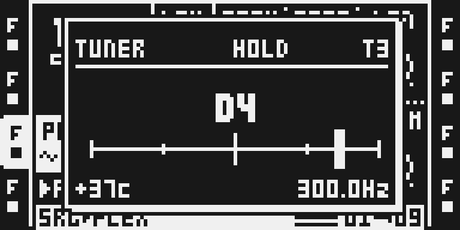
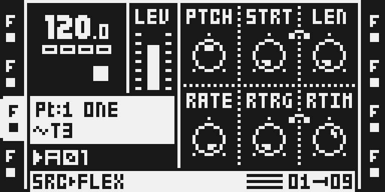

# Tuner

Version `0.1.0-experimental` · author [@timhastie](https://github.com/timhastie) · source [timhastie/octatrick-modules](https://github.com/timhastie/octatrick-modules/tree/v2.12/tuner), tag `v2.12` (`ca13ed85547790f788ceaaada5df3cdd31508441`)

## Overview

A guitar-tuner readout for the Octatrack's current audio track. Hold **UP** and press **TEMPO**: a window the size of the stock TEMPO window opens over the page and shows what the track is playing:

| where | shows |
|---|---|
| header | `TUNER`, `HOLD` while the last reading is being kept, the track (`T1`–`T8`) |
| centre, big | the note name and octave (`A4`; sharps as `#`, A4 = 440 Hz) |
| the scale | −50 to +50 cents with ticks at ±50, ±25 and 0, and a needle at the reading |
| bottom left | the cents as a signed number (`+21c`, `-20c`) |
| bottom right | the frequency to a tenth of a hertz (`1000.0Hz`) |

About seven readings a second. A fresh window shows `--` until the first reading; when the signal drops below −54 dBFS, or the detector is not confident (no clear pitch), the last reading stays and the header says `HOLD`. Close the window with **TEMPO**, **YES**, **NO** or **UP + TEMPO** again.

### What it listens to

The track's own audio after its effects and before its fader: the read-back the Octatrack's audio DMA writes for every track every 16-sample block, the same memory the stock delay reads. Left and right are summed to mono. Because it is before the fader, a track turned down, faded by the crossfader or under a low MAIN volume still tunes. What the track plays is up to you: a Flex or Static sample, a Pickup loop, or a Thru machine listening to an input (a guitar, a synth, a microphone), so you can tune an instrument through the Octatrack.

### How it works

- **The tap.** While the window is open, a few instructions at the end of the audio interrupt copy the current track's 16 frames of the block, `(L + R) / 2`, into a 4,096-sample ring (93 ms). While it is closed they only check that it is closed.
- **The detector.** Every 400 blocks (145 ms) the UI task, never the audio interrupt, takes the ring and finds its period: McLeod's normalised square difference on a copy decimated to 11,025 Hz (lags down to 30 Hz), the first strong peak, then the YIN difference at the full 44.1 kHz around it for the fine value. Integer arithmetic only. The period gives the frequency, the note, the octave and the cents (to the nearest cent).
- **The window.** It is a stock window of the TEMPO window's class with its own key layer, so the stock TEMPO window and the tuner replace each other, and a menu (the PROJECT menu, for example) closes it.

## Controls

The tuner has no knobs, settings or saved values. Everything is keys:

- **UP held, then TEMPO**: opens the tuner on the current audio track. The order matters: UP first, then TEMPO.
- **T1–T8** while it is open: the window follows the selected track (the header shows which). Page keys, track keys and the encoders reach the page underneath; UP and DOWN are kept by the window.
- **TEMPO, YES, NO, or UP + TEMPO** again: close it.

## Usage

Put something pitched on a track: a sample of one note, a synth line, or a Thru machine on an input with your instrument plugged in. Select the track, make it play, hold UP and press TEMPO. Play a single sustained note and tune until the needle sits in the middle and the number reads `0c`. Chords, drums and noisy or inharmonic sounds have no single period and give a wandering or held reading, as any tuner would.

### Quick tutorial: tune a track

1. Build a firmware with Tuner in the Modwerk configurator and install it. There is nothing to set up: the tuner is part of the firmware you built.
2. Select a track that plays one pitched note (a sample, or a Thru machine with your instrument on its input) and play it. Hold UP and press TEMPO: the tuner window opens over the page and shows -- until the first reading.
3. Read the note, the octave and the needle: a needle left of centre with -20c is 20 cents flat, right of centre is sharp. Tune the instrument, or change the sample's pitch, until the needle is in the middle and it reads 0c. Press another track key to tune that track instead.
4. Stop playing: the last reading stays with HOLD. Press TEMPO (or YES or NO) to close the window; the page underneath is back as it was.

## Compatibility and limitations

OS 1.40C only. MKI and MKII share the hook sites; the module has run on the emulator with the MKII panel. The same `tuner.s` has run on the author's MKI (UP + TEMPO opens the window and tunes; Octatrick test build 3.0 b40, 29 September 2026), and the author's MKI report for this exact image is in TESTING.md (2026-10-13); no MKII has run it.

- **One change to a stock gesture (minor).** With **UP held**, TEMPO opens the tuner instead of the stock TEMPO window. *Who:* everyone who presses UP and then TEMPO on a firmware with this module. *Why:* the tuner needs a way in that works over every page, mid-performance; a page or menu row of its own was considered and rejected because it would take the musician away from the page they are playing. *What a musician sees:* the tuner window instead of the TEMPO window for that chord only; TEMPO alone, FUNC + TEMPO (tap tempo) and UP alone are stock, and TEMPO pressed **first** still opens the TEMPO window with UP stepping its BPM, as on stock. *Off:* build without the module. *Checked:* TEMPO alone, FUNC + TEMPO, the chord on the stock image, closing by each key, a menu over the window (TESTING.md, Stock flows).
- **Nothing is saved.** No Part, project, card file or battery-RAM byte is written; the window starts closed after every start-up and project load. A project saved on a firmware with the module loads unchanged on one without it, and the other way round.
- **Sample memory.** Like every module with a DRAM unit it brings the shared platform reserve: about 10 MB of Flex sample RAM (sample pages 14,602 → 12,895). Beside other DRAM modules (FM Synth, for example) the reserve is shared, not added again.
- **Cost while open.** While the window is open the ColdFire runs a large analysis about seven times a second in the UI task (see Tests and measurements); the audio interrupt only gains a short copy loop. While it is closed the cost is a few instructions a block and a few per UI pass.
- **Accuracy.** To the nearest cent (a 12-bit ratio, 0.42 cents a step, so a reading can sit one cent off at a boundary); the frequency to a tenth of a hertz. One reading is one 93 ms window, with no averaging, so a noisy input moves more than on a tuner that averages. Lags reach down to about 30 Hz; the author saw no octave error on harmonic tones from 55 Hz to 2 kHz.
- **What it cannot tune.** Chords, drum loops and inharmonic sounds (an FM tone with a high index, for example) have no single period: the reading wanders or holds. A sound whose waveform repeats only every few cycles reads at that longer period.
- **The current audio track.** It tunes the track the UI has selected; in MIDI mode it keeps the last audio track.
- **Dependencies and conflicts.** None. The tuner hooks what it needs itself (the TEMPO key's opener, the end of the audio interrupt and the UI task's loop), reads the track read-back the stock firmware always writes, and needs no other module (not USB Audio either).

## Tests and measurements

All on the pinned ColdFire emulator with the image Modwerk's exporter builds from this folder alone (MAIN OS `66489376…`); emulator readings and instruction counts, never hardware times. Details, commands and the tables are in [TESTING.md](TESTING.md).

- **Readings.** Seven looping test tones on Flex tracks T1–T7 (T8 plays a silent sample), the window open while playing, every reading within 1 cent of the true value and the frequency within a tenth of a hertz: 440 Hz → `A4 +0c 440.0Hz`, 82.5 Hz → `E2 +2c 82.4Hz`, 300 Hz → `D4 +37c 300.0Hz`, 1000 Hz → `B5 +21c 1000.0Hz`, 110 Hz → `A2 -1c 109.9Hz`, 435 Hz → `A4 -20c 435.0Hz`, 1318.5 Hz → `E6 +0c 1318.5Hz`. A silent track and STOP keep the last reading with `HOLD`; a fresh window on silence shows `--`. In a 60 s run with the window open, T1 and then T2 read the same every 5 s.
- **Cost.** In the audio interrupt: 4 instructions a block with the window closed, exactly 195 with it open (the copy of 16 frames), on every block counted, against a stock interrupt of about 22,000 to 43,000 instructions in the same runs. In the UI task: 4 instructions a pass closed, 7 open, and with a pitched signal one analysis and redraw of about 1.0 M instructions every 145 ms (about 47,000 when the signal is below the gate). With the window open on a playing track the emulated ColdFire executed 6 % (eight tracks playing) to 11 % (one track) more instructions than with it closed; with it closed, the same as stock to within 0.01 %.
- **Memory.** A DRAM unit of 2,830 B of code and tables and 19,500 B of state, ring and analysis buffers (30,524 B with link alignment), 18 B of hook sites, a 2,241-byte appended loader and packed unit, the shared platform reserve; stack at most 172 B in the UI task and none in the interrupt.
- **Keys.** TEMPO alone opens the stock TEMPO window; FUNC + TEMPO is tap tempo; UP + TEMPO opens the tuner; TEMPO, YES, NO and UP + TEMPO each close it, on the MKII and the MKI panel; TEMPO held then UP opens the stock window and steps its BPM (120.0 → 120.1, as on the stock image); the PROJECT menu closes it.
- **Smoke.** `verify.py` (24 checks: the keys, the ring, `--` on silence, and with a generated tone project seven readings, HOLD and STOP) passes on this image ([evidence/native-smoke.json](evidence/native-smoke.json)).
- **Builds beside the others.** Native octabam and Modwerk's browser builder agree on all 130 selections of the coverage set (62 built, 68 refused for reasons between other modules); all 493,056 allowed selections with the tuner pass the native declaration checks.
- **Hardware.** The author's MKI report of this exact image (2026-10-13): see TESTING.md. The same `tuner.s` ran on his MKI in Octatrick test build 3.0 b40.

## Authorship and licences

Tim Hastie: Tuner (tuner.s, its manifest and README in [`upstream/tuner/`](upstream/tuner/), byte-identical to octatrick-modules v2.12 except the manifest's three stock spans, written as `stock_guard` fingerprints) and this Modwerk package, MIT ([LICENSE](LICENSE); [upstream/LICENSE](upstream/LICENSE) unchanged). Sam Banks: octabam, the build system these manifests are written for, whose USB AUDIO module documents the track read-back layout the tuner reads, MIT. Exact pins and per-file hashes: `sdk/imports/tuner-5f3d745.json`. No Elektron firmware, extracted routine or table is included; the three stock spans the module touches are address / length / SHA-256 guards read from your own OS file when you build.

## Screens and audio

Real LCD captures from the emulator ([media/capture.json](media/capture.json) records the image, emulator, panel plan and PNG hashes), MKII panel, a card with generated test tones. They show where the tuner is and what it looks like; they do not establish hardware behaviour. No audio: the module makes and changes none.

