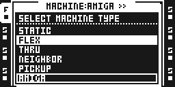
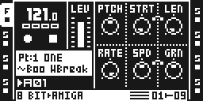
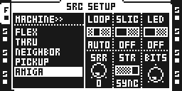

# Amiga

Version 0.2.1-experimental · by Jannik Aßfalg (@repeat98) · experimental: played and measured on one MKII on a development base; the list of what was not tried is in [TESTING.md](TESTING.md).

## Overview

Amiga is a track machine modelled on how a home computer's 8-bit sound chip and its tracker software played samples. It plays the track's Flex sample, reduces its word length and its storage rate before the Octatrack repitches it, and stretches it in cycles, as the samplers of that time did: every few milliseconds the sample restarts a little further on, while the last grain goes on under it and fades out over half a cycle, as Amigo's grains overlap. PTCH then changes the pitch and SPD the length, each without the other, with that metallic flutter. A sliced note stretches inside its slice.

RATE is stock's own: it plays the sample forwards, backwards and slower, and the stretch follows it both ways. The track's filter, AMP, LFOs and effects follow as for any sample.

## Controls

On the SRC page. PTCH, STRT, LEN and RATE (knobs A–D) are stock FLEX's.

| Knob | Control | Shows | Default | What it does |
| --- | --- | --- | --- | --- |
| D | RATE | −64 to +63 | +63 | Stock's RATE: speed and pitch together, backwards below 0. The stretch works on top of it in both directions. |
| E | SPD | 0–127 | 64 | How fast the note moves through the sample, whatever the pitch: 64 is its own speed, 32 half (twice as long), 127 about twice as fast, 0 holds the sound where it is. |
| F | GRN | 0–127 | 64 | The stretch's cycle: 96 samples (2 ms, a buzz) through 1120 at 64 (25 ms) to 4128 (94 ms, a stutter). Each restart crossfades over half of it. |

On SRC SETUP. LOOP and SLIC (knobs A and B) are stock FLEX's. With SLIC on, STRT picks the slice as on a FLEX track, and the stretch stays inside it.

| Knob | Control | Shows | Default | What it does |
| --- | --- | --- | --- | --- |
| C | LED | OFF, ON | OFF | A fixed lowpass (two poles, about 3.3 kHz at PTCH 0) on the stored sample. It moves with PTCH. |
| D | SRR | 0–127 | 0 | Storage rate: the sample is stored at 16/(16+SRR) of its rate, each stored sample the average of those it replaces, then held. 0 keeps every sample, 16 is half the rate, 127 about a ninth. |
| E | STR | OFF, ON, PCH | ON | The stretch. OFF plays as FLEX does: pitch changes the length, and SPD and GRN do nothing. PCH turns it into a pitch shift: the length stays and SPD moves the pitch instead, 32 an octave up, 127 an octave down, no further, and never past PTCH's own range. |
| F | BITS | 4–16 | 8 | Word length. 16 leaves the sample untouched. It moves one step every few detents. |

RATE, SPD and GRN take parameter locks, LFOs and scenes, as SRC knobs do. SPD and GRN act from the next cycle.

With STR on, SPD 64, PTCH 0 and RATE +63 nothing is restarted. With SRR 0, BITS 16 and LED off as well, the track hands the Octatrack exactly what FLEX does.

## Usage

1. Double-tap a track key (or open SRC SETUP), move to AMIGA in the machine list and press YES.
2. Double-tap the track key again and pick a sample from the Flex list, as for a Flex track.
3. Open SRC: knob D is RATE, E is SPD, F is GRN.

## Quick tutorial

1. Put a drum loop on an Amiga track and play it. At the defaults it is the loop at 8 bits.
2. Turn PTCH up a few semitones: the loop keeps its length and starts to flutter. Turn GRN for the size of the flutter.
3. Turn SPD down to 32 for half speed at the same pitch, or all the way to 0 to hold the sound where it is.
4. Turn RATE below 0: the loop runs backwards, still stretched.
5. On SRC SETUP, turn SRR up to about 20 for a grainy, folded top end, and switch LED on to take the edge off it.
6. Put a sliced loop on the track, switch SLIC on in SRC SETUP and trig slices with STRT locks: turn PTCH and each slice keeps its length, SPD and GRN stretch inside it.

## Compatibility and limitations

- No stock RTRG or RTIM on an Amiga track: SPD and GRN take their knobs.
- Stock's own time-stretch (TSTR) is off on an Amiga track, and SETUP's LEN switch is LED: the track always uses stock's default length setting, LEN OFF.
- SRR, LED, STR and BITS are SETUP values: one for the Part, without locks or LFOs.
- A sliced note is stretched when it is one slice, as stock plays it with LEN off. To move the reader, the module tells stock for that one START that the slice starts (backwards: ends) at the frame it wants, then puts the slice back. SRR, BITS and LED work either way.
- The cycle length is in samples, not tied to the tempo.
- The crossfade reads the last grain from the sample itself, where stock keeps it in memory, in pages as FRACT's Flex adapter found them. A recorder buffer that is recording, or a sample whose pages are not laid out as known, restarts with a short fade-out of the step instead; so does a restart that cuts a crossfade short, and a reader that turns round.
- A stretched note that is not looped ends when SPD has carried it to the end of the sample (its start, backwards), even if LEN would stop a FLEX note sooner by time.
- When RATE slows a stretched note, the place follows stock's RATE as a straight line from 0 to +63 (0 to −64 backwards). Where stock's own scale differs, the note's length is off by that much; at SPD 64 and PTCH 0 the place is the reader's own and nothing restarts.
- To start a backward reader at a frame of its choosing, the module tells stock for that one start that the sample ends there, then gives the sample and the note their own ends back. Stock starts a backward note at its end whatever STRT says, and this is the one way found to place it.
- **How many tracks:** measured on 0.1.0 on an MKII beside seven FLEX tracks playing loops, one Amiga track at the defaults added 5.5 points to the frame interrupt, an octave up 3.6 more, SRR 2.0 more and LED 2.7 more. Eight Amiga tracks at the defaults reached the base's frame guard, which then skipped 17 % of their renders (dropouts). This version measured 2 to 3 points dearer than 0.1.0 on the same unit (with T1 alone playing: 35.5 % against 33.3 % at the defaults, 40.6 % against 37.4 % at PTCH +12). The base's CPU budget takes three Amiga tracks a Part and refuses a fourth with CPU FULL; three at the defaults beside four busy tracks already ran the frame late. Installed modules leave less room still: beside fifteen other modules and three sounding FLEX tracks, one Amiga track (0.1.0) took 12.6 points at the defaults and 16 at PTCH +12, and FM Synth 0.1.2, installed on no track, took 14 more from the FLEX tracks alone. The figures are in [TESTING.md](TESTING.md).
- A project opened without the module plays Amiga tracks as FLEX and reads SPD and GRN as stock's RTRG and RTIM, and LED, SRR, STR and BITS as SETUP's LEN, RATE, TSTR and TSNS. Leave the tracks for FLEX before you go back to the stock OS.
- Leaving Amiga for another machine puts the track's SRC settings back to FLEX defaults.
- Before a trial of the module ends or the module is removed, put its tracks on another machine: the base refuses to take a machine away from a track that names it.
- USB only: it loads on the Modwerk base over USB and has no card build. It needs a base with `ot_machine_starts` (the START dispatch) and patches no stock code. It takes no key gesture and no stock screen.

## Tests and measurements

See [TESTING.md](TESTING.md). Worst-case cycles are not measured; [evidence/performance.json](evidence/performance.json) says what was measured in their place.

## Authorship and licences

Original code by Jannik Aßfalg, MIT ([LICENSE](LICENSE)). No firmware, stock routines or tables, samples or third-party code. The machine-list and sample-pool glue is the S950 draft's, by the same author. Where stock keeps a Flex sample's pages, and the checks before reading them, are as FRACT's Flex adapter found them (ex1010, MIT); the code that reads them is this module's own. Amigo, PotenzaDSP's plug-in, was the reference for the stretch's controls and its crossfade, compared as a black box ([reference/amigo_check.py](reference/amigo_check.py)); none of its code or data is used.

"Amiga" names the discontinued home computer whose sound this models. The module is not affiliated with or endorsed by the owners of that name.

## Screens and audio

Captured from the LCD of an MKII over USB on 11 November 2026; provenance and hashes are in [media/capture.json](media/capture.json).

The machine list: move to AMIGA and press YES.

SRC: RATE on knob D, SPD on E, GRN on F.

SRC SETUP: LED, SRR, STR and BITS.

## Develop

- Edit `amiga.c`, then `python3 -B generate.py` writes `amiga_core.s`, the unit the build links. `python3 -B verify.py` tests the engine on the host.
- `python3 -B reference/amigo_check.py <folder>` compares the stretch's crossfades with Amigo's, on a Mac where Amigo is installed (the steps are at its top).
- Hear it: `npm run module:dev -- amiga` builds it and tries it on your unit over USB.
- Check it: `npm run module:doctor -- amiga`.
