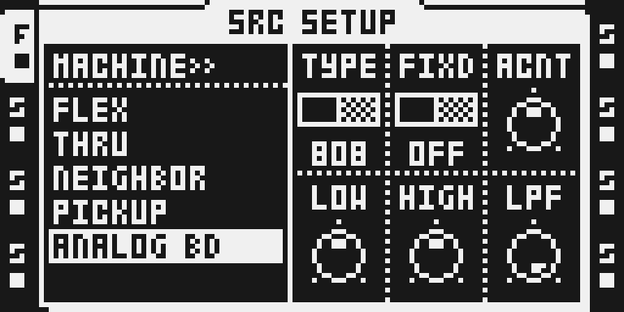
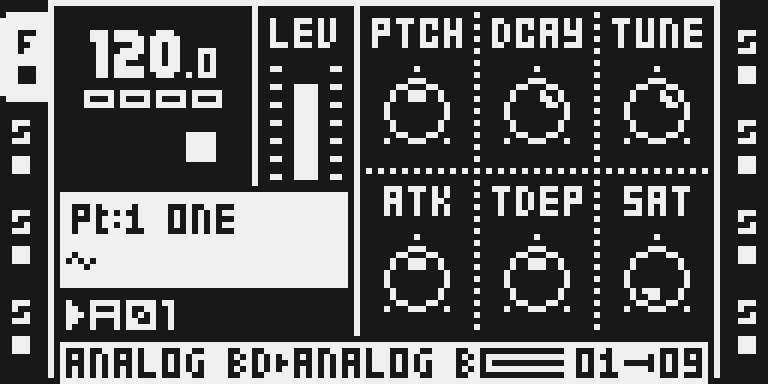
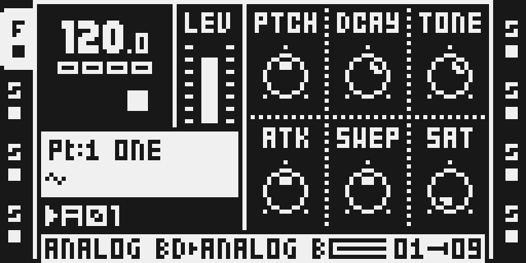

# Analog BD

Version `0.2.0-experimental` is a rewrite: Analog BD now synthesizes its 808 and 909 bassdrums on the Octatrack's ColdFire and uses no DSP at all, so it takes no DSP room and never causes DSP FULL. On the owner's MKII one Analog BD track adds 8.7 % to the longest frame and each further track about 4 %, against 0.1.7's 20.7 % and 8 to 12 % plus a DSP voice each ([Tests and measurements](#tests-and-measurements)). The 909 keeps 0.1.7's fit to Skee Mask's recorded TR-909 and adds the short rise every recorded hit shows before its main fall. **SAT, LOW, HIGH and LPF are gone**: use the track's own effects. 0.2.0 is a USB package for the Modwerk base; card firmware cannot include it.

## Overview

Analog BD is a track machine with two models, chosen with the TYPE switch:

- **909**, fitted to recordings of one TR-909 (Skee Mask's, from its direct out). Its body is read from the recorded cycle up to the 40th harmonic, whose shape above the fundamental follows the pitch sweep and the envelope. Each hit opens with the 2.25 ms rise the recordings show before the main fall (measured on 160 hits), then the body, its click just after it and the attack noise. While the sweep is fast the body reads band-limited copies of its cycle, so no harmonic folds back under 18 kHz.
- **808**, 0.1.7's model: a decaying, slightly bending body and a damped trigger transient through TONE's low-pass.

The 909's pitch-sweep depth (up to ±1.45 %, as measured between same-setting hits), its click strength, its lead-in level and its noise vary between consecutive hits unless FIXD is ON; the 808's trigger transient varies by up to 4 %. Timing is never randomised. Hits that follow each other quickly fade the last one out across the new one's lead-in, so they do not click. A track whose hit has died away rests and costs nothing.

The samples go through the track's own SRC page, AMP, LFOs and both effect slots like a sample's.

## Controls

All ranges are 0–127 except the two switches. The Part bytes are 0.1.7's: projects saved with 0.1.6 or 0.1.7 load with every value where it was.

| Control | Default | Behavior |
| --- | --- | --- |
| PTCH | 64 | Body pitch. 909: one octave, 32.7 Hz at 0, the recorded 909's 45.6 Hz at 64, 65.4 Hz at 127; the sweep follows the settled pitch. |
| DCAY | 80 | Body decay. 909: 15 ms at 0, the recording's 247 ms at 80, 600 ms at 127. The 808 keeps its own law. |
| TONE / TUNE | 80 | 808 transient tone; 909 pitch-envelope duration and excursion. |
| ATK | 64 | 808 trigger transient; 909 click, attack noise and lead-in. |
| SWEP / TDEP | 64 | 808 pitch bend; 909 pitch-envelope depth and the thump that comes with it. |
| TYPE | 808 | SRC SETUP top left: 808 (left) or 909 (right). A sounding hit finishes on its model; the next hit plays the new one. |
| FIXD | OFF | SRC SETUP top middle. OFF varies every hit slightly (above); ON makes every hit open identically. |
| ACNT | 64 | Accent, SRC SETUP top right: level and attack. The recordings are ACNT 72. Above about 95 a 909 can reach full scale and clips. |

SRC reads PTCH, DCAY, TUNE (TONE), ATK and TDEP (SWEP); SRC SETUP reads TYPE, FIXD and ACNT. **Projects saved with 0.1.x** keep their SAT, LOW, HIGH and LPF bytes, unread: a kick that used them, or a very loud accent (0.1.7's desk limited it softly), sounds different. A track set up with 0.1.5 holds its old LPF value in ACNT and its accent in FIXD's slot (FIXD then plays OFF): set ACNT and FIXD again.

## Usage

1. Select an audio track with its TRACK key. Hold FUNC and press SRC for SRC SETUP, go DOWN to ANALOG BD and press YES. (A double tap of the TRACK key opens the machine list too.)
2. Turn TYPE (top left) to the right for the 909. For the recorded 909, set PTCH 64, DCAY 80, TUNE 0, TDEP 64 and ACNT 72, then sweep ATK alone and TUNE alone to hear their ranges.
3. Put trigs on the track and press PLAY. Shape the sound further with the track's AMP and effects.
4. To leave Analog BD, pick another machine for the track: stock's FLEX defaults go back into its SRC bytes.

## Compatibility and limitations

- Needs the Modwerk base over USB, with machine rows (`ot_machines`). Card firmware cannot include it.
- Until its CPU price is measured the base charges each Analog BD track its default share, so a fourth Analog BD track in one Part is refused (CPU FULL).
- The supplied recordings cover one modified TR-909 at one decay setting; its intermediate knob positions are unknown. The match is close, not a 1:1 recreation of every setting or hit.
- Tested on one MKII: sound, picks on up to three tracks, retriggers, the cost curve and rollback. Not yet tested: MKI, project save/reload and a power cycle with Analog BD tracks, eight tracks beside heavy effects.
- The unit's module lists name the package `analog-bassdrum`; the machine chooser shows ANALOG BD.

0.1.x's DSP engines, their glue and their documents (`*.asm`, `control.*`, `machine.s`, `engine.*`, `dsp808.py`, `dsp909.py`, `manifest.py`, CPU.md, DSP808.md, DSP909.md, REVIEW.md, SCHEMATIC.md) stay in this folder unchanged: the base's build still makes 0.1.7's trust row from them, until a base without it ships. 0.2.0 is built from `drum.c`, `drum_machine.c` and `tables.h` alone.

## Tests and measurements

[TESTING.md](TESTING.md) has the record. On the owner's MKII (24 November 2026, a development twin of base 0.8.1): the cost curve read 8.7 % of the longest frame for one track, 12.7 % for two and 16.7 % for three (0.1.7 on the same scene: 20.7, 32.6 and 40.8 %, plus a DSP voice each), nothing installed but unused, and no render dropped. On the host the 909 matches the recordings, aligned at the main fall, within -19.5 to -24.7 dB over the first 25 ms (their own hit-to-hit spread is -22 to -31 dB) and the lead-in within -11 to -15 dB (0.1.7 had none: -2 to -5 dB); the 808 matches 0.1.7's at -50 to -55 dB.

## Authorship and licences

Original 808/909 engines, the 0.2.0 ColdFire rewrite and machine integration: repeat98 (Jannik Aßfalg). Composition infrastructure of 0.1.x: Sam Banks. Existing tooling/author notices and MIT terms remain in [LICENSE](LICENSE); the 0.1.x upstream import remains pinned to `sambanks/octabam` commit `363861e31ee963c478fab2b190a0fabe1d7ce37b`.

Many thanks to **Skee Mask**, who kindly recorded his TR-909 so we could match Analog BD more closely. The reference recordings remain private and are not distributed or covered by the source-code licence. The tables are computed by `tools/tables.ts` from parameters fitted to them (`fit909.json`) and from the mean of their 160 hits' 2.2 ms lead-in (`leadin.json`); no stretch of a recording is included. No firmware, extracted stock code or private project is included.

## Screens and audio

These are captures of the owner's MKII screen over USB (`png:`, a development twin, 0.2.0 in a trial). [Capture provenance](media/capture.json) records each image.

Select a track, hold FUNC and press SRC, move down to ANALOG BD and press YES. SRC SETUP reads TYPE, FIXD and ACNT.

Turn TYPE to the right for the 909 and press SRC for PTCH, DCAY, TUNE, ATK and TDEP.

Turn TYPE to the left for the 808: the third control is TONE and the fifth SWEP.

