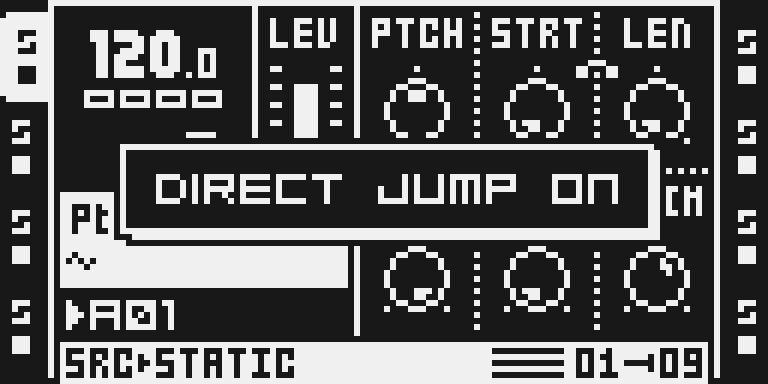
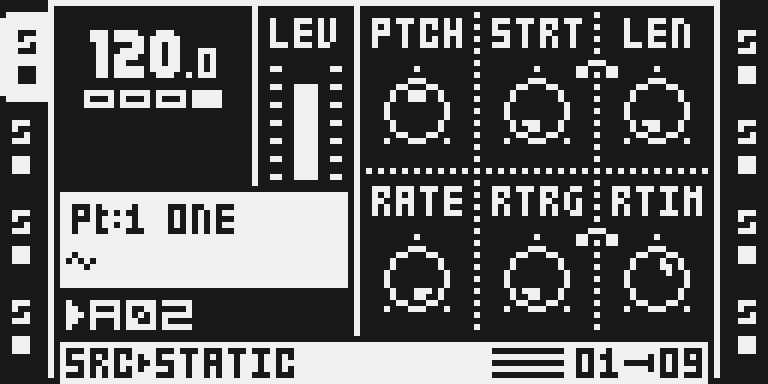
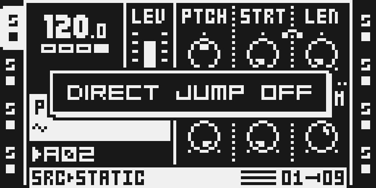

# Direct Jump Kyoti

## Overview

On the stock OS a cued pattern waits for the playing one to reach its end. With Direct Jump on, it takes over on the next step instead, locked to the master clock: it starts at the step it would be on had it been playing since you pressed PLAY, or since the last normal pattern change, whatever its length, scale or per-track settings. Trig conditions carry on as if the new pattern had played all along, each track gets its new Part settings with its own first trig, and with SILENCE TRACKS on the tracks a jump silences are released before the step instead of cut. The last MIDI Program Change sent names the pattern that plays. Direct Jump is off at every power-on, so the stock pattern change stays the default.

Version `0.2.0-experimental`, for OS 1.40C, over USB on the Modwerk base for beta testers, where the unit's module list shows it as DirectJmp Kyoti: a name there holds 15 characters, too few for Direct Jump Kyoti. This is Zac Kyoti's Direct Jump V7.3 from his repository (`octabam-modules/direct-jump-kyoti`, commit `cd788e9`), with his fix for stock's MIDI Plays-Free trig stall built in, as in his own Direct Jump builds. Modwerk runs his code unchanged: the unit is his bytes.

**What 0.2.0 changes.** Trig conditions carry on across a jump instead of starting again (his V7.0.2). A jump lands one tick before the step it starts on, so the new pattern's first step is never late (V7.1), and a cue made in the playing pattern's last step is no longer taken by stock's own pattern change (V7.1.1). Each track's own Part settings reach the engine with that track's first sounding trig of the new pattern (V7.2). With SILENCE TRACKS on, the tracks a jump silences are released with stock's note-off just before the step (V7.2.2). A jump counts from the last restart: after a normal pattern change (Direct Jump off, a chain or the arranger), the new pattern lands in phase with the one that started there, and its trig conditions count from there too (V7.3).

**Hardware status.** The author tested the timing, the Part change and the toggle on his MKI (27 September to 1 October 2026, his own builds), V7.2.2's changes on 15 November 2026 in his own builds of the same Direct Jump code: the SILENCE TRACKS pop gone in his standalone image, and in his combined KYOTI V1.8C image (beside his Clyps) landings at other lengths and scales, a cue in the last step, trig conditions across a jump and each track's Part with LFO AUTO CHANGE on; and V7.3 on 16 November 2026 in KYOTI V1.8C: after a normal change from a 16-step A01 to a 12-step A02, a jump to a 12-step A03 lands in phase with A02, 1:2 trigs stay in step, and a Clyps load after it stays in step. Those are not Modwerk builds. **This Modwerk version on a unit:** on 17 November 2026 the author flashed its native card image of this module alone (MAIN OS `a7074bfd…`, OS VERSION MW_DJK73B) on his MKI and all 13 items of his checklist passed: the toggle, OFF at power-on, a Part-changing jump, other lengths and scales, a last-step cue, trig conditions with FILL and PRE, a jump after a normal pattern change, LFO AUTO CHANGE, SILENCE TRACKS, a Plays Free MIDI track and Direct Jump off as stock ([evidence/hardware.md](evidence/hardware.md)). The USB package and an MKII have not run this version. Earlier versions: the 0.1.x USB package ran on the owner's MKII on 24 and 25 October 2026 (install, keep, power cycle, removal, and on a development twin the toggle and jumps between a 64- and a 16-step pattern).

## Controls

| Gesture | What it does |
|---|---|
| Hold [PTN], press [YES] | Turns Direct Jump on or off. A toast shows DIRECT JUMP ON or DIRECT JUMP OFF. Releasing [PTN] afterwards does not open the pattern chooser. |
| Hold [PTN], press a trig key, while playing | Cues that pattern, as on stock. With Direct Jump on it takes over on the next step. |

There is no menu row, page or knob, and nothing is saved: the setting lives in the module's own memory and is OFF after every power-on.

## Usage

Direct Jump changes only when a cued pattern takes over. Cue patterns the stock way, with [PTN] and a trig key; the toggle decides whether the cue waits for the end of the playing pattern (OFF, stock) or lands on the next step (ON).

### Quick tutorial: jump between patterns on the next step

1. Hold [PTN] and press [YES]: DIRECT JUMP ON appears. Release [PTN]; the pattern chooser stays shut.
2. Press [PLAY]. Hold [PTN] and press a trig key to cue that pattern: it takes over on the next step, at the step it would be on had it played since PLAY or the last normal pattern change.
3. Hold [PTN] and press [YES] again for DIRECT JUMP OFF: cued patterns wait for the end of the playing one again, as on the stock OS.

### Where the new pattern lands

The landing is clock-locked: the incoming pattern starts at the position it would hold had it been playing since the last restart, which is PLAY or the last normal pattern change (with Direct Jump off, by a chain or by the arranger). For two 16-step patterns that is simply the next step. A 7-step pattern lands on the step a 7-step loop would be on at that moment, so it stays in phase with a loop that had been running all along. After PLAY on a 16-step A01 and a normal change to a 12-step A02, a jump to a 12-step A03 lands on the step A02 is on, as if A03 had started where A02 did. In PER TRACK mode, with tracks of different scales, the jump waits for the next clock tick at which every track sits on a step boundary (at most one common step of all the scales involved, for example 24 clock ticks with 1x, 3/4x and 1/2x tracks), so every track starts exactly on its step.

A jump changes the Part if the new pattern uses another one, and START SILENT, as a stock pattern change does. Unlike a stock change:

- **Trig conditions carry on.** Every track's A:B count (1:2, 3:4 and the rest) stands where the new pattern's would had it played since that restart, so a 1:2 trig keeps alternating across the jump. A latched [FILL] stays latched, and a PRE trig right after the jump plays, as at the start of a pattern.
- **Each track gets its new Part settings with its own first trig.** The Part's pattern-wide settings change at the jump; with LFO AUTO CHANGE on (PROJECT > CONTROL > SEQUENCER), each track's LFO setup changes with that track's first trig of the new pattern, so a sample still ringing from the old pattern keeps its own LFOs. A track with no trig in the new pattern gets them at once; STOP, turning Direct Jump off or the next jump applies every track still waiting. With LFO AUTO CHANGE off, nothing waits.
- **No pop with SILENCE TRACKS.** The tracks a jump silences (SILENCE TRACKS, or START SILENT on the track) are released with stock's note-off, the same release STOP uses, a tick before the step, instead of being cut on it.

The jump lands one tick before the step it starts on, so the new pattern's first step sounds exactly where it should, and a cue made in the playing pattern's last step still lands on its grid point. Cueing again before the jump lands takes the newest cue; cueing back the playing pattern cancels, and a Program Change for the playing pattern is sent again so external gear follows. No MIDI START is sent on a jump.

While the arranger or a pattern chain runs, Direct Jump leaves pattern changes to stock.

### What changes in a stock flow

One stock gesture is touched:

- **What changes and for whom.** [PTN] + [YES] toggles Direct Jump, with a toast. On the stock OS [YES] does nothing in the [PTN] layer, and releasing [PTN] then opens the pattern chooser; with this module the chooser stays shut after the toggle. Everyone with the module in their build or module set has the gesture.
- **Why.** The toggle belongs next to the pattern keys it changes, and [YES] is free in the [PTN] layer on stock. A menu row would need a settings store Modwerk does not have yet.
- **What you see and do differently.** A toast on [PTN] + [YES]. [PTN] alone, [PTN] with trig keys, [YES] alone and the chooser after a plain [PTN] tap are unchanged.
- **Turning it off.** [PTN] + [YES] again, or a power cycle. Pattern changes are stock while it is off.
- **Neighbouring flows checked** (emulator, MKII panel, against the original OS): [YES] alone; [PTN] + [YES] and the chooser on release; a stock cued pattern change while OFF (identical sequencer state on every step); with LFO AUTO CHANGE off, the Part apply after a jump is stock. A stock change followed by a jump: the jump lands and counts as if the stock change had gone straight to its pattern. Not checked: the arranger, chains, MKI panel.

## Compatibility and limitations

- OS 1.40C. The author tested the clock-locked timing, the Part change, the toggle and 0.2.0's changes on his MKI in his own builds; Program Change on fast re-cues, MIDI tracks and START SILENT he verified in his emulator only. This version's native card image passed his 13-item checklist on his MKI (17 November 2026); it has not run on an MKII or as the USB package. The 0.1.x USB package ran on an MKII (the toggle, jumps, a power cycle, removal).
- OFF at every power-on and not stored in the project: turn it on again after a restart.
- While the arranger or a pattern chain runs, pattern changes stay stock.
- With differing track scales in PER TRACK mode the jump waits for the next tick where every track is on a step boundary (see above).
- With LFO AUTO CHANGE on, a track keeps the old Part's LFO setup until its first trig in the new pattern (see above).
- A jump changes the Part through stock's own Part-change path, so stock's known Part-change carryover issues (a track going from PICKUP to FLEX can keep the old Part's pickup loop; see the author's notes) happen on a jump as on a stock pattern change.
- With [Play Modes](../playmodes/README.md): each jump runs through the stock path that starts the transport, which Play Modes watches, so Play Modes restarts its per-track state on a jump as it does on PLAY. Not yet tested together.
- No conflicts are declared. The upstream module also refuses octabam's DIRECT JUMP (Tim Hastie's CHAIN AFTER option) and OCTAKIT, neither of which Modwerk has.

**The MIDI Plays-Free fix is built in.** Upstream, the module `requires` the author's BATCH_BUGFIXES bundle for its MIDI Plays-Free fix ([upstream/README.md](upstream/README.md), "Required: the bugfix bundle"). On stock, a Plays-Free MIDI track with trig quantize DIRECT under PER TRACK scale stalls after its first step when you start it with its trig key, because stock seeds that track's scale from the wrong byte. Direct Jump reads that same byte to place each track, so without the fix it would place such a track with the master's scale instead of its own. Modwerk modules never depend on another module, so from 0.1.1 Direct Jump carries the fix itself, as the author's standalone Direct Jump image does: his `patch_trigscale.s`, from the same pin. It fixes the stall too, whether Direct Jump is on or off. The source still reads any scale byte above 6 as the master's, as a backstop. The bundle's other two fixes are not included: the empty-pattern LED is unrelated to Direct Jump, and the Part-change carryover fix is the one the author measured as independent of it (the Part-change trace, Program Changes on fast re-cues and the whole timing matrix identical with and without it). Version 0.1.0 shipped without the Plays-Free fix.

Hook sites: the landing countdown read in phase D of the sequencer's tick handler at `0x400a1f72` and the MIDI START gate in its landing path at `0x400a221c` (both `jsr`, replaying what they displace), the [PTN] release at `0x40043418` (`jmp`), the light Part apply's LFO AUTO CHANGE test at `0x40009ebe` (`jsr`, new in 0.2.0: the one apply after a jump leaves each track's LFO setup to that track's first trig, every other apply is stock), stock's pattern switch calling its trig-condition reset at `0x400a4850` (`jsr`, new in 0.2.0 with V7.3: it makes that switch the jump's time origin, then runs the reset exactly as stock's call did; a jump never passes there), the [PTN] layer's YES press slot at `0x400bf0c0`, which is empty on stock, and, for the Plays-Free fix, the per-track scale seed of a track's manual start at `0x4009b6f2` (a `jmp` to the fix, which redoes the 18 stock bytes there for audio tracks and reads a MIDI track's own scale). No other catalogue module claims any of them.

## Tests and measurements

[TESTING.md](TESTING.md) has the commands and every result: the unit's bytes, the emulator gate (the toggle, OFF against the original OS, four jumps whose sequencer and trig-condition state equal reference runs, two jumps after a stock pattern change against runs that changed straight to the jump's pattern, each track's Part at its first trig, the SILENCE TRACKS release, and the MIDI Plays-Free stall on the original OS against the fix), the cycles and load, the USB package, and what was not tested. Emulator results say nothing about a real unit's timing or audio.

## Authorship and licences

Zac Kyoti designed Direct Jump and wrote its ColdFire source (MIT, [LICENSE](LICENSE)); Sam Banks integrated it into octabam (MIT, [upstream/OCTABAM_LICENSE](upstream/OCTABAM_LICENSE)). Thanks to Sebastien Michel (uvbproject) for investigating the port in [pull request #856](https://github.com/repeat98/modwerk/pull/856); nothing from it is in the module. The author's own description is kept in [upstream/README.md](upstream/README.md) and octabam's wrapper page in [upstream/OCTABAM_README.md](upstream/OCTABAM_README.md). `../../../imports/direct-jump-kyoti-cd788e9.json` records each copied file with its source pin (the 0.1.x import is `../../../imports/direct-jump-kyoti-b725fb1.json`): `upstream/README.md` and `LICENSE` are the author's files byte for byte; `patch_directjump_v7.s` is his V7.3 file unchanged; `patch_trigscale.s` is his MIDI Plays-Free fix from BATCH_BUGFIXES with its label renamed (marked MODWERK; no byte changes); `manifest.py` declares the same units and sites with SHA-256 guards in place of stock bytes. The Modwerk gate (`verify.py`), documentation and thumbnail are GPL-3.0-or-later. No firmware, stock code, built image or card is included.

## Screens and audio

Captured from the real LCD in the headless emulator, MKII panel, on this version's native image; provenance is in [media/capture.json](media/capture.json). They show the emulator, not a unit. The module makes no sound of its own, so there is no audio preview.

