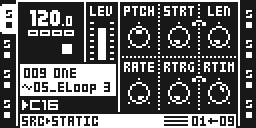
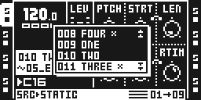
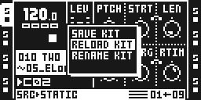

# Kits

255 Kits per project: each pattern plays its own.

## Overview

On a stock Octatrack each bank has four Parts, and a pattern can only play one of its own bank's four. Kits keeps a library of 255 Kits per project instead. A Kit is a saved Part with a name: machines, sample slots, effects, track and MIDI settings, LFOs and the LFO designer shapes, and the 16 scenes. Each pattern plays the Kit assigned to it, whatever its bank.

The stock Part engine still does the playing. Before a pattern plays, Kits copies its Kit into one of the bank's four Part slots that nothing is using and points the pattern at that slot. When all four hold unsaved edits, the edits of one are put aside in a pool and come back when its Kit plays again.

A Kit holds what a Part holds, and no more. Samples are referred to by slot number, so Kits belong to one project. The pattern keeps its trigs, locks, lengths and scale, and the project keeps its tempo, arrangements and recorders.

## Controls

| Keys | MKII | MKI |
|---|---|---|
| LOAD KIT | PART | FUNC+MIDI |
| SAVE KIT, RELOAD KIT, RENAME KIT | FUNC+PART (the Part Edit window: Kits' rows in PART's place) | FUNC+MIDI, then FUNC+BANK (SAVE KIT) |
| Reload the pattern's Kit as saved (KIT RELOADED) | FUNC+CUE | FUNC+CUE |
| After a pattern paste: the pasted pattern plays a copy of its Kit in the next empty Kit | PART while STOP is still held | FUNC+MIDI while STOP is still held |
| Save the Kit, copy it and the pattern to the next empty ones and play the copy | PTN+FUNC+RIGHT | PTN+FUNC+RIGHT |
| Copy, paste or clear another pattern of the current bank (paste or clear again: undo) | hold PTN, FUNC and its TRIG; REC, STOP or PLAY | the same |

In the LOAD KIT and SAVE KIT lists:

- UP, DOWN and the LEVEL encoder move the cursor.
- FUNC+REC copies the Kit under the cursor, FUNC+STOP pastes onto it, FUNC+PLAY clears it. The same paste or clear again on the same Kit undoes it.
- On the MKI, FUNC+BANK in LOAD KIT opens SAVE KIT; in SAVE KIT it closes the list, and in the name editor it cancels.

## Usage

- **LOAD KIT** lists UNDO KIT (the Kit the pattern had before the last load) and the 255 Kits: `NNN name`, a `*` after a Kit no pattern plays, `NNN ---` for an empty one. YES on a Kit: the current pattern plays it, at once.
- **SAVE KIT** opens on the current Part's Kit, or on the first empty Kit. YES opens the name editor (seven characters, `NEW KIT` for an empty Kit); confirming saves the current Part into that Kit and the pattern plays it.
- The two lists look alike: each shows its name for a moment when it opens.
- The status line shows the current pattern's Kit as `NNN name`, or `NNN ---` when it has none.
- Part Save and SAVE ALL also update the Kits in the slots they save. Copying and pasting a pattern carries its Kit.
- A project without Kits is migrated the first time Kits reads it: each of the 64 Parts becomes a Kit (bank × 4 + Part) and its patterns keep playing it. A project with Em's Octakit files (kits3a.work, kits3b.work) and no kits.work is imported from them; her files stay on the card.
- Kits are saved in kits.work in the project folder (written beside the bank files whenever a Kit or an assignment changed) and in kits.strd with SAVE PROJECT. RELOAD PROJECT brings back kits.strd. Which Kit each slot and each pattern holds also survives a power cycle.

### What changes in a stock flow

- PART opens LOAD KIT instead of stock's Part window. FUNC+PART (MKII) opens the base's Part Edit window with KITS in PART's place: SAVE KIT, RELOAD KIT (the pattern's Kit as saved, as FUNC+CUE) and RENAME KIT (the pattern's Kit's name, and the Part's while its slot holds that Kit). Stock's RENAME, RELOAD, SAVE and SAVE ALL act on the slot a Kit plays from, so they are left out while Kits is on. With another module's row there too, the window has two columns, KITS first under where PART was; with Kits' row alone it is drawn as stock's popup.
- FUNC+CUE reloads the pattern's Kit from the library even when stock would see no change.
- A pattern's Part byte is rewritten when its Kit is put into another slot. Removing Kits leaves each pattern playing the slot Kits last gave it.
- While the base lends Kits no sample memory, nothing of this happens: every key and screen is stock's.

## Quick tutorial

1. Install Kits into a project and press PART (MKI: FUNC+MIDI). The list shows the project's Parts as Kits 001 to 064.
2. Change a sound on the current track, press FUNC+PART and YES on SAVE KIT (MKI: FUNC+MIDI, then FUNC+BANK), move to an empty Kit, press YES, type a name and confirm: `KIT SAVED`, and the status line shows the new Kit.
3. Select another pattern, press PART, choose the Kit you saved and press YES: that pattern now plays it. Switch between the two patterns while playing; each plays its own Kit.

## Compatibility and limitations

- Kits starts working after Keep: while a Sync from the site is still a trial, the base keeps the sample memory and the project load for Kits until Keep.

- OS 1.40C on the Modwerk base with the sample-memory loan (`ot_sample_memory`), installed over USB. Card firmware cannot include it. This port has not run on a unit or in the emulator yet.
- Kits borrows 331 pages of sample memory (2,033,664 bytes) while it is installed: about 23 s less of 16-bit mono sample time (11.5 s of stereo). When the sample pool cannot spare them, Kits stays off and the unit behaves as stock.
- Needs Modwerk base 0.8 or newer (the Part Edit menu's record version that leaves PART out, `ot_part_menu`).
- While Kits is on, stock's Part Edit rows (RENAME, RELOAD, SAVE, SAVE ALL) are not in FUNC+PART: use SAVE KIT, RELOAD KIT and RENAME KIT. While Kits is off (no sample memory) its row is left out and the window is stock's.
- No quick save: octabam's FUNC+YES in SAVE KIT is not here, because Temp Save owns that key's handler and the base has no shared hook for it yet. Save with YES and the name editor. FUNC+YES in either list does what stock or Temp Save does elsewhere.
- A Kit carries no MIDI scene locks. MIDI Scenes keeps its locks with the Part slot, so they stay with the slot when a Kit is copied into it. A kits.work written by an octabam image with MIDI SCENES (version 2) is not read.
- A damaged kits.work, or one of another version, is never overwritten: that project then plays its Parts as stock and keeps no Kits. Rename or delete the file on the card to start over (octabam's prompt for this is not here).
- Keep Kits installed while you save, reload or copy a project that uses it: without it, kits.work is not saved or reloaded with the project. If you edit Parts without Kits and install it again, it reads the older kits.work.
- The first time Kits reads a project without kits.work, it writes one (1.6 MB), also when you install it into a running project.
- The arranger and pattern changes made from the sequencer's tick play the Kit already in the slot. PTN+FUNC+TRIG works on the current bank only, and its clear clears the audio tracks' trigs and locks, not the MIDI tracks'.
- Close the Kits lists and the name editor before you remove Kits.

## Tests and measurements

See [TESTING.md](TESTING.md).

## Authorship and licences

Em ([emuyia](https://github.com/emuyia)) designed Kits on the Octatrack in [Octakit](https://github.com/emuyia/ems-octakit) (MIT, Copyright (c) 2026 June Kiff): Kits per project, LOAD KIT and SAVE KIT on PART and FUNC+PART with its key map, the list copy, paste, clear and undo, the pattern clipboard carrying the Kit, the `NNN name` status line and the pool that keeps a slot's edits. bkkbrls-del ([bkkbrls-del](https://github.com/bkkbrls-del)) found and fixed the slot cases the edit pool and the unassigned-pattern rule cover. Sam Banks wrote this implementation in octabam (modules/kits, MIT); none of Octakit's code is in it. Modwerk ported it to the base's hooks (16 November 2026). See [LICENSE](LICENSE).

## Screens and audio

With Kits installed the status line names the pattern's Kit: here 009 ONE.

PART opens LOAD KIT with the project's Kits. YES on one makes the current pattern play it.

FUNC + PART opens the Part Edit window with SAVE KIT, RELOAD KIT and RENAME KIT in PART's place.

Captured on an MKII (media/capture.json). No audio: Kits changes what the Parts hold, not how they sound.
