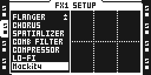
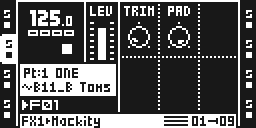

# Mackity

Version 0.1.0-experimental · Chris Johnson's Airwindows Mackity.

## Overview

Mackity is Airwindows' model of the input stage of a Mackie-style mixing desk.
The track's audio passes a gentle low cut (13 Hz), the desk's high-frequency
rolloff (19.16 kHz), the IN TRIM gain and the console's clip, rounded by its
curve (v − 0.1768 v⁵), then a second rolloff and a DC blocker (2 Hz). At TRIM 13
it adds only the desk's colour. Turning TRIM up drives the channel into the
clip, from warm thickening to hard, square distortion. PAD sets the output level.

This is upstream's whole algorithm, unchanged, in the Octatrack DSP's 24-bit
fixed point at its 44.1 kHz. It is a stereo insert with no buffer, so it runs
on FX1 or FX2 of any track.

## Controls

| Knob | Name | Range | Default | What it does |
|---|---|---|---|---|
| A | TRIM | 0–127 | 13 | In Trim: gain (TRIM/13)², the original's (10·A)² with A = TRIM/130. 13 is 0 dB, 26 is +12 dB, 52 is +24 dB, 127 is +39.6 dB, 0 is silence. |
| B | PAD | 0–127 | 127 | Out Pad: output level PAD/128. 127 is exactly 0 dB, 64 is −6 dB. |

Both knobs glide over about 1.5 ms, so turning them does not click. The
original's TRIM reaches +40 dB at its top; here it stops 0.4 dB short, so that
13 is exactly 0 dB.

## Usage

1. Select an audio track that plays something.
2. Hold FUNC and press FX1 (or FX2), highlight MACKITY with UP/DOWN and press YES.
3. Press FX1 (or FX2): knob A is TRIM, knob B is PAD.

## Quick tutorial

1. Put MACKITY on FX1 of a drum loop's track: hold FUNC, press FX1, turn LEVEL to Mackity and press YES. At TRIM 13 and PAD 127 the loop keeps its level and gains the desk's colour.
2. Turn TRIM to 40 on the FX1 page. The loop thickens and its peaks flatten into the clip; turn PAD to about 90 to bring the level back down.
3. Set TRIM 13 and PAD 127 to return to the clean desk, or select NONE in the FX1 chooser to remove it.

## Compatibility and limitations

- Tested on one MKII by the test procedure (TESTING.md); the MKI, a Part or
  project reload with it saved and a power cycle were not tested by hand.
- On a pattern that already fills the CPU, a pick can be refused with CPU FULL:
  on eight busy tracks it asked for 3 % more than was left.
- At high TRIM the clip makes harmonics above 22 kHz that fold back below it,
  as the original does at 44.1 kHz. That is part of its sound; it is not
  oversampled.
- With heavy drive the desk's second rolloff peaks up to about 0.6 dB over full
  scale. The original's float output keeps those peaks; a 24-bit output limits
  them. PAD 120 or lower keeps every peak.
- The value going into the trim is limited at +6 dBFS before the gain. Only
  input with a large DC step and a low TRIM can reach that.
- The original's 32-bit float dither and denormal noise are left out: the
  Octatrack's path is 24-bit fixed point.
- It shares nothing with other modules: no buffer, no bus, 32 words of the
  track's own state block.

## Tests and measurements

See [TESTING.md](TESTING.md). In short: `verify.py` matches the bit-exact model
in every case it renders, `test_reference.py` holds that model to the original,
and dsp_host reads 228 instructions a sample at worst (0.79 of stock LO-FI). On
the owner's MKII the test procedure passed, with a 2-minute soak: Mackity adds
0.1 % to the frame interrupt on one slot, nothing installed and unused, and
0.9 points to the longest frame per instance.

## Authorship and licences

Original: [Chris Johnson / Airwindows](https://www.airwindows.com/),
[Mackity source](https://github.com/airwindows/airwindows/tree/e718c9bcfcdd736deeddb08bffe6bce2aa8e0eea/plugins/LinuxVST/src/Mackity),
MIT. His source and licence are kept unchanged in [upstream/](upstream/); the
Octatrack adaptation is distributed under the same terms. See [LICENSE](LICENSE).

## Screens and audio

Two captures off the unit's LCD (provenance in media/capture.json). No audio preview yet.

## Develop

- Hear it: `npm run module:dev -- mackity` builds it and tries it on your unit over USB; `--watch` does that again on every save.
- Check it: `npm run module:doctor -- mackity`.
- `python3 -B sdk/octatrack/modules/mackity/test_reference.py` runs without tools;
  `verify.py` and `perf.py` beside it need dsp_asm, dsp_host and the
  disassembler from an octabam checkout (`npm run upstream:tools`).
- How the port works, in fixed point: the header of `mackity.asm`.
