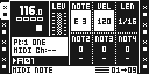
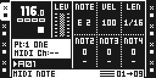

# MIDI Scenes

Scene locks for the Octatrack's eight MIDI tracks.

## Overview

Stock scenes lock audio tracks only: on a MIDI track, holding a scene key and turning a knob does nothing. MIDI Scenes gives the MIDI tracks the same scene locks. Hold SCENE A or SCENE B and turn a knob on the NOTE, LFO, ARP, CTRL 1 or CTRL 2 page, and the crossfader morphs that parameter between the two scenes and sends it as a CC. Each Part has its own MIDI locks, saved with the project and kept over a power cycle as stock keeps audio scene locks.

This is a new version of MIDI Scenes. The 0.2 versions stored their locks inside the Part, over the LFO designer's shapes; this one keeps them in a file of its own and converts projects saved with 0.2 the first time they load.

## Controls

MIDI Scenes adds no menu rows. It uses the stock scene gestures on MIDI tracks:

| Gesture on a MIDI track | What it does |
|---|---|
| Hold SCENE A or B, turn an encoder | Locks that parameter in the held scene; the knob shows the locked value |
| Hold SCENE A or B, press an encoder | Clears that parameter's lock in the held scene |
| Move the crossfader | Each locked parameter moves between scene A's and scene B's value; changed values go out as CCs |
| CLEAR, COPY, PASTE SCENE | Carry the MIDI locks with the audio ones |

A parameter without a lock on one side uses the Part's value, or the trig's lock when a trig plays. The lock LEDs and the scene pads light for MIDI locks as for audio ones.

## Usage

- Locks belong to the Part: switching patterns to another Part switches to that Part's locks, and the mix follows the Part that plays.
- Part Clear clears the Part's MIDI locks. Part Save and Part Reload leave them as they are.
- SAVE PROJECT saves them (scenes.strd beside the project's other files) and RELOAD PROJECT brings the saved ones back. A background save writes them to scenes.work.

### What changes in a stock flow

On a MIDI track, the scene-held encoder turn and press, the lock LEDs, the scene pads and the crossfader now act on MIDI locks; stock does nothing there. Audio tracks are unchanged. Nothing changes while MIDI Scenes is not installed, and removing it leaves the project's audio scenes as they are (its scenes.work stays on the card).

## Quick tutorial

1. Press MIDI and select a MIDI track with its TRACK key. Assign a scene to SCENE A and another to SCENE B: hold the scene key and press a TRIG key.
2. Hold SCENE B and turn encoder A on CTRL 1: the knob shows the locked value. Release the scene key.
3. Move the crossfader from A to B: CC 1 moves between the Part's value and the lock. To stop, hold SCENE B and press encoder A to clear the lock.

## Compatibility and limitations

- OS 1.40C on the Modwerk base 0.7.4 or newer, installed over USB. Card firmware cannot include it.
- Installed and run briefly on one MKII; the scene locks, the crossfader, saving and reloading are not yet tested on a unit.
- A damaged scenes.work, or one from a newer version, is never overwritten: that project then has no MIDI scene locks and keeps none. Rename or delete the file on the card to start over.
- Keep MIDI Scenes installed while you save, reload or copy a project that uses it: without it, scenes.work is not saved, reloaded or copied with the project.
- The power-cycle copy holds about 2,500 locks of the current bank. With more, unsaved locks since the last save are lost at a power cut.
- Up to 24 of a project's 64 Parts hold MIDI scene locks. A lock in a 25th Part is refused with LOCKS: 24 PARTS on the screen; clear a Part's locks to free its place.
- A project saved with more than 24 locked Parts loads the first 24 and shows LOCKS NOT LOADED at the next scene gesture. Its scenes.work is then never written over, so the card keeps every lock, and edits made meanwhile are not saved.
- It uses about 121 KB of the module memory all modules share (0.3.0 took 272 KB: a lock table for each of the 64 Parts).

## Tests and measurements

See [TESTING.md](TESTING.md).

## Authorship and licences

bkkbrls-del designed the behaviour in MIDISC ([midisc](https://github.com/bkkbrls-del/midisc), MIT). Sam Banks wrote this implementation in octabam (modules/midi-scenes, MIT); none of MIDISC's code is in it. Modwerk ported it to the base's hooks with Sam's permission (13 November 2026). See [LICENSE](LICENSE).

## Screens and audio

Hold SCENE B on a MIDI track and turn a knob: the page shows the held scene's locked values, highlighted.

Let go: the page shows the Part's values again, and the crossfader morphs between them and the locks.

Captured on an MKII (media/capture.json). No audio: MIDI Scenes sends MIDI only.
