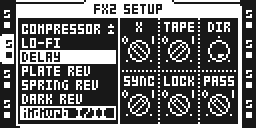
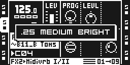
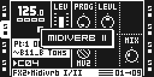
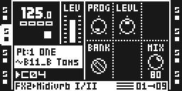

# Midiverb I/II

Version 0.1.0-experimental · the Alesis Midiverb (Keith Barr), from Eric Brombaugh's and thement's reverse engineering · an FX2 effect for the Octatrack MKI and MKII on the Modwerk base.

## Overview

The reverbs and effects of three late-1980s Alesis units on FX2: the Midiverb, the Midiverb II and the Midifex. Every program is the original's, played step for step at the original's arithmetic: the same delay lines, the same 12-bit input, the same 16-bit memory and rounding. That grain is part of the sound. 174 programs are in this release: 59 Midiverb, 56 Midiverb II and 59 Midifex.

## Controls

| Knob | Name | Range | Default | What it does |
| --- | --- | --- | --- | --- |
| A | PROG | 1-59 | 1 | The program in the current bank. Its name shows in a message box while you turn. Past the bank's last program it stays on the last one (Midiverb and Midifex have 59, Midiverb II 56). |
| B | LEVL | 0-127 | 64 | Input level into the 12-bit converter: unity at 32, 64 is +6 dB, 127 about +12 dB. Higher levels use more of the 12 bits and sound cleaner; too high and the reverb crunches. |
| D | BANK | MV1, MV2, FEX | MV1 | Midiverb, Midiverb II or Midifex programs. The bank's name shows while you turn. |
| F | MIX | 0-127 | 40 | Dry and wet: 0 is exactly dry, 127 wet only. |

The four controls are ordinary FX2 knobs, so parameter locks, LFOs and scenes reach them as any effect's (exercised in the DSP stress run; not tried on the unit). A new program fades the reverb out, clears its memory and starts from silence, in under a tenth of a second; the dry signal keeps playing at its MIX level meanwhile.

## Usage

1. Select a track and press **FX2**, then **FUNC + FX2** for FX2 SETUP.
2. Turn **LEVEL** to MIDIVRB I/II (the chooser's 12 letters) and press **YES**, then press **FX2** for the main page.
3. Turn **A** for the program and **D** for the bank.

**STOP, STOP, STOP** cuts the reverb's tail, as it does for the Octatrack's own reverbs; the reverb plays again from the track's next trig.

## Quick tutorial

1. Load a drum loop on track 1, press FX2, then FUNC + FX2, scroll to MIDIVRB I/II with LEVEL, press YES, then FX2: the page shows PROG, LEVL, BANK and MIX.
2. Play the pattern and turn A slowly: the message box names each program, from short bright rooms to 20-second halls. Turn D to MV2 for the Midiverb II's programs, or FEX for the Midifex's.
3. Turn F (MIX) up to hear more of the reverb. Turn it to 0, or press STOP three times, to get the dry loop back.

## Compatibility and limitations

- FX2 only, on the Modwerk base 0.8.1 or later. Each instance takes 15,870 words of its track's 16K FX2 buffer, so it cannot share a core's FX2 memory with Analog BD.
- It patches one stock site of its own, where the Octatrack finishes each frame's parameters (0x4000d568). Euclid's patch ends there and returns into it, so both install together.
- It takes the knob's value store while the FX2 page shows, only to name the program or bank; every value is stored as stock stores it.
- DSP time: at most 398 instructions a sample in the DSP emulator, about 1.26 times stock SPRING REV at its worst (314). The 31 original programs that need more are not in this release, nor the Midiverb II's chorus and flange programs.
- Not like the original: it runs at 22.05 kHz instead of about 23.4 kHz, so reverb times and delays are about 6 % longer; the original's analog filters and noise are not modelled; some long delays are up to 4.5 % shorter to fit the memory; the input is the average of left and right.
- With Scale Quantizer or FM Synth installed the program and bank names do not show, and on base 0.8.1 slow PROG and BANK turns right after a pick need an FX2 re-entry: those modules take the knob store first.
- Known issue on base 0.8.1: after picking it in FX2 SETUP the first NO only closes the memory box; press FX2 for its page instead. Base 0.8.2 fixes it. (Otherwise PROG and BANK turn from the first detent on either base: Midiverb stages them itself.)

## Tests and measurements

See [TESTING.md](TESTING.md): the program table against a model of the original machine, the engine against the table in the DSP emulator, and the runs on the owner's Octatrack MKII.

## Authorship and licences

This module plays other people's work:

- **Alesis and Keith Barr** made the Midiverb (1986), the Midiverb II and the Midifex, and wrote every program in them. `generate.mjs` reads the programs from the original ROMs, which are not in this repository, into `stream.h`, `stream.s` and `programs.json`. They are not covered by the MIT licence; the repository owner allowed their inclusion for this module on 25 November 2026.
- **Eric Brombaugh** reverse-engineered the Midiverb's DSP: its schematic, microcode and how it computes ([emeb/MIDIVerb_RE](https://github.com/emeb/MIDIVerb_RE), MIT). The program model in `generate.mjs` and the engine follow his description of the machine.
- **thement** decompiled the Midiverb, Midiverb II and Midifex programs and documented the ROM layout ([thement/midiverb_emulator](https://github.com/thement/midiverb_emulator), GPL-3.0). The extractor reads the ROMs in that layout; it was written for this module and copies none of that code.

The extractor, the DSP engine and the ColdFire streaming code are under the MIT licence in [LICENSE](LICENSE). Not affiliated with or endorsed by Alesis or Elektron.

## Screens and audio

Real captures of the Octatrack MKII's LCD, read over USB on the release build (media/capture.json).

Select an audio track, hold FUNC and press FX2. Turn LEVEL down the list to MIDIVRB I/II and press YES to put it on FX2.

Press FX2 for its page: PROG (A) picks the program, LEVL (B) drives the input, BANK (D) switches between Midiverb, Midiverb II and Midifex, MIX (F) sets dry and wet.

Turn PROG: a message box names each program as you go, here .25 MEDIUM BRIGHT. Try the long halls near the end of the Midiverb bank, or the gated and reverse programs.

Turn BANK to MV2 for the Midiverb II's programs or FEX for the Midifex's; the message box names the bank.

Turn MIX up to hear more of the reverb: 0 is exactly dry, 127 wet only. STOP, STOP, STOP cuts the tail.

No audio preview yet.

## Develop

- Hear it: `npm run module:dev -- midiverb` builds it and tries it on your unit over USB; `--watch` does that again on every save.
- Programs: `node generate.mjs --mv1 … --mv2 … --fex …` with your own ROM files proves them against the original machine; `--write` writes `stream.h` and `programs.json`, `--stream` writes `stream.s`.
- Engine: `python3 verify.py` runs it in `dsp_host`, bit for bit against a model of the table.
