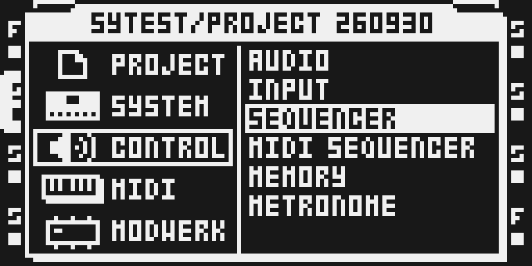
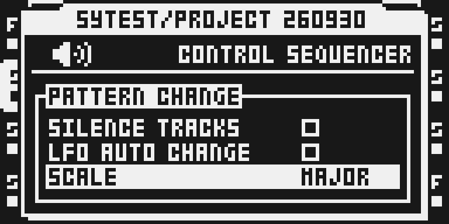
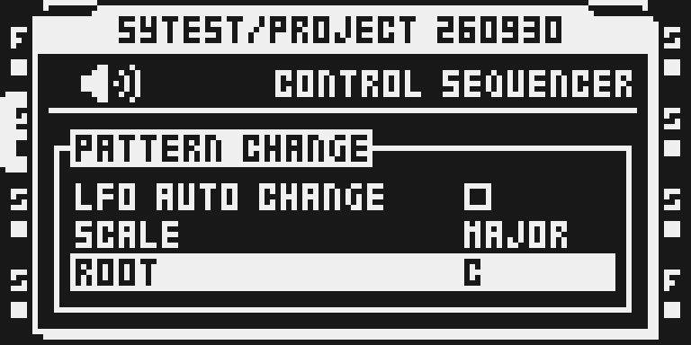
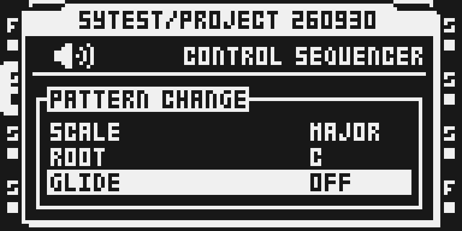
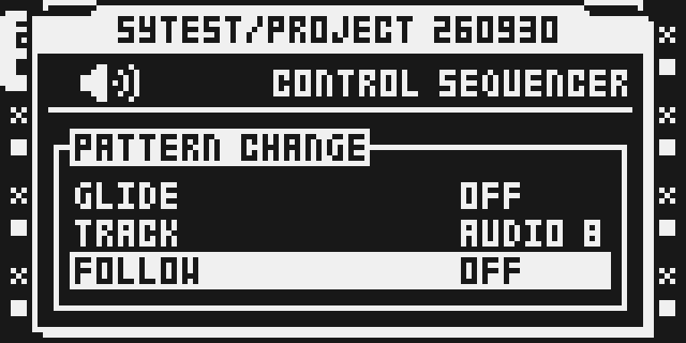
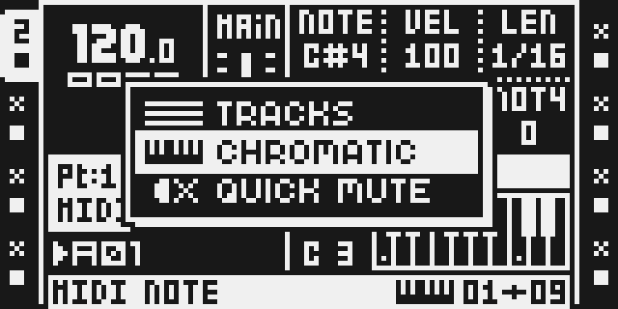

# Scale Quantizer

Version: `0.1.5-experimental`, for Octatrack OS 1.40C.

## Overview

Scale Quantizer adds SCALE, ROOT, GLIDE, TRACK and FOLLOW to
PROJECT > CONTROL > SEQUENCER. Pitch edits, parameter locks and chromatic trig
keys follow the selected scale and root, and so does what the tracks play:
recorded notes follow a scale change. Version 0.1.5 keeps the MIDI tracks, per-track switches and scale-following playback
introduced in 0.1.4 ([#439](https://github.com/repeat98/modwerk/issues/439)). It leaves
out two panel hooks so the separately planned FM Synth update can install beside it. The per-track
switches are two rows, TRACK and FOLLOW, so the module's five rows fit the
base's SEQUENCER table on the card and over USB alike.

## Controls

- **SCALE:** OFF or one of 24 scales. OFF restores stock pitch behavior.
- **ROOT:** C–B. Transposes the selected scale and the chromatic keyboard;
  ignored with SCALE OFF.
- **GLIDE:** OFF or 1–127. Slide time depends on the track's LEG setting.
  Synth-specific glide and polyphony require the separate FM Synth module.
- **TRACK:** AUDIO 1..8, then MIDI 1..8. Picks the track FOLLOW shows and
  changes no sound. It is not a setting: it starts at AUDIO 1 at power-on and is
  not saved with the project.
- **FOLLOW:** ON (default) or OFF for the track TRACK shows; turning TRACK
  shows the newly picked track's value at once. OFF keeps that track stock in
  every path: on an audio track PTCH, locks, chromatic keys and what it plays;
  on a MIDI track the NOTE knob, NOTE locks, chromatic keys and what it plays.
  Each track's FOLLOW is saved with the project (the same `#` lines and
  battery-RAM bits as the 2.19-2.21 per-track rows, so their projects load the
  same).

## Usage

On a Flex, Static or Pickup track, PTCH steps through scale degrees, and
parameter locks and chromatic trig keys use the same root-rotated scale. When a
pattern plays, a Static or Flex track's pitch (its PTCH lock or the Part's
value) is snapped to the scale as the trig is played, so notes recorded before a
scale change play in the new scale. On a MIDI track the NOTE knob, NOTE locks
and chromatic keys step through the scale from ROOT, and the notes the track
sends (NOTE, the chord notes, TRAN and the arpeggiator) are snapped to the
nearest scale note. The settings are project settings kept in battery RAM and
saved in the project as `#` lines, which a stock unit skips.

### Quick tutorial: choose a scale

1. Open PROJECT > CONTROL > SEQUENCER and scroll to SCALE. Turn LEVEL to select MAJOR; OFF restores stock pitch behavior.
2. Scroll to ROOT and turn LEVEL to choose C. ROOT transposes the selected scale and the audio chromatic keyboard.
3. Close the project menu, select a Flex or Static audio track with a sample assigned, and turn PTCH or play the chromatic trig keys. Notes follow the selected scale; recorded notes play in it too.
4. Back in SEQUENCER, set TRACK to AUDIO 1 (or MIDI 1) and FOLLOW to OFF: that track plays unquantized while the others follow the scale.

## Compatibility and limitations

The module adds ColdFire control hooks and no continuous DSP audio engine. RATE
is not a semitone control.

FM Synth carries its own copy of this quantizer. Released FM Synth 0.1.2 to 0.1.4
still declare a conflict with Scale Quantizer, so do not force that pair into an
installation. Scale Quantizer 0.1.5 leaves out the two panel hooks that FM Synth's
copy needs. A later FM Synth release is planned to drop the conflict in its own update
([#1146](https://github.com/repeat98/modwerk/issues/1146)). This module's own
`conflicts` list remains empty.

On the Modwerk USB base, shared quantizer sites use base events and the
SEQUENCER rows use the base's table. This version has seven guarded stock-code
sites, down from nine. The module contributes five rows (SCALE, ROOT, GLIDE,
TRACK and FOLLOW), as on the card build.

The author's MKI reports of 30 October and 1 November 2026 concern 0.1.4's
card image. They are historical evidence, not a hardware result for 0.1.5.
Current emulator checks and their limitations are in [TESTING.md](TESTING.md).
Chip timing, complete memory bounds and hardware qualification remain unmeasured
for this update. Emulator sample-pitch measurements are relative; they do not
establish fidelity to the original source WAV.

## Tests and measurements

[TESTING.md](TESTING.md) records the source and package checks, current-main USB
installation/removal, native UI, audio/MIDI FOLLOW, SAVE/power-cycle and explicit
project-reload observations. It retains failed and invalid fixture attempts with
their explanations, and the older 0.1.4 hardware reports without upgrading their
scope. No chip-cycle measurement or complete release qualification is claimed.

## Authorship and licences

Tim Hastie authored Scale Quantizer in
[timhastie/octatrick-modules](https://github.com/timhastie/octatrick-modules),
pinned here to his release tag `v2.23`, `e908beb0f2c1fce3cf8b1de5178d7cb77b00d7fb`, whose
`quantizer/` is vendored byte for byte (0.1.4 pinned `8f6f564a9c42636ed4c5cc6ad314ee6b7ce69e5c`,
his 2.21 quantizer plus the TRACK / FOLLOW rows, released with Octatrick 2.22), with the hook comments
in words and every guard read through `stock_guard`. Sam Banks
provided the Octabam wrapper up to 0.1.3. Vendored source remains MIT licensed
with its original notices in [LICENSE](LICENSE) and
[upstream/LICENSE](upstream/LICENSE). Nothing inside `upstream/` is edited.

Original framebuffer captures use
[LicenseRef-OT-UI-Documentation](media/LICENSE.md). Underlying Elektron interface
rights remain reserved. No firmware or extracted stock image is distributed.

## Screens and audio

These actual 0.1.5 emulator LCD exports use stopped transport and a disposable
synthetic project with the module installed over USB. They document the interface;
no stopped image proves audio or hardware behavior. [Capture provenance](media/capture.json)
separates the base and module-package hashes and records the two session setups.
The retained exports were visually reviewed, but renderer completion was not traced;
no complete-frame pixel-equivalence claim is made. The [0.1.4 record](media/0.1.4/capture.json)
and its original images remain unchanged. No audio preview is supplied.

Press PROJ on the MKII panel, choose CONTROL and select SEQUENCER. Press YES to open the scale settings; on an MKI, open the project menu with FUNC+MIXER.

Scroll DOWN to SCALE and turn LEVEL to choose MAJOR. Choose OFF to restore stock pitch behavior.

Scroll to ROOT and turn LEVEL to choose the key. C is shown here with MAJOR selected; ROOT is ignored while SCALE is OFF.

Scroll to GLIDE and turn LEVEL to set its amount; OFF is shown here. Its effect depends on the track’s LEG setting, and synth-specific glide needs the separate FM Synth module.

Use TRACK to choose AUDIO 8, then select FOLLOW and turn LEVEL left for OFF. That track keeps its original pitch while other enabled tracks follow the scale; turn LEVEL right for ON.

### More screenshots

Press MIDI to select a MIDI track, then hold FUNC and press DOWN to open the trig-mode popup. Select CHROMATIC with UP/DOWN and release FUNC to use the trig keys as a keyboard.
