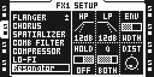
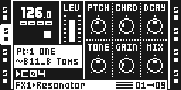
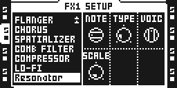

# Resonator

Version 0.1.0-experimental · by [Jannik Aßfalg](https://github.com/repeat98) · a draft, tried on one unit.

## Overview

Eight tuned partials, shared by one to four voices, ring with the track's own audio. Each voice is a body (a pure mode, a string, a tube, a bar, a plate, a drum or a bell) at a chord note, a note in a key, or a frequency of Aleksi Perälä's Colundi sequence. Lock PTCH or CHRD on trigs and the sequencer plays the resonator.

## Controls

| Page | A | B | C | D | E | F |
|---|---|---|---|---|---|---|
| Main | PTCH (DEG) | CHRD | DCAY | TONE | GAIN | MIX |
| Setup | COLUN | TYPE | VOIC | SCALE | | |

- **PTCH** 0–127, default 57: the root. A MIDI note (69 = A at 440 Hz), or with COLUN set to COLUN a Colundi degree (78 = 440 Hz, 79 = 441 Hz); the panel names it DEG.
- **TYPE** default STRNG: every voice's body. PURE (one mode), STRNG (harmonics 1–8), TUBE (odd harmonics, a closed pipe), BAR (a struck beam), PLATE, DRUM (a membrane), BELL (hum, prime, tierce, quint and up).
- **CHRD** default MAJ: the other voices' notes. OCT, 5TH, SUS2, SUS4, MAJ, MIN, MAJ7, MIN7, DOM7, DIM, AUG, ADD9, 5THS, 4THS.
- **DCAY** 0–127, default 64: the ring to -60 dB, 25 ms at 0, about 0.5 s at 64, 10 s at 127. Each voice's higher partials ring a little shorter, as on a real string or bar.
- **GAIN** 0–127, default 32: the ring's level, in proportion (GAIN/32): 0 silences it, 32 is 0 dB, 64 +6 dB, 127 +12 dB. At 32 the ring on steady noise sits about 4 dB under the dry at any DCAY (three voices). Loud rings soft-clip at -3.5 dBFS: drum hits near full scale reach it at short DCAY even at 32.
- **MIX** 0–127, default 64: at constant power. 0 is exact passthrough, 127 is only the ring. The dry falls as (1 - MIX/128)^2, -12 dB at 64 and -26 dB at 100, and the ring rises so the two keep their power (the ring -0.3 dB at 64). A loud dry and a loud ring in phase can add past full scale.
- **COLUN** NOTE / COLUN, default NOTE: the switch shows its setting. At COLUN, PTCH becomes a Colundi degree and every voice snaps to the nearest of the 128 Colundi frequencies. A voice's body keeps its own overtones.
- **VOIC** 1–4, default 3: how many voices share the eight partials. One voice has all eight, two voices four each, three voices 3, 3 and 2, four voices two each. One voice plays the root only.
- **TONE** default centre: filters what excites the partials. Left: a low-pass from 20 kHz down to 150 Hz, so only the low partials ring. Right: a high-pass from 20 Hz up to 3 kHz, so only the high ones ring.
- **SCALE** OFF, or a key and scale (CMAJ … BPMI: MAJ, MIN, DOR, PHR, LYD, MIX, HMI, MMI, PMA, PMI): the root and chord notes snap to the key, so chords turn diatonic. COLUN ignores it.

Voice 1 sits in the centre; with more voices their upper partials spread left and right. The input is summed to mono.

## Usage

1. Select an audio track that plays a sample.
2. Hold **FUNC** and press **FX1** (or **FX2**). Turn **LEVEL** to RESONATOR and press **YES**.
3. Press **FX1** for the main page; hold **FUNC** and press **FX1** for the setup page.

## Quick tutorial

1. Put RESONATOR on FX1 of a drum loop: hold FUNC, press FX1, turn LEVEL to RESONATOR and press YES. The defaults ring a major triad of string voices on A under every hit.
2. Press FX1 for the main page. Turn DCAY for a longer ring and MIX to bring the ring in; TONE darkens or brightens what sets it off.
3. Hold FUNC and press FX1 for the setup page: turn TYPE to BELL or BAR for metal, DRUM for skins, VOIC for more or fewer voices, SCALE to keep chords in a key.
4. Lock CHRD on a few trigs for chord changes, or turn the NOTE switch to COLUN and lock PTCH (now DEG) on trigs: each hit rings at its own Colundi frequency.

## Compatibility and limitations

- A buffer-free insert: FX1 or FX2 on any track, several at once. It patches no stock code and claims no keys or screens.
- A pitch, chord or type change settles within eight DSP blocks (2.9 ms): one partial retunes per block.
- A sustained tone on a partial's pitch with long DCAY and high GAIN soft-clips; lower GAIN or DCAY for a clean ring.
- Pitches assume 44.1 kHz.

## Tests and measurements

On the owner's Octatrack MKII (24 November 2026), the test procedure passed twice: the scripted pass with eight instances at once, a soak, Part switches, and the cost on the unit, which is 0.2 % of a frame (the work runs on the DSP). In the DSP emulator it runs at 0.79 of stock SPRING REV's worst case. Details, the edge cases and what was not tested: [TESTING.md](TESTING.md).

## Screens and audio

Hardware captures from the owner's unit; no audio preview yet.

## Authorship and licences

Original code by Jannik Aßfalg under the MIT licence in LICENSE. The partial ratios are textbook acoustics (a string's harmonics, a free beam's and a circular membrane's modes, a supported plate's, a church bell's partials). The Colundi sequence, 128 absolute frequencies from 10.8 Hz to 12 kHz, is Aleksi Perälä's ([colundi.net](http://colundi.net/data.php)); the values follow tubbutec's full Scala file of it, rounded back to the published 0.01 Hz. Used with the owner's permission recorded on 23 November 2026. The COLUNDI draft ([#2047](https://github.com/repeat98/modwerk/pull/2047)) measured the first one-mode resonator and its tail-silence failure, which shaped this design.

## How it works

Each partial is a coupled-form resonator: a rotation by its pitch's angle, scaled by the decay radius, so its pitch is exactly the rotation's angle and a locked pitch or decay jumps without a transient. The state is kept in double precision (a rounded 24-bit word and its signed remainder), so even a ten-second ring decays to digital silence. Partial m belongs to voice m mod VOIC as its partial m div VOIC. Once per block one partial is retuned: its voice's note (root plus chord offset, snapped into the key or to the nearest Colundi frequency by ratio), times TYPE's ratio; sine and cosine come from a Taylor kernel. The table is short (634 words): a note's pitch is its top-octave twin's, kept in 48 bits and shifted down by octaves, which gives exactly the 24-bit pitch; decay, input gain and TONE interpolate between every fourth knob value (T60 within 0.7 %, TONE's corner within 1.7 %). TONE, like the tuning, is set once per block, so the call before a trig keeps the last block's. The input gain follows (1 - r)^0.45, cut by up to 2 dB below DCAY 32: a ring's level on noise goes as the gain over the square root of (1 - r), so the ring on noise stays about 4 dB under the dry at every DCAY. Not level with it: a hit's ring goes as the gain alone, and a ring as loud as a full-scale dry would drive hot hits through the soft clip, whose ceiling (2/3 full scale) is below the dry's; short rings follow hits closest, hence the cut. The soft clip catches the rest. The mix is at constant power: the dry's gain (1 - MIX/128)^2, the ring's the square root of one minus its square, from a table between every fourth value (MIX 1-3 up to 0.14 dB under constant power, from 4 within 0.03 dB).

## Develop

- Check it: `python3 sdk/octatrack/modules/resonator/verify.py` (the render gate) and `npm run module:doctor -- resonator`.
- Hear it: `npm run module:dev -- resonator --cycles 256 --cycles-kind executed --state 89` builds it and tries it on your unit over USB.
- The tables come from `tables.py`; the DSP is `resonator.asm`. Read the traps in sdk/octabam/AGENTS.md before changing it.
