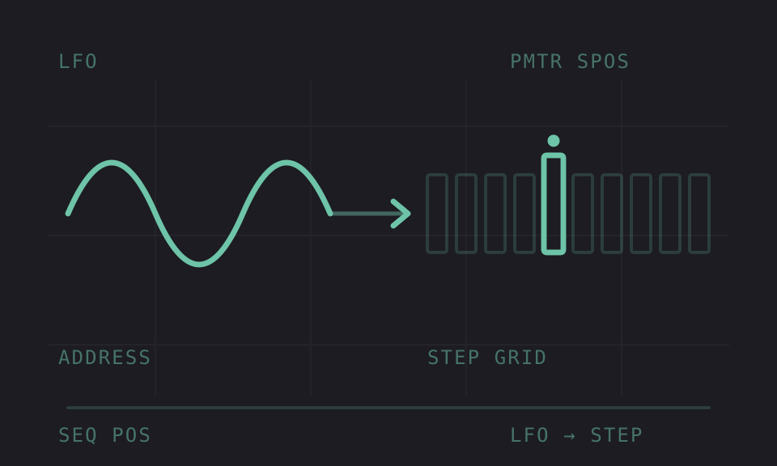
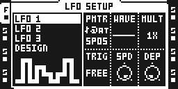
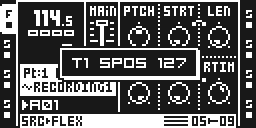
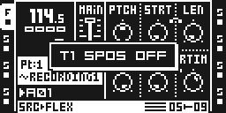

# Seq Pos

USB packages contribute `ot_lfo_pmtr_dest` (MOP-48) and drop base-owned count/formatter/beq alone-sink sites. Dest lea dropped (MOP-61); base owns `0x4000d042` (`mw_lfo_pmtr_dest`).

Version: `0.1.0-experimental` · author: [@jonathanwardle1992-beep](https://github.com/jonathanwardle1992-beep)

Exposes sequencer position as an LFO **PMTR** destination, **SPOS**, so any
audio-track LFO can address which step plays. ColdFire only (no DSP, no
effect slot). Original OS 1.40C.

**Experimental.** Catalog-listed under `sdk/octabam/modules/seq-pos/`
(MOP-248). Keep-safe Undo coexist WAV is **USB-audibleProven**
([#130](https://github.com/jonathanwardle1992-beep/modwerk/pull/130) /
mop157 — onset Δ −254; peaks near-null; remapper Detour-on-twin ≠
tip-matched base remapper). Publication cites
`tests.qualification` **Placed** mop197 — cycles + functional + memory
tip-wired **944** / mop202; mop195 **908** / mop192 **372** lineage + toast Proven mop196;
dual-install **words-move Proven** mop184;
measured/load/stress cycles **Filled (emulator)** mop178/179/181;
inventory+remapper Proven mop167; SETUP PMTR=SPOS label Proven mop172;
FUNC+TRACK toast USB **Proven** mop196; Play Modes Detours → runtime
**Proven** mop188 tip + mop189 USB (0.1.1 `.mwrm` still Detours /
`lagsBehind`); jump-colour **Unproven/waived** (mop243 owner waive — not
Proven; mop219 SLICE/STRT S0≈S15 `slice-strt-mute-isolation` Open fixture
retained; mop223 protocol **consumed**; mop216 `shared-Flex-attr-lock`;
mop211 S0≈S15 abort C/D; mop203 `sp_len=16` + toast bound / C≈D; mop209
SAMPLE/PTCH tip; mop201 `sp_len=0`; mop199 C≈D; mop200 tip dig stall;
mop227/mop242 decision path cited); Keep Accept inventory/card-save
**PASS** + reboot persistence **PASS** (mop245 / mop247; mop244 protocol).
Catalog **PINNED** (MOP-248; cite Keep mop245/247 + jump-colour
Unproven/waived mop243 + qual place mop197) —
[mop248](evidence/catalog-pin-mop248-2026-11-25.md). Address-mode
playhead A/B dens **Open** (mop258/259; mop269 reopen null with
`sp_ui_shown` PASS mop268). mop260 parked dens as a **0.1.x firmware
gap**; [mop270](evidence/dens-ab-fixture-tip-mop270-2026-11-26.md) tip
reopens dens only via **asymmetric silent-end** fixture (TRIG1-only /
empty 2–16) — mop258-class both-ends-loud cannot separate dens B vs C.
Latch-only ratchet fallback only after verified dens null. Dens USB
(mop271) still **pending**. Stock PLAYHEAD marches by design; judge
remapped UI via `sp_ui_shown` / toast. Full LFO ratchet/reverse/stage tip
dig **blocked** until dens PASS or that fallback — tip-gate matrix
[mop275](evidence/peer-lfo-ratchet-tip-gates-mop275-2026-11-26.md). Do
**not** invent dens PASS, jump-colour, playhead-motion, or ratchet
Proven.
Checklist:
[MOP-113 / MOP-162 / MOP-244](../../../docs/OCTATRACK_LFO_PMTR_EXTENSION.md#catalog-gate-checklist-mop-113);
tip strengthen
[MOP-166](../../../docs/OCTATRACK_LFO_PMTR_EXTENSION.md#spos-tip-strengthen-mop157-honesty-and-dual-install-mop-166);
qualification fill path
[MOP-168](../../../docs/OCTATRACK_LFO_PMTR_EXTENSION.md#spos-qualification-stub-fill-path-mop-168);
qualification fill recipe
[MOP-176](../../../docs/OCTATRACK_LFO_PMTR_EXTENSION.md#spos-qualification-stub-fill-recipe-mop-176);
qualification stub fill
[MOP-186](../../../docs/OCTATRACK_LFO_PMTR_EXTENSION.md#spos-qualification-stub-fill-mop-186);
qualification owner fill
[MOP-191](../../../docs/OCTATRACK_LFO_PMTR_EXTENSION.md#spos-qualification-owner-fill-mop-191);
measured memory
[MOP-192](../../../docs/OCTATRACK_LFO_PMTR_EXTENSION.md#spos-qualification-memory-mop-192);
hub sync after memory
[MOP-193](../../../docs/OCTATRACK_LFO_PMTR_EXTENSION.md#spos-publishability-gates-after-memory-measure-mop-193);
toast tip wire
[MOP-195](../../../docs/OCTATRACK_LFO_PMTR_EXTENSION.md#spos-toast-tip-wire-mop-195);
toast USB Proven
[MOP-196](../../../docs/OCTATRACK_LFO_PMTR_EXTENSION.md#spos-functrack-toast-usb-prove-mop-196);
`tests.qualification` place
[MOP-197](../../../docs/OCTATRACK_LFO_PMTR_EXTENSION.md#spos-tests-qualification-place-mop-197);
hub sync after qualification place
[MOP-198](../../../docs/OCTATRACK_LFO_PMTR_EXTENSION.md#spos-publishability-gates-after-qualification-place-mop-198);
words dig (tip remapper afterStore live / words frozen `0x4000`)
[MOP-169](evidence/usb-words-dig-mop169-2026-11-24.md);
cycles recipe
[MOP-170](../../../docs/OCTATRACK_LFO_PMTR_EXTENSION.md#spos-coldfire-cycles-performance-plan-mop-170);
SETUP provenance
[MOP-171](../../../docs/OCTATRACK_LFO_PMTR_EXTENSION.md#spos-setup-pmtr-monochrome-capturejson-plan-mop-171);
SETUP hardware capture
[MOP-172](../../../docs/OCTATRACK_LFO_PMTR_EXTENSION.md#spos-setup-pmtr-hardware-capture-mop-172);
hub sync
[MOP-174](../../../docs/OCTATRACK_LFO_PMTR_EXTENSION.md#spos-publishability-gates-after-setup-capture-mop-174);
after toast/qual
[MOP-177](../../../docs/OCTATRACK_LFO_PMTR_EXTENSION.md#spos-publishability-gates-after-toast-miss-and-qual-recipe-mop-177);
after cycles static
[MOP-180](../../../docs/OCTATRACK_LFO_PMTR_EXTENSION.md#spos-publishability-gates-after-cycles-static-mop-180);
prior [MOP-182](../../../docs/OCTATRACK_LFO_PMTR_EXTENSION.md#spos-publishability-gates-after-cycles-measured-mop-182);
[MOP-183](../../../docs/OCTATRACK_LFO_PMTR_EXTENSION.md#spos-play-modes-detours-runtime-mop-183);
[MOP-186](../../../docs/OCTATRACK_LFO_PMTR_EXTENSION.md#spos-qualification-stub-fill-mop-186);
[MOP-187](../../../docs/OCTATRACK_LFO_PMTR_EXTENSION.md#spos-publishability-gates-after-toast-reprobe-miss-and-qual-stub-mop-187);
[MOP-188](../../../docs/OCTATRACK_LFO_PMTR_EXTENSION.md#spos-play-modes-detours-runtime-mop-188);
[MOP-189](../../../docs/OCTATRACK_LFO_PMTR_EXTENSION.md#spos-play-modes-021-dual-install-usb-mop-189);
[MOP-190](../../../docs/OCTATRACK_LFO_PMTR_EXTENSION.md#spos-publishability-gates-after-playmodes-prove-mop-190);
[MOP-191](../../../docs/OCTATRACK_LFO_PMTR_EXTENSION.md#spos-qualification-owner-fill-mop-191);
[MOP-192](../../../docs/OCTATRACK_LFO_PMTR_EXTENSION.md#spos-qualification-memory-mop-192);
[MOP-193](../../../docs/OCTATRACK_LFO_PMTR_EXTENSION.md#spos-publishability-gates-after-memory-measure-mop-193);
[MOP-197](../../../docs/OCTATRACK_LFO_PMTR_EXTENSION.md#spos-tests-qualification-place-mop-197);
[MOP-198](../../../docs/OCTATRACK_LFO_PMTR_EXTENSION.md#spos-publishability-gates-after-qualification-place-mop-198);
jump-colour stronger fixture tip
[MOP-209](../../../docs/OCTATRACK_LFO_PMTR_EXTENSION.md#spos-jump-colour-stronger-fixture-tip-mop-209);
jump-colour PTCH mute-isolation Open
[MOP-211](evidence/usb-jump-colour-open-mop211-2026-11-25.md);
jump-colour fixture dead-end tip
[MOP-216](../../../docs/OCTATRACK_LFO_PMTR_EXTENSION.md#spos-jump-colour-fixture-deadend-tip-mop-216);
jump-colour fixture dead-end tip
[MOP-216](../../../docs/OCTATRACK_LFO_PMTR_EXTENSION.md#spos-jump-colour-fixture-deadend-tip-mop-216);
jump-colour SLICE/STRT fixture tip
[MOP-223](../../../docs/OCTATRACK_LFO_PMTR_EXTENSION.md#spos-jump-colour-slice-fixture-tip-mop-223);
jump-colour SLICE/STRT mute-isolation Open
[MOP-219](evidence/usb-jump-colour-open-mop219-2026-11-25.md);
hub honesty after jump dead-end
[MOP-224](../../../docs/OCTATRACK_LFO_PMTR_EXTENSION.md#spos-publishability-gates-after-jump-deadend-mop-224);
hub honesty after SLICE/STRT consumed (no next USB lever)
[MOP-227](../../../docs/OCTATRACK_LFO_PMTR_EXTENSION.md#spos-publishability-gates-after-slice-consumed-mop-227);
hub honesty after MT resume (park vs Jon decision)
[MOP-242](../../../docs/OCTATRACK_LFO_PMTR_EXTENSION.md#spos-publishability-gates-after-mt-resume-mop-242);
hub honesty after jump-colour owner waive (Unproven/waived; Keep/qual/pin SHUT)
[MOP-243](../../../docs/OCTATRACK_LFO_PMTR_EXTENSION.md#spos-publishability-gates-after-jump-colour-waive-mop-243);
Keep of Seq Pos publish tip (Open; needs Accept/`device_keep` auth)
[MOP-244](../../../docs/OCTATRACK_LFO_PMTR_EXTENSION.md#spos-publishability-gates-after-keep-publish-tip-mop-244);
playhead remapper 0.1.x firmware gap (dens parked)
[MOP-260](../../../docs/OCTATRACK_LFO_PMTR_EXTENSION.md#spos-playhead-remapper-firmware-gap-mop-260).
See [INVESTIGATION.md](INVESTIGATION.md) and [TESTING.md](TESTING.md).

## Overview

Stock Octatrack LFOs can modulate page and voice parameters, but not the
sequencer playhead itself. Seq Pos adds that destination:

- Each audio track has a position word **SPOS** (0–127).
- Default **address mode off**: installing the module alone does not change
  which steps play.
- When address mode is on, the tick plays
  `step = (SPOS × length) ÷ 128` instead of the stock playhead step.
- On LFO SETUP, **PMTR** gains **SPOS** (index 37). Point an LFO at it and
  use DEP / WAVE / MULT / TRIG as usual; p-locks and scenes that move DEP
  apply through stock. Targeting SPOS also arms address mode for that track.

Tempo, track speed and swing stay stock. The module does not keep a second
clock; it only remaps which step content the stock tick prepares.

## Controls

| Control | Access | Values | Default |
| --- | --- | --- | --- |
| SPOS (per track) | Hold **FUNC** + **TRACK n**, turn **LEVEL** | 0–127 | 0 (with address mode off) |
| Address off | Hold **FUNC** + **TRACK n**, press **NO** | — | stock playhead |
| LFO → SPOS | LFO SETUP → **PMTR = SPOS** | stock LFO page | — |

No effect slot and no Part knob page of its own. The live value LFOs write
is the destination halfword for that track (`sp_pos_w`); the panel edits
that word and sets enable.

## Usage

Anyone with the module can address which step plays from FUNC+TRACK+LEVEL
or by pointing an LFO at PMTR = SPOS. Default off leaves stock sequencing
unchanged. Omit the module to stop using it — there is no separate Part
store for SPOS in 0.1.0.

### Quick tutorial

1. Include Seq Pos in a configuration (catalog-listed MOP-248). Put a pattern with distinct steps on an audio track (different locks or samples per step help).
2. Hold FUNC and the track’s TRACK key, turn LEVEL. The toast reads `Tn SPOS nn` and address mode turns on; you should hear the addressed step instead of the marching playhead.
3. Hold FUNC and press LFO. Set PMTR to SPOS, raise DEP, pick a WAVE. The LFO now sweeps which step plays. Hold FUNC + TRACK and press NO (`Tn SPOS OFF`) to follow the stock playhead again.

## Compatibility and limitations

- Catalog-listed under `sdk/octabam/modules/seq-pos/` (MOP-248). Jump-colour
  under address mode remains **Unproven/waived** (mop243 — not Proven).
- OS 1.40C. Audio tracks T1–T8 only in 0.1.0; MIDI tracks and MIDI LFOs
  are not wired.
- **Conflicts with Play Modes** while the **published** standalone 0.1.1
  `.mwrm` still Detours the tick audio step remap site (`0x400a2d6a`)
  (`lagsBehind` 0.2.1). Tip Play Modes 0.2.1 drops that Detour for event
  packages (`runtime.json` / mop188); USB dual-install **Proven** (mop189);
  base owns `ev_audio_step` after MOP-102 — see
  [evidence/playmodes-runtime-mop188-2026-11-24.md](evidence/playmodes-runtime-mop188-2026-11-24.md),
  [evidence/usb-playmodes-dual-mop189-2026-11-24.md](evidence/usb-playmodes-dual-mop189-2026-11-24.md),
  [evidence/playmodes-runtime-mop183-2026-11-24.md](evidence/playmodes-runtime-mop183-2026-11-24.md),
  [evidence/playmodes-audio-step-conflict-mop92-2026-11-24.md](evidence/playmodes-audio-step-conflict-mop92-2026-11-24.md),
  [evidence/base-ev-audio-step-remapper-mop101-2026-11-24.md](evidence/base-ev-audio-step-remapper-mop101-2026-11-24.md),
  [evidence/base-ev-audio-step-impl-mop102-2026-11-24.md](evidence/base-ev-audio-step-impl-mop102-2026-11-24.md).
  Keep-safe audible protocol tip:
  [MOP-110 fixture](evidence/next-audible-fixture-mop110-2026-11-24.md)
  (queue lever #8 after MOP-100; catalog gate MOP-83). Dual-install Keep
  proof (Play Modes 40 + SPOS 50 on tip-matched remapper):
  [MOP-166](evidence/dual-install-keep-proof-mop166-2026-11-24.md) /
  [mop167](evidence/usb-dual-install-mop167-2026-11-24.md) — inventory +
  remapper **Proven**; words-move **Proven**
  ([mop184](evidence/usb-words-move-mop184-2026-11-24.md); mop169 stall
  cited).
- **PMTR index 37** (SPOS). Coordinated lock: PROB=30, RST=31, SLIC=32,
  SWING=33, TSPD=34, TLEN=35, PHAS=36; next free 38.
- **Conflicts with Trig Prob** (draft) on FUNC+TRACK+LEVEL until a shared
  panel path exists. Prefer a base-owned LFO-destination table for count/labels.
- Length defaults to 16 and may grow from the observed playhead; reading
  the exact pattern-blob length is not wired yet.
- Look-ahead, rebuild and MIDI sites described in Play Modes’
  investigation remain unwired in SPOS 0.1.x. LED/UI playhead tip-wires
  base `ev_ui_step` at `0x4009b2b0` (MOP-262: Play Modes 40 → SPOS 50 via
  machine-ports → `sp_map`; native unit unchanged; never write remapped
  step into `PLAYHEAD`). Dens digs stay parked (mop260 after mop258/259);
  LED USB peeks deferred before dens / ratchet reopen — see
  [ev_ui_step impl](evidence/base-ev-ui-step-impl-mop262-2026-11-26.md)
  and [playhead-led dig](evidence/playhead-led-firmware-dig-mop261-2026-11-26.md).
- Opening a project that somehow stored PMTR=37 without the module is
  undefined until the label/count behaviour without the module is
  measured (expected: stock clamps or draws an empty label).
- USB Keep-safe Undo audible coexist: **proven** (mop157); tip-matched
  remapper dual-install inventory+remapper: **proven** (mop167);
  words-move / chip timing / cycles measured·load·stress / owner
  qualification: **not** yet (`cycles.static=752` Partial mop178).
## Tests and measurements

See [TESTING.md](TESTING.md). `evidence/performance.json` has static/
measured **752**, load 287.8/287.8, stress **62 s REACHED** (mop178/179/181).
`tests.qualification` **placed** (mop197). Keep Accept + reboot **PASS**
(mop245/247). Jump-colour **Unproven/waived** (mop243). Catalog **PINNED**
(mop248) — [catalog-pin](evidence/catalog-pin-mop248-2026-11-25.md).
Playhead remapper audible dens = still **parked** (mop260 after
mop258/259). LED/UI tip wire mop262 (`ev_ui_step`); LED USB peeks
deferred.

## Authorship and licences

jonathanwardle1992-beep: design, ColdFire unit, documentation and
thumbnail. MIT, [LICENSE](LICENSE). Site plan cites published octabam
LFO and playmodes notes (addresses and SHA-256 guards only; no stock
bytes). No Elektron firmware or extracted tables are included.

## Screens and audio

Hardware USB LCD captures (black-and-white). The module makes no sound of
its own; address mode changes which step plays.

1. 
   LFO SETUP with PMTR = SPOS on a tip-matched twin mid-trial (MOP-172).
2. 
   FUNC+track-pad+LEVEL toast `T1 SPOS 127` after tip wire (MOP-196).
3. 
   FUNC+track-pad+NO toast `T1 SPOS OFF` (MOP-196).
