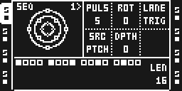
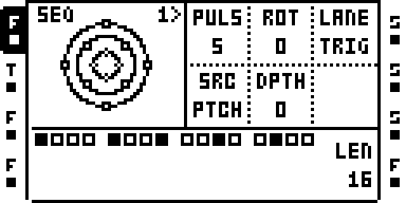
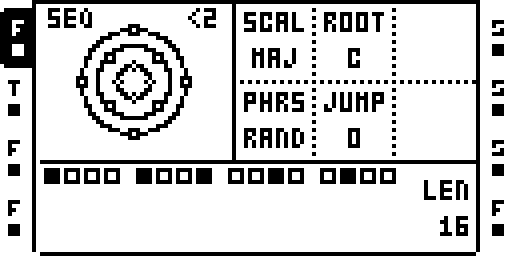
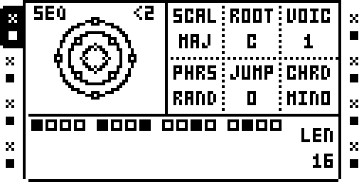
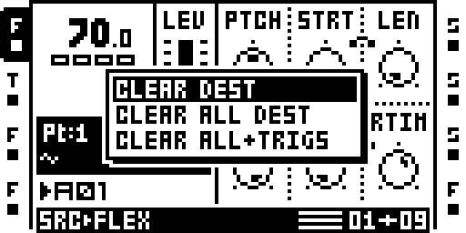

# SEQ

Version 0.1.0-experimental · by @ilia-murzinov · MKII and emulator results recorded.

## Overview

SEQ is a track window for Euclidean rhythms. Hold **`[TRACK]`** and press
**`[PAGE]`**: SEQ opens on that track with the title SEQ, a 3×2 knob grid,
**LEN** at bottom right and a 4×16 step grid for up to 64 steps. It spreads
**PULS** hits over the track length, turns them with **ROT**, and writes the
result into the pattern as ordinary sample trigs, note trigs and parameter
locks. What it writes plays, saves and copies like anything programmed by hand.

SEQ takes its name from the SEQ submenu on Digitakt II and Digitone II. Its
rhythm names, ranges and the **PULS** default match the EUCLID filter.

For the full guide (mental model, phrase types, examples and diagrams), see
the [octabam SEQ manual](https://ilia-murzinov.github.io/octabam/reference/modules/seq.html).

## Controls

Rhythm page (**`1>`** at top right when Harmony is available):

| cell | label | does |
|---|---|---|
| A | **PULS** | hits of the focused lane |
| B | **ROT** | turns the focused lane's hits |
| C | **LANE** | **TRIG** edits the trig rhythm; **PLCK** edits the lock rhythm of the selected parameter |
| D | page + parameter | the parameter to lock, named as in LFO SETUP **PMTR** (**SRC** / **PTCH**, **AMP** / **VOL**, ...) |
| E | **DPTH** | how far the locks move around the Part's value; 0 clears them |
| F | | empty |

Harmony page (**`<2`**), reached with **`[RIGHT]`** when D is **PTCH** on an
audio track or **NOTE** on a MIDI track:

| cell | label | does |
|---|---|---|
| A | **SCAL** | scale |
| B | **ROOT** | root note |
| C | **VOIC** | voices per hit, 1 to 4 (MIDI tracks) |
| D | **PHRS** | phrase: **RAND**, **UP**, **DOWN**, **ALT**, **TRI** |
| E | **JUMP** | largest step between notes |
| F | **CHRD** | chord shape (MIDI tracks) |

Keys while SEQ is open:

| key | does |
|---|---|
| **`[TRACK]`** | switch SEQ to that track; stock **`[TRACK]`** gestures keep working |
| **`[MIDI]`** | switch between the audio track and the MIDI track of the same number |
| **`[LEFT]`** / **`[RIGHT]`** | rhythm page / Harmony page |
| **`[CUE]`** | held: stock cue. Released alone: random hits on the focused lane. **`[CUE]`** + **`[TRACK]`** cues that track |
| **`[FUNC]`** + **`[BANK]`** | clear menu: **CLEAR DEST**, **CLEAR ALL DEST**, **CLEAR ALL+TRIGS** |
| **`[YES]`** | write the rhythm and the selected parameter's locks into the pattern |
| **`[NO]`** | close SEQ |

Bare **`[PAGE]`** keeps its stock function while SEQ is open.

## Usage

1. Hold **`[TRACK]`** and press **`[PAGE]`** on an audio or MIDI track.
2. With **LANE** on **TRIG**, set **PULS** and **ROT**, then press **`[YES]`**:
   the track gets sample trigs (audio) or note trigs (MIDI) on those steps,
   with locks for the parameter on D at the depth on E.
3. Turn C to **PLCK**, pick a parameter with D and a depth with E, set its own
   **PULS** and **ROT**, then **`[YES]`**: that parameter gets locks on its own
   rhythm. On audio tracks, steps without a sample trig become trigless trigs.
4. On **PTCH** or **NOTE**, press **`[RIGHT]`** for Harmony: the locks follow
   the scale, root and phrase.

Settings are kept per track and per project in `seq.work`, beside the bank
files, and saved with the project.

## Mental model

Each track has one **TRIG** rhythm and a separate **PLCK** rhythm for each
destination. **TRIG** fills sample trigs (audio) or note trigs (MIDI). **PLCK**
fills one parameter's locks on its own steps. The grid previews SEQ's settings;
press **`[YES]`** to write the preview to the pattern.

| **LANE** | What you edit | What **`[YES]`** does |
|---|---|---|
| **TRIG** | Sample-trig or note-trig rhythm | Rewrites track trigs and writes locks for the current destination on those steps. |
| **PLCK** | That destination's lock rhythm | Leaves track trigs alone. Clears that destination on every miss, then writes on PLCK hits. |

On audio tracks, a PLCK hit without a sample trig creates a **trigless trig**.
**`[CUE]`** released alone keeps **PULS** as the hit count and randomizes which
steps are on for the focused lane.

## Quick tutorial

1. Hold a [TRACK] key and press [PAGE]: the SEQ window opens on that track.
2. Turn A (PULS) and B (ROT) to shape the rhythm in the step grid, then press [YES] to write it into the pattern.
3. Turn C to PLCK, pick a parameter with D and a depth with E, then press [YES]. Press [NO] to close SEQ.

## Compatibility and limitations

- OS 1.40C on the Modwerk base, over USB. MKII results use the author's unit and RAM-booted twin `43ac24652a89f28b` (release base `eb667962`); earlier rows used `4c7eb79b`. Emulator rollback cases are listed in [TESTING.md](TESTING.md).
- D offers page-1 parameters only. The octabam module's FX page-2 destinations
  (through PLOCKS P2) and CX OSC SETUP destinations are left out, because
  Modwerk has neither module.
- A `seq.work` from octabam loads here unchanged, and one from here loads in
  octabam. Page-2 and CX settings in an octabam file are kept but not offered.
- Keep SEQ installed while you save, reload or copy a project that uses it:
  without it, `seq.work` is not saved or reloaded with the project.
- A `seq.work` SEQ cannot read is left as it is, and SEQ starts from its
  defaults. The next save copies it to `seq.bak` before writing a new one.

## How it is built

A port of the author's octabam module (`modules/seq` at `076e2d3c`, the
`seq.s` of the OCTABAM 83 image he confirmed on his MKII on 25 Nov 2026), kept
byte for byte under `upstream/`. `seq.s` here differs in five ways:

1. **No STORE.** The project events come from the base's hooks
   (`runtime.json`): `ev_banks_loaded`, `ev_bank_loaded`, `ev_project_new`,
   `ev_bank_written`, `ev_project_store`, `ev_project_stored`,
   `ev_project_reloaded`, and `ev_modules_ready` to read the project once
   after an install. The file, CRC-32 and Part-context helpers are in
   `seq.s`. A refused file is backed up at the next save, where STORE asked.
2. **No PLOCKS P2 and no CX OSC.** Destinations 30-46 are never selectable
   (`ef_audio_dest_valid`), CLEAR ALL DEST stops at 29, and the trigless scan
   no longer reads PLOCKS P2's table. The `seq.work` layout is unchanged;
   `test_seq_port.py` compares it with the upstream source.
3. **Stock's FX2 descriptor table** (`0x400d5fdc`, ids 0-31): the base's
   effect ids fit it.
4. **Stock sites by SHA-256**: the PAGE prologue (`0x4004ffc4`), MKII TRACK
   TRIG EDIT (`0x4007c0d0`) and the MKI FUNC+BANK key-table entry
   (`0x400bf4a4`). The MKI entry falls back to its stock handler, which
   KITS detours, so the two install together.
5. **Closing leaves no pointer into SEQ**, so the base can remove it. A
   layer stock pushed above one of SEQ's keeps a link to it after stock
   pops it; SEQ points such links past its layer and has stock refill the
   key cache. SEQ's key and encoder handlers are called through thunks
   that keep `%d2`-`%d7` and `%a2`-`%a6`: upstream's **`[CUE]`** release
   overwrote the key number stock's dispatch keeps in `%d2`, which left
   **`[CUE]`** routed to SEQ after it closed.

SEQ opens its own window, so its package needs a base with loader
capability 1024 (`docs/OCTATRACK_API.md`, Pages and controls).

## Tests and measurements

See [TESTING.md](TESTING.md).

## Authorship and licences

SEQ is by [ilia-murzinov](https://github.com/ilia-murzinov), MIT
([LICENSE](LICENSE)). The Euclidean rhythm math matches the EUCLID filter by
[repeat98](https://github.com/repeat98).

## Screens and audio

