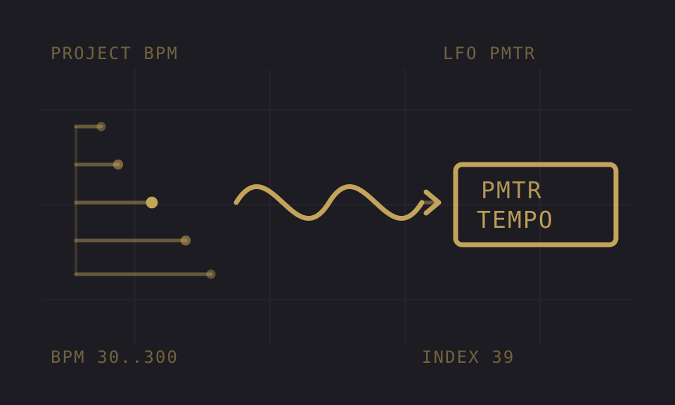
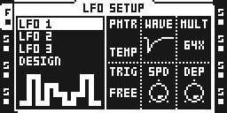
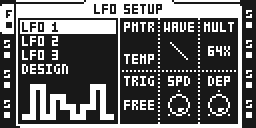
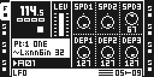

# Tempo LFO

USB packages contribute `ot_lfo_pmtr_dest` and drop base-owned count/formatter/beq/lea/store alone-sink sites. Base owns `0x4000d042` (`mw_lfo_pmtr_dest`) and `0x4000d07a` (`mw_lfo_pmtr_store`).

Version: `0.1.0-experimental` · author: [@jonathanwardle1992-beep](https://github.com/jonathanwardle1992-beep)

Maps **project/global tempo** to a new LFO **PMTR** destination, **TEMPO**,
so stock LFOs can address BPM. ColdFire only (no DSP, no effect slot).
Original OS 1.40C.

**Catalog PINNED** (MOP-257). First Modwerk catalog release at
`0.1.0-experimental`. `tests.qualification` placed under Jon owner review
(G). Cite Keep mop253/254, measured **624** mop255, qual tip mop256.
Evidence: [`evidence/catalog-pin-mop257-2026-11-25.md`](evidence/catalog-pin-mop257-2026-11-25.md),
[`evidence/qualification-place-mop257-2026-11-25.md`](evidence/qualification-place-mop257-2026-11-25.md).
Release notes: [CHANGELOG.md](CHANGELOG.md) / community `tempo-lfo.json`. See
[INVESTIGATION.md](INVESTIGATION.md) and [TESTING.md](TESTING.md).

## Overview

Stock Octatrack project tempo is edited with the **TEMPO** key, but it is
not an LFO destination. Tempo LFO adds that link:

- The live project tempo word stays the stock sequencer value at
  `0x8000181c` (BPM × 24, 30–300), the same word REPITCH and the frame
  builder already follow.
- On LFO SETUP, **PMTR** gains **TEMPO** (**index 39**). Point an LFO at
  it and use DEP / WAVE / MULT / TRIG as usual; p-locks and scenes that
  move DEP apply through stock.
- After the LFO stores the destination word, the module maps the high
  byte onto 30–300 BPM and publishes into `PROJECT_BPM24` so transport
  follows live.
- When no LFO has written TEMPO for a track shadow, the shadow re-syncs
  from the project word so the TEMPO key remains the base editor.

Track scale/speed, swing, length and step remap stay with their own
modules (**TSPD**, **SWING**, **TLEN**, **SPOS** / Play Modes).

### Why index 39

Coordinated draft map: **30 PROB** … **38 TSTR**. This module takes the
next clear unused slot **39 TEMPO** so it does not collide with those
nine, and stays off SPOS / Play Modes dials. Confirm with the coordinator
allocation lock if another claim lands first; see
[INVESTIGATION.md](INVESTIGATION.md).

## Controls

| Control | Access | Values | Default |
| --- | --- | --- | --- |
| Project tempo | Stock **TEMPO** key / LEVEL | 30–300 BPM | project’s existing value |
| LFO → TEMPO | LFO SETUP → **PMTR = TEMPO** | stock LFO page | — |

No effect slot and no new Part knob page. No FUNC+TRACK gesture (reserved
by other drafts).

## Usage

Anyone with the module can point an audio-track LFO at PMTR = TEMPO to
modulate project/global BPM. The TEMPO key remains the base editor.

### Quick tutorial

1. Include Tempo LFO in a build; set a known project tempo (for example 120 BPM) on an audio track with a clear rhythm.
2. Hold FUNC+LFO; set PMTR=TEMPO, raise DEP, pick WAVE/TRIG; press PLAY and watch project BPM move.
3. Set DEP to 0 or change PMTR away from TEMPO; re-edit with the TEMPO key.

## Compatibility and limitations

- OS 1.40C. Audio-track LFOs only in 0.1.0; MIDI LFOs are not wired.
- **PMTR index 39** by design (map: 30–38 peers, then TEMPO). Alone, dial
  max is still **30** until peers coexist (same alone-dial ABI as SWING /
  TSPD — [MOP-122](../../../docs/OCTATRACK_LFO_PMTR_EXTENSION.md#alone-dial-max-30-vs-dest-33-mop-122)).
- Global publish: last writing track’s LFO wins for `PROJECT_BPM24`.
- Does **not** write track scale (`tr+0x51`); that remains **TSPD**.
- Does **not** detour `ev_audio_step` / Play Modes / SPOS.
- USB smoke PASS (MOP-205); audible Undo (MOP-252); Keep + reboot
  (MOP-253/254); measured **624** (MOP-255). `tests.qualification`
  **Placed** and catalog **PINNED** (MOP-257).

## Tests and measurements

See [TESTING.md](TESTING.md). `evidence/performance.json` has
`cycles.static` = `cycles.measured` = **624**, budget **4790**, load +
stress filled (MOP-255). Qualification placed (MOP-257).

## Authorship and licences

jonathanwardle1992-beep: design, ColdFire unit, documentation and
thumbnail. MIT, [LICENSE](LICENSE). Site plan cites published REPITCH
`PROJECT_BPM24` and peer LFO-PMTR contribute shape (addresses only; no
stock bytes). No Elektron firmware or extracted tables are included.

## Screens and audio

Hardware USB LCD captures (Keep-safe Undo / mop205–252 lineage; monochrome):

## Screens and audio

SETUP PMTR=TEMPO panel PNG retained from mop205 (store media); not OCR'd
as Proven. The module makes no sound of its own; it only moves tempo.
Audible WAV A/B remains open — Keep-safe Undo fixture tip-ready
([MOP-250](evidence/next-audible-fixture-mop250-2026-11-25.md)). Keep
Accept needs Jon auth
([protocol](evidence/protocol-mop250-keep-usb-2026-11-25.md)).
