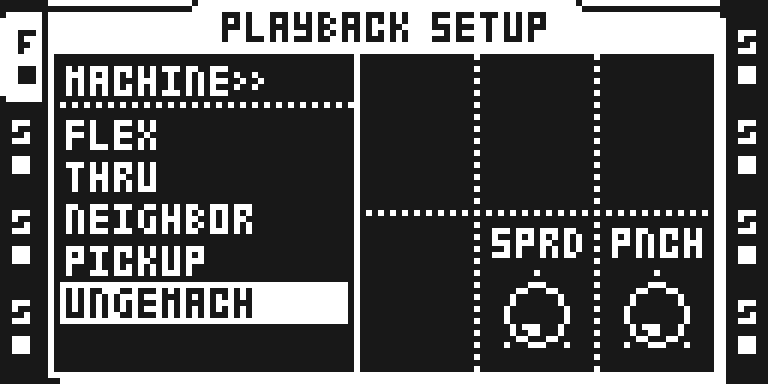
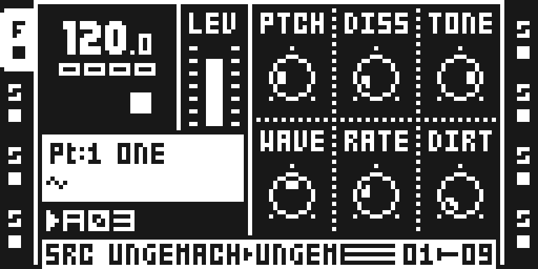

# Ungemach

Version 0.1.0-experimental · by GnocchiBalboa (@GnocchiBalboa). An experimental draft: the author has played it on an Octatrack MKI over the Modwerk USB base. The [test record](TESTING.md) names the build for each result.

## Overview

UNGEMACH is a track machine for dark techno that makes its own sound on the ColdFire instead of playing a sample: a dissonant drone that never stands still. Sixteen detuned voices in three groups, an octave sub and a dark noise run through a resonant low-pass filter and a soft saturation, in stereo.

PTCH sets the root. DISS moves the second and third voice groups against it, from unison through quarter tones, tritones and ninths to a scream, and the chord's pitch rises with the knob. WAVE crossfades through 32 original waveforms from dull to shrill. TONE opens the filter, and DIRT adds resonance, drive and a phase push between the voices that makes the drone rough. RATE lets pitch, filter and level drift on their own, or pulse in time with the track. On SRC SETUP, SPRD sets the stereo width and PNCH gives every trig a punch.

The track's AMP envelope shapes the drone as it shapes a sample: a trig opens it and HOLD keeps it sounding. LFOs, parameter locks, scenes and the track's effects act on the six SRC knobs as on any machine.

## Controls

SRC (knobs A to F):

| Knob | Range | Default | What it does |
| --- | --- | --- | --- |
| PTCH | 0 to 120 | 24 | The root, in half semitones: 0 is 27.5 Hz, 24 is 55 Hz (A1), 120 is 880 Hz. Locks, LFOs and slides move it smoothly. |
| DISS | 0 to 127 | 40 | The chord: where the second and third voice groups sit against the root. 0 is unison; then quarter tones, semitones, tritones, sevenths and ninths, octave and fifth near 71-76, and the scream from 121. The chord's pitch rises with the knob. A step glides in about 90 ms, so a turn or an LFO is a glissando. |
| TONE | 0 to 127 | 80 | The low-pass filter's cutoff: dark at 0, open at 127. |
| WAVE | 0 to 127 | 24 | The voices' waveform: 32 original waveforms from dull to shrill, crossfaded. A turn glides, half the range in about 0.7 s. |
| RATE | 0 to 63, S16 to S2 | 20 | How the drone moves. 0-63: pitch, filter and level drift on their own, from 0.02 Hz at 0 to 2 Hz at 63; the filter moves by up to a quarter of TONE's travel. Above 63: a pulse in time with the track, one every 16, 8, 6, 4, 3 or 2 steps (S16 to S2), that opens the filter by 25 % of TONE's travel at 64, rising to 35 % from 74. |
| DIRT | 0 to 127 | 12 | Resonance, saturation and a phase push between the voices: clean and round at 0, rough and screaming at 127. |

SRC SETUP (knobs E and F; A to D are empty):

| Knob | Range | Default | What it does |
| --- | --- | --- | --- |
| SPRD | MONO, NARW, WIDE, FULL | WIDE | The stereo width. |
| PNCH | 0 to 127 | 0 | A punch on every trig: it opens the filter, adds dirt and lifts the level, then falls away in 35 ms at low values to 55 ms at 127. 0 is off. |

## Usage

UNGEMACH is reached through the track's machine list. It needs no sample. A good start for a dark drone under a kick: PTCH 24 (A1), DISS 40, TONE 70, WAVE 24, RATE 20, DIRT 12, the AMP envelope's HOLD high, and a trig on step 1. Turn DISS above 100 for a screaming, rising chord, and set RATE above 63 for a pulse with the pattern. For hits, set PNCH and add trigs, or put an LFO on DIRT in a trig mode.

## Quick tutorial: play an UNGEMACH drone

1. Double-tap a track key, move to UNGEMACH in the machine list and press YES.
2. Put a trig on the track, set the AMP envelope's HOLD high and press PLAY: the drone sounds. On the SRC page, turn DISS slowly from 0 up: the chord widens and rises. Turn WAVE for the colour and TONE and DIRT for brightness and grit.
3. Press SRC again for SRC SETUP and turn PNCH up: each trig now punches. Set RATE above 63 for a pulse in time with the track. Press STOP to stop, or double-tap the track key and choose FLEX to leave the machine.

## Compatibility and limitations

- The author tested it on an Octatrack MKI with OS 1.40C, the Modwerk USB base 0.7.10 and a development twin of the beta base. It has not been tested on an MKII.
- One UNGEMACH track per Part: the base refuses it for a second track, and that track stays what it was.
- It renders on the ColdFire, in the frame interrupt: about 37-60 microseconds of the 363-microsecond frame in the author's busy live set. With a full pattern the base's frame guard skipped some of its frames: none in most seconds, up to a few dozen a second at busy moments (under 2 % of frames). The author heard no dropouts. Several UNGEMACH-like machines at once would not fit.
- SPRD and PNCH sit on SRC SETUP, which locks, LFOs and scenes do not reach.
- Every byte UNGEMACH keeps in the Part is a valid FLEX value: a project opened without the module shows that UNGEMACH is missing and plays the track as FLEX.
- Not yet tested: MIDI, scenes and recording on an UNGEMACH track.

## Tests and measurements

See [TESTING.md](TESTING.md): host tests under UBSan and ASan, and the measurements on the author's MKI.

## Authorship and licences

Original work by GnocchiBalboa under the MIT licence ([LICENSE](LICENSE)). The engine, the waveforms and every table are original and generated by `gen_tables.py`. The machine reads the sequencer's clock, tempo and track speed at the RAM locations Euclid (Sam Banks, MIT) reads; no code is copied from it. No Elektron firmware, extracted routines, tables, samples or graphics are included: the machine page copies stock's FLEX page record at run time on the user's own unit.

## Screens and audio

Captures of the author's MKI LCD over USB ([media rights](media/LICENSE.md)). No audio preview.
