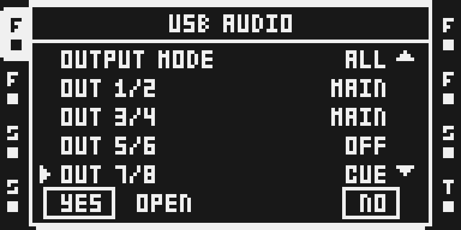

# USB Audio

## Overview

Install USB Audio once to record the Octatrack on a computer or route four stereo USB pairs to Outbox 8. The Octatrack sends 24-bit audio at 44.1 kHz. Pick the destination and sources on the instrument.

## Controls

Open **PROJ → MODWERK → SETTINGS**, highlight **USB AUDIO** and press **YES**. Open a field to see all its choices and the active selection. Use the arrows to browse, **YES** to select and **NO** to go back.

| Field | Choices on the Octatrack |
| --- | --- |
| SEND TO | COMPUTER or OUTBOX 8 |
| LAYOUT | Eight tracks plus Main and Cue (20 channels), eight tracks (16), Main and Cue (4), Main (2), or Track 8/Master (2) |
| TRACK TAP | PRE LEVEL or POST LEVEL for either eight-track layout. POST follows track LEVEL, mutes, solo and crossfader. Main and Cue keep their channel pairs. |
| OUTPUT MODE | ALL CHANNELS or OFF. The 20-channel layout also offers MAIN + CUE ONLY. |
| Outbox pairs | Choose a source from the selected layout for each of the four stereo pairs. Choose OFF for silence. A source can feed more than one pair. |

Track 8/Master sends track 8 after effects and before LEVEL. Enable MASTER TRACK on the Octatrack to use it as the master mix. The POST LEVEL stems for tracks 1–7 exclude MAIN LEVEL and master effects. With a master track, those stems lead track 8 by 32 samples.

## Usage

For recording, choose COMPUTER and the layout you want, then select Octatrack as the audio input in your DAW. Stop recording before a layout change that changes the number of channels. The USB device reconnects so the host can see the new inputs.

When you load an existing Modwerk set, its saved destination, layout, track tap and Outbox assignments supply the initial settings. A classic set without USB settings starts with eight PRE LEVEL stereo tracks followed by Main and Cue.

### Record a mix or send Main + Cue to Outbox

1. Load the USB Audio module. Open PROJ > MODWERK > SETTINGS > USB AUDIO and select OUTBOX 8 under SEND TO.
2. Choose MAIN + CUE under LAYOUT. Set OUT 1/2 to MAIN and OUT 3/4 to CUE. Pick OFF for the remaining outputs.
3. In the Outbox app assign the four USB pairs to their corresponding physical outputs. You can now change the source for each pair on the Octatrack.

[Open Elektron’s Outbox app](https://app.elektron.se/outbox8).

## Compatibility and limitations

USB Audio 0.3.0-experimental requires the configurable USB Audio hooks introduced in Modwerk’s Octatrack base 0.7.12. If you use base 0.7.11 or earlier, update the base, then load your existing set to restore its saved routing.

- Built for Octatrack OS 1.40C. USB Audio supports output only. Multichannel recording needs a high-speed USB connection.
- The DRAM platform reserves about 10 MB of sample memory. A project that filled Flex and recorder memory can show OUT OF MEMORY. Shorten its recorder reservation or use a Static machine for long samples. [Memory guidance](https://github.com/repeat98/modwerk/issues/433).
- The physical Outbox 8 and Windows and Linux hosts remain untested on this release candidate.

## Tests and measurements

The default 0.3 package contains 10,288 bytes of initialized image and 94,152 bytes of BSS. Worst-case ColdFire cycles and complete memory use including stack and DMA remain unmeasured. See the build-specific reconnect, recording and persistence results in [TESTING.md](TESTING.md). Historical 0.2 layout sizes and source hashes are in [evidence/layouts.json](evidence/layouts.json).

## Authorship and licences

Mark Roberts (markandrus/octemu) wrote USB audio/MIDI. Bryan T contributed
Main/Cue channels and alignment work. Sam Banks and Octabam contributors
added layouts, shared-stack integration and Outbox support.
allmyfriendsaresynths (@clickysteve) contributed the post-LEVEL gain engine. Modwerk adds
the configurator, on-instrument settings, saved routing and module packaging.
The imported source is available under the MIT licence. See [LICENSE](LICENSE), source comments,
[layouts/UPSTREAM-AUDIO.md](layouts/UPSTREAM-AUDIO.md) and
[layouts/UPSTREAM-POST.md](layouts/UPSTREAM-POST.md). Exact imported file
identities are in the source-only package and SDK import record. See
[LEGACY.md](LEGACY.md) for preserved classic documentation and historical
measurements. Elektron rights remain reserved for locally recovered stock.

## Screens and audio

These MKII emulator captures show the settings list, USB Audio fields, track tap and Outbox source assignments. [Capture details](media/capture.json).

