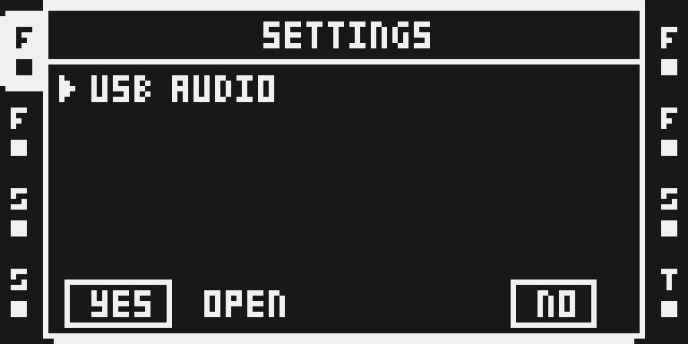
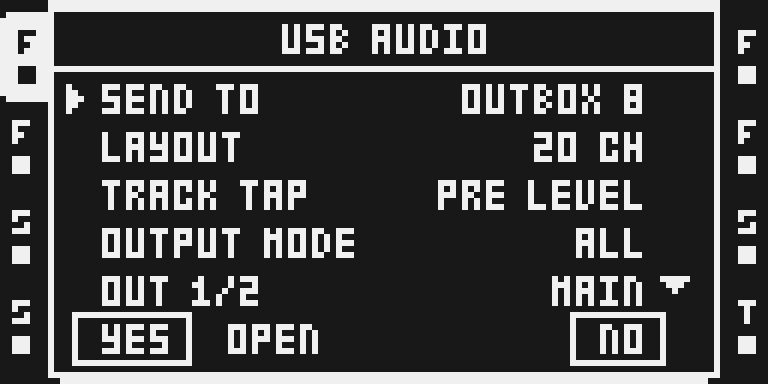
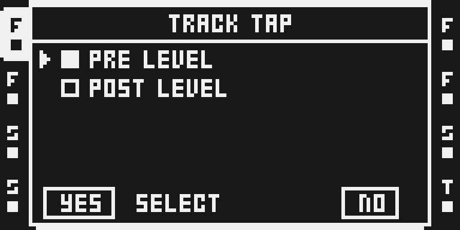
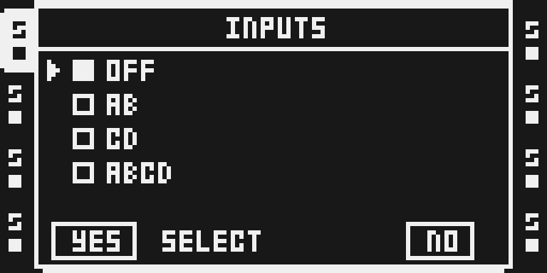

# USB Audio

## Overview

Install USB Audio once to record the Octatrack on a computer or route four stereo USB pairs to Outbox 8, and to play audio from the computer into the Octatrack's inputs. The Octatrack sends and receives 24-bit audio at 44.1 kHz. Pick the destination, sources and inputs on the instrument.

## Controls

Open **PROJ → MODWERK → SETTINGS**, highlight **USB AUDIO** and press **YES**. Open a field to see all its choices and the active selection. Use the arrows to browse, **YES** to select and **NO** to go back.

| Field | Choices on the Octatrack |
| --- | --- |
| SEND TO | COMPUTER or OUTBOX 8 |
| LAYOUT | Eight tracks plus Main and Cue (20 channels), eight tracks (16), Main and Cue (4), Main (2), or Track 8/Master (2) |
| TRACK TAP | PRE LEVEL or POST LEVEL for either eight-track layout. POST follows track LEVEL, mutes, solo and crossfader. Main and Cue keep their channel pairs. |
| OUTPUT MODE | ALL CHANNELS or OFF. The 20-channel layout also offers MAIN + CUE ONLY. |
| Outbox pairs | Choose a source from the selected layout for each of the four stereo pairs. Choose OFF for silence. A source can feed more than one pair. |
| INPUTS | OFF, AB, CD or ABCD, with SEND TO COMPUTER. AB or CD plays USB 1/2 from the computer into inputs A/B or C/D; ABCD plays USB 1–4 into all four. OFF, the default, leaves every input on its jack. Works on macOS, not yet on Windows. |

Track 8/Master sends track 8 after effects and before LEVEL. Enable MASTER TRACK on the Octatrack to use it as the master mix. The POST LEVEL stems for tracks 1–7 exclude MAIN LEVEL and master effects. With a master track, those stems lead track 8 by 32 samples.

## Usage

For recording, choose COMPUTER and the layout you want, then select Octatrack as the audio input in your DAW. Stop recording before a layout change that changes the number of channels. The USB device reconnects so the host can see the new inputs.

When you load an existing Modwerk set, its saved destination, layout, track tap and Outbox assignments supply the initial settings. A classic set without USB settings starts with eight PRE LEVEL stereo tracks followed by Main and Cue.

### Play audio from the computer into the Octatrack

This ran on macOS with 0.4.0. Windows needs 0.4.1, which runs on Windows 11; Windows 10 and macOS have not been tried with 0.4.1 yet. If Windows shows an error for the Octatrack after a change of INPUTS, set INPUTS to OFF, unplug the Octatrack and restart Windows; if the error stays, show hidden devices in Device Manager and uninstall the Octatrack entries.

1. Load the USB Audio module and connect the Octatrack to a computer with a high-speed USB port. Open PROJ > MODWERK > SETTINGS > USB AUDIO and select COMPUTER under SEND TO.
2. Under INPUTS choose AB. The USB device reconnects once and now also shows two output channels to the computer.
3. In your DAW, send a track to the Octatrack's USB outputs 1/2. It arrives on inputs A/B: hear it with DIR AB in the mixer, run it through a Thru machine's effects or record it with a recorder. Choose ABCD for four channels, or OFF to go back to the jacks.

### Record a mix or send Main + Cue to Outbox

1. Load the USB Audio module. Open PROJ > MODWERK > SETTINGS > USB AUDIO and select OUTBOX 8 under SEND TO.
2. Choose MAIN + CUE under LAYOUT. Set OUT 1/2 to MAIN and OUT 3/4 to CUE. Pick OFF for the remaining outputs.
3. In the Outbox app assign the four USB pairs to their corresponding physical outputs. You can now change the source for each pair on the Octatrack.

[Open Elektron’s Outbox app](https://app.elektron.se/outbox8).

## Compatibility and limitations

USB Audio 0.4.0-experimental requires Modwerk’s Octatrack base 0.8.1, which carries the USB input transfer. If the site asks for a base update, install it, then load your set: its saved routing comes back, and an Octatrack running USB Audio 0.3.0 gets this version with that sync.

- Built for Octatrack OS 1.40C. Multichannel recording and every USB input need a high-speed USB connection to a computer. At full speed and with OUTBOX 8 the module sends only; when no USB stream arrives, the inputs read their jacks.
- A change of INPUTS or of the channel count reconnects the USB device. Stop recording in your DAW first.
- The DRAM platform reserves about 10 MB of sample memory. A project that filled Flex and recorder memory can show OUT OF MEMORY. Shorten its recorder reservation or use a Static machine for long samples. [Memory guidance](https://github.com/repeat98/modwerk/issues/433).
- The physical Outbox 8, Linux hosts and the Octatrack MKI remain untested on this release candidate. USB input ran on an MKII with macOS (0.4.0) and, in 0.4.1, with Windows 11 (INPUTS AB). Windows 10 is untested.

## Tests and measurements

The 0.4 package contains 17,852 bytes of code and data and 110,552 bytes of BSS (0.3: 10,288 and 94,152). Worst-case ColdFire cycles and complete memory use including stack and DMA remain unmeasured. See the build-specific reconnect, recording and persistence results in [TESTING.md](TESTING.md). Historical 0.2 layout sizes and source hashes are in [evidence/layouts.json](evidence/layouts.json).

## Authorship and licences

Mark Roberts (markandrus/octemu) wrote USB audio/MIDI. Bryan T contributed
Main/Cue channels, alignment work and the USB input receiver. Sam Banks and Octabam contributors
added layouts, shared-stack integration and Outbox support.
allmyfriendsaresynths (@clickysteve) contributed the post-LEVEL gain engine. Modwerk adds
the configurator, on-instrument settings, saved routing and module packaging.
The imported source is available under the MIT licence. See [LICENSE](LICENSE), source comments,
[layouts/UPSTREAM-AUDIO.md](layouts/UPSTREAM-AUDIO.md) and
[layouts/UPSTREAM-POST.md](layouts/UPSTREAM-POST.md). Exact imported file
identities are in the source-only package and SDK import record. See
[LEGACY.md](LEGACY.md) for preserved classic documentation and historical
measurements. Elektron rights remain reserved for locally recovered stock.

## Screens and audio

These MKII emulator captures show the settings list, the USB Audio fields, the track tap, the inputs and the Outbox source assignments. [Capture details](media/capture.json).

