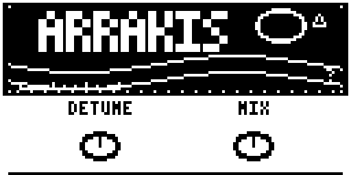

# Arrakis

## Overview

A Dune-style detuned sub-octave drone: two subs beating against each other.

## Controls

| Control | Default | Function |
| --- | ---: | --- |
| Detun | 63 | params[5]. Beat spread between the two detuned voices. Range 0–100. |
| Mix | 50 | params[6]. Dry/wet. Default 45 (not ~0) so the effect is AUDIBLE the moment a patch loads — custom effects read params as 0 until a knob is touched, so this default is the on-load value. Range 0–100. |

## Usage

Play a sustained single note and listen for the beating suboctave layer.

### Quick tutorial

1. Add Arrakis from the Delay group to a spare patch.
2. Play a sustained single note and listen for the beating suboctave layer.
3. Compare the effect with bypass using the footswitch.

## Compatibility and limitations

Hardware untested on the original MS-70CDR with OS 2.10. This build has startup knob initialization disabled. Check saved settings after recalling a patch.

## Tests and measurements

Ziddle passed the loader check and rendered 22,050 stereo frames. The compiled file passed the stock-code scan and MS-70CDR size limits. Hardware untested. [Verification](TESTING.md)

## Authorship and licences

Roman Rusinov and the ZoomMultistompZDL contributors. [Source](https://github.com/themanro/ZoomMultistompZDL/tree/aee98c53d7b568cbb55bb927aefbdc9b4e739f3e/src/custom/arrakis) · [Licences](LICENSE)

## Screens and audio

