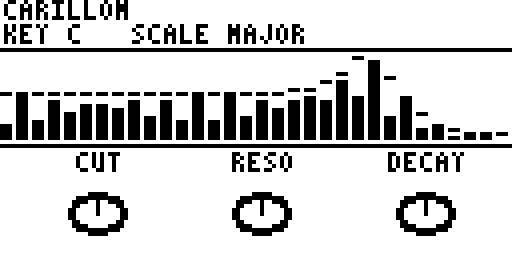

# Carillon

## Overview

A resonant filter bank: 32 narrow filters from C2 to C8, snapped to a key and scale. A filter at low Decay, ringing bells turned up.

## Controls

| Control | Default | Function |
| --- | ---: | --- |
| Cut | 70 | params[5]. Where the bank's emphasis sits, C2 .. above C8. Range 0–100. |
| Reso | 30 | params[6]. Boost of the bands around Cutoff. Range 0–100. |
| Decay | 55 | params[7]. Band width and ring: 0 one plain filter, 100 bells ringing a few seconds. Range 0–100. |
| Key | 0 | params[8]. Named steps C .. B: the scale's root; in Free, moves the bank. Range 0–11. |
| Scale | 2 | params[9]. Named steps: Free, Chrom, Major, Minor, Dor, Pent, MinPt, Whole, Fifth, Oct. Range 0–9. |
| Slope | 40 | params[10]. Low-pass (0) .. band-pass (50) .. high-pass (100). Range 0–100. |
| Waves | 20 | params[11]. 0..50 depth of a slow ripple across the bands; 50..100 full depth, faster. Range 0–100. |
| Noise | 0 | params[12]. 0..50 random bands struck on their own; 50..100 adds a hiss that makes the bank whistle. Range 0–100. |
| Mix | 60 | params[13]. Dry/wet. Range 0–100. |

## Usage

Use percussive hits and listen for separately ringing, tuned resonances.

### Quick tutorial

1. Add Carillon from the Delay group to a spare patch.
2. Use percussive hits and listen for separately ringing, tuned resonances.
3. Use the page buttons to reach the remaining controls.

## Compatibility and limitations

Hardware untested on the original MS-70CDR with OS 2.10. This build has startup knob initialization disabled. Check saved settings after recalling a patch.

## Tests and measurements

Ziddle passed the loader check and rendered 22,050 stereo frames. The compiled file passed the stock-code scan and MS-70CDR size limits. Hardware untested. [Verification](TESTING.md)

## Authorship and licences

Roman Rusinov and the ZoomMultistompZDL contributors. [Source](https://github.com/themanro/ZoomMultistompZDL/tree/aee98c53d7b568cbb55bb927aefbdc9b4e739f3e/src/custom/carillon) · [Licences](LICENSE)

## Screens and audio

