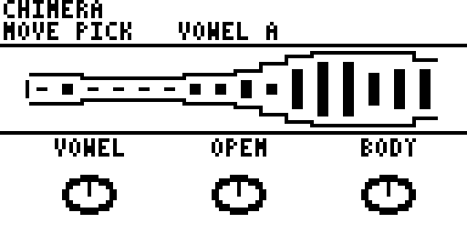

# Chimera

## Overview

Your guitar as the voice of a simulated throat and mouth, like a talkbox: vowels, jaw, body size, nose, and a mouth that can follow your notes or babble.

## Controls

| Control | Default | Function |
| --- | ---: | --- |
| Vowel | 50 | params[5]. The mouth's shape: u, o, a, e, i from 0 to 100, morphing between. Range 0–100. |
| Open | 55 | params[6]. Jaw and lips: closed (a hum, with Nasal) to wide open. Range 0–100. |
| Body | 30 | params[7]. The throat's length: 19 cm (big) to 13.5 cm (small); 30 is an adult man. Range 0–100. |
| Nasal | 0 | params[8]. Opens the soft palate into the nose. Range 0–100. |
| Talk | 35 | params[9]. How far Move moves the mouth. Range 0–100. |
| Move | 0 | params[10]. Named steps Pick, Slow, Fast, Chat: the mouth follows each note, sways slowly or quickly, or babbles. Range 0–3. |
| Buzz | 30 | params[11]. Drives the guitar into a soft clipper first: more harmonics for the mouth to shape. Range 0–100. |
| Breath | 0 | params[12]. Air noise through the throat, following your playing: a whisper. Range 0–100. |
| Mix | 100 | params[13]. Dry/wet. Range 0–100. |

## Usage

Hold a harmonically rich sound and move the vowel controls to hear the formants.

### Quick tutorial

1. Add Chimera from the Delay group to a spare patch.
2. Hold a harmonically rich sound and move the vowel controls to hear the formants.
3. Use the page buttons to reach the remaining controls.

## Compatibility and limitations

Hardware untested on the original MS-70CDR with OS 2.10. This build has startup knob initialization disabled. Check saved settings after recalling a patch.

## Tests and measurements

Ziddle passed the loader check and rendered 22,050 stereo frames. The compiled file passed the stock-code scan and MS-70CDR size limits. Hardware untested. [Verification](TESTING.md)

## Authorship and licences

Roman Rusinov and the ZoomMultistompZDL contributors. [Source](https://github.com/themanro/ZoomMultistompZDL/tree/aee98c53d7b568cbb55bb927aefbdc9b4e739f3e/src/custom/chimera) · [Licences](LICENSE)

## Screens and audio

