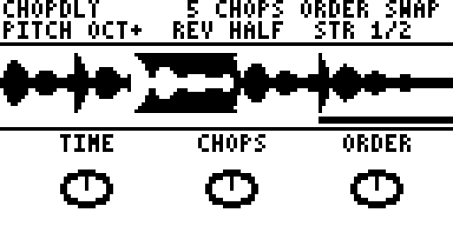

# Chopdly

## Overview

A delay that chops what it recorded: every repeat replays the last cycle cut into 1-16 chops (or at your notes), rearranged, reversed, pitched and stretched, and the repeats get re-chopped.

## Controls

| Control | Default | Function |
| --- | ---: | --- |
| Time | 45 | params[5]. Cycle/delay length 30 ms .. 2.5 s, squared curve (45 = ~0.53 s). Range 0–100. |
| Chops | 4 | params[6]. Named steps: 0 = Trans (cut at note attacks; none found: 4 equal), 1..16 = equal chops. Range 0–16. |
| Order | 6 | params[7]. Named steps: Fwd, Back (chops in reverse order), Swap (pairs swapped), Skip (evens then odds), Stutr (each other chop twice), Build (0, 01, 012...), Mix1-8 (fixed shuffles, every chop once), Rpt1-6 (fixed, chops may repeat or drop), Rand (new shuffle every cycle), Chaos (new random with repeats every cycle). Range 0–21. |
| Pitch | 3 | params[8]. Named steps: -12/-7/-5/Unity/+5/+7/+12 = all chops; Oct+ / Oct- = half the chops up / down an octave; Octs = a third up, a third down; Fifth = a third +7, a third -5; Some = half the chops jump +-5/7/12; Wild = every chop jumps. Fixed per-slot coins, so it recalls. Varispeed unless Stretch is on. Range 0–12. |
| Rev | 0 | params[9]. Named steps: Off, Few (1/4 of chops), Alt (every other chop), Half, Most (3/4), All, Ping (chops alternate L/R, forward), Scatr (each chop a fixed pan, forward). Fixed per-slot coins. Range 0–7. |
| Strch | 4 | params[10]. Named steps: 1/4, 1/3, 1/2, 3/4 = slower, Off = plain read, 1.5x, 2x = faster; how fast each chop runs through its audio with pitch kept (two-grain crossfade, 46 ms grains). Pitch still applies on top. Range 0–6. |
| Glide | 20 | params[11]. Chop edges: 0 = cut where chopped (32-sample anti-click fade); higher = longer fades and the ending chop overlaps the next one (crossfade). 100 = half the shorter chop. Range 0–100. |
| Feed | 35 | params[12]. Chopped output back into the recording (0 .. 0.95), limited. Range 0–100. |
| Mix | 50 | params[13]. Dry/wet. Range 0–100. |

## Usage

Play a held chord and listen for the repeats to break into rhythmic slices.

### Quick tutorial

1. Add Chopdly from the Delay group to a spare patch.
2. Play a held chord and listen for the repeats to break into rhythmic slices.
3. Use the page buttons to reach the remaining controls.

## Compatibility and limitations

Hardware untested on the original MS-70CDR with OS 2.10. This build has startup knob initialization disabled. Check saved settings after recalling a patch.

## Tests and measurements

Ziddle passed the loader check and rendered 22,050 stereo frames. The compiled file passed the stock-code scan and MS-70CDR size limits. Hardware untested. [Verification](TESTING.md)

## Authorship and licences

Roman Rusinov and the ZoomMultistompZDL contributors. [Source](https://github.com/themanro/ZoomMultistompZDL/tree/aee98c53d7b568cbb55bb927aefbdc9b4e739f3e/src/custom/chopdly) · [Licences](LICENSE)

## Screens and audio

