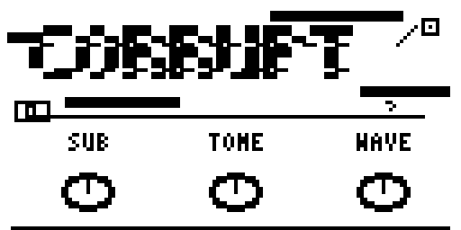

# Corrupt

## Overview

A Data Corrupter-style square synth: the note you play, a tracked sub and a divided harmony.

## Controls

| Control | Default | Function |
| --- | ---: | --- |
| Sub | 82 | params[5]. Sub (octave-down) square level. Range 0–100. |
| Tone | 45 | params[6]. Low-pass: dark/smooth .. raw/buzzy. Range 0–100. |
| Wave | 50 | params[7]. Octave-up harmony square level (richness). Range 0–100. |
| Mix | 50 | Mix default 1 (quiet-safe). The editor materialises patches on load (full-patch send), so audible-on-load no longer needs a hot default. Range 0–100. |

## Usage

Play single notes across the range and listen for the square-wave tracking.

### Quick tutorial

1. Add Corrupt from the Delay group to a spare patch.
2. Play single notes across the range and listen for the square-wave tracking.
3. Use the page buttons to reach the remaining controls.

## Compatibility and limitations

Hardware untested on the original MS-70CDR with OS 2.10. This build has startup knob initialization disabled. Check saved settings after recalling a patch.

## Tests and measurements

Ziddle passed the loader check and rendered 22,050 stereo frames. The compiled file passed the stock-code scan and MS-70CDR size limits. Hardware untested. [Verification](TESTING.md)

## Authorship and licences

Roman Rusinov and the ZoomMultistompZDL contributors. [Source](https://github.com/themanro/ZoomMultistompZDL/tree/aee98c53d7b568cbb55bb927aefbdc9b4e739f3e/src/custom/corrupt) · [Licences](LICENSE)

## Screens and audio

