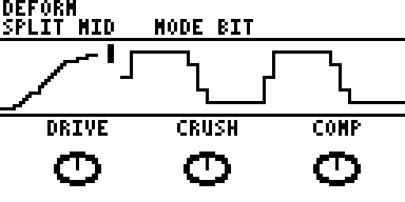

# Deform

## Overview

Drive, crush and compression in one, after the Torso S-4: two-band drive, a soft crush and a one-knob compressor, with noise that follows your playing.

## Controls

| Control | Default | Function |
| --- | ---: | --- |
| Drive | 35 | params[5]. 0..+36 dB into a soft, slightly uneven clipper; level held about even. Range 0–100. |
| Crush | 40 | params[6]. How far the crush goes (Mode picks how); 0 off. Range 0–100. |
| Comp | 30 | params[7]. One-knob compressor: threshold and ratio together, level made up. Range 0–100. |
| Tilt | 50 | params[8]. 50 flat; up pushes highs into the drive, down pushes lows. Half undone after. Range 0–100. |
| Split | 1 | params[9]. Named steps Low, Mid, High: Tilt's crossover, 80 Hz, 650 Hz, 2.5 kHz. Range 0–2. |
| Mode | 0 | params[10]. Named steps Bit, Redux, Both: fewer levels, lower sample rate, or both. Range 0–2. |
| Noise | 0 | params[11]. Pink noise that follows your playing, before the drive. Range 0–100. |
| Decay | 40 | params[12]. How long the noise hangs on after you stop, 20 ms .. 2 s. Range 0–100. |
| Mix | 100 | params[13]. Dry/wet. Range 0–100. |

## Usage

Alternate quiet and loud attacks and compare distortion and gain reduction.

### Quick tutorial

1. Add Deform from the Delay group to a spare patch.
2. Alternate quiet and loud attacks and compare distortion and gain reduction.
3. Use the page buttons to reach the remaining controls.

## Compatibility and limitations

Hardware untested on the original MS-70CDR with OS 2.10. This build has startup knob initialization disabled. Check saved settings after recalling a patch.

## Tests and measurements

Ziddle passed the loader check and rendered 22,050 stereo frames. The compiled file passed the stock-code scan and MS-70CDR size limits. Hardware untested. [Verification](TESTING.md)

## Authorship and licences

Roman Rusinov and the ZoomMultistompZDL contributors. [Source](https://github.com/themanro/ZoomMultistompZDL/tree/aee98c53d7b568cbb55bb927aefbdc9b4e739f3e/src/custom/deform) · [Licences](LICENSE)

## Screens and audio

