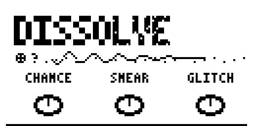

# Dissolve

## Overview

A glitch delay after the OBNE Parting: chunks of what you play are dropped, smeared into a wash, reversed or dropped an octave.

## Controls

| Control | Default | Function |
| --- | ---: | --- |
| Chnce | 40 | params[5]. Probability an input chunk is dropped before the delay line. Range 0–100. |
| Smear | 55 | params[6]. Feedback + diffusion: slapback .. washy near-reverb dissolve. Range 0–100. |
| Gltch | 35 | params[7]. Probability a read chunk plays reversed or an octave down. Range 0–100. |
| Mix | 50 | Mix default 1 (quiet-safe). The editor materialises patches on load (full-patch send), so audible-on-load no longer needs a hot default. Range 0–100. |

## Usage

Play a steady beat and listen for the transitions between smear and glitch.

### Quick tutorial

1. Add Dissolve from the Delay group to a spare patch.
2. Play a steady beat and listen for the transitions between smear and glitch.
3. Use the page buttons to reach the remaining controls.

## Compatibility and limitations

Hardware untested on the original MS-70CDR with OS 2.10. This build has startup knob initialization disabled. Check saved settings after recalling a patch.

## Tests and measurements

Ziddle passed the loader check and rendered 22,050 stereo frames. The compiled file passed the stock-code scan and MS-70CDR size limits. Hardware untested. [Verification](TESTING.md)

## Authorship and licences

Roman Rusinov and the ZoomMultistompZDL contributors. [Source](https://github.com/themanro/ZoomMultistompZDL/tree/aee98c53d7b568cbb55bb927aefbdc9b4e739f3e/src/custom/dissolve) · [Licences](LICENSE)

## Screens and audio

