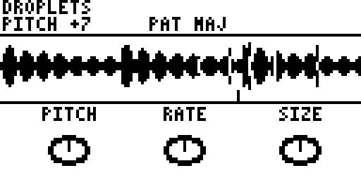

# Droplets

## Overview

A granular delay: short grains sprayed from the last 2.5 s, with pitch steps and patterns, scan, randomness and feedback. Feedback at 100 freezes the buffer.

## Controls

| Control | Default | Function |
| --- | ---: | --- |
| Pitch | 5 | params[5]. Named steps: -24, -12, -7, -5, -3, Unity, +3, +5, +7, +12, +24 semitones for every grain. Range 0–10. |
| Rate | 45 | params[6]. Grains per second, ~2 .. 60 (free running). Range 0–100. |
| Size | 40 | params[7]. Grain length 10 .. 250 ms, squared curve. Range 0–100. |
| Contr | 50 | params[8]. Grain envelope: 0 = sharp hit, 50 = smooth, 100 = slow swell with a sharp end. Range 0–100. |
| Scan | 25 | params[9]. 0..49: where grains start, 30 ms .. 2.5 s behind the live input (a place in the frozen buffer when Locked). 50..100: the start point travels through the last 2.5 s, still at 50 up to twice speed at 100. Range 0–100. |
| Pattn | 0 | params[10]. Named steps: pitch sequence stepped per grain, on top of Pitch. Off, Oct, Oct-, Fifth, Pwr, Maj, Min, Down, Sus (fixed cycles), Pent, Wide (random picks). Range 0–10. |
| Rand | 20 | params[11]. 0..33: spray (random start, up to 0.5 s) and stereo spread; 33..66 adds random pitch jumps, size, timing and level; 66..100 adds reversed grains (up to half). Range 0–100. |
| Feed | 30 | params[12]. Grains back into the buffer, 0 .. 99; 100 = Lock: the buffer freezes (nothing new is recorded) and the grains keep playing from it. Range 0–100. |
| Mix | 50 | params[13]. Dry/wet. Range 0–100. |

## Usage

Hold a chord, then engage Lock and listen for a captured cloud after the input stops.

### Quick tutorial

1. Add Droplets from the Delay group to a spare patch.
2. Hold a chord, then engage Lock and listen for a captured cloud after the input stops.
3. Use the page buttons to reach the remaining controls.

## Compatibility and limitations

Hardware untested on the original MS-70CDR with OS 2.10. This build has startup knob initialization disabled. Check saved settings after recalling a patch.

## Tests and measurements

Ziddle passed the loader check and rendered 22,050 stereo frames. The compiled file passed the stock-code scan and MS-70CDR size limits. Hardware untested. [Verification](TESTING.md)

## Authorship and licences

Roman Rusinov and the ZoomMultistompZDL contributors. [Source](https://github.com/themanro/ZoomMultistompZDL/tree/aee98c53d7b568cbb55bb927aefbdc9b4e739f3e/src/custom/droplets) · [Licences](LICENSE)

## Screens and audio

