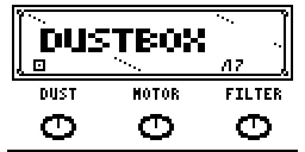

# Dustbox

## Overview

A Buzz Box-style fuzz with a flip-flop sub-octave. Contributed by Marcelo Fuentes (MIT).

## Controls

| Control | Default | Function |
| --- | ---: | --- |
| Dust | 50 | params[5]. (was Heavy) Blend distortion (0) <-> sub-octave fuzz (100, 2 octaves down). The ONLY knob that adds the octave; at 0 no octave is present. Knob 1, matching the real FX33's Heavy/Buzz/Saw/Thrust layout order. Range 0–100. |
| Motor | 60 | params[6]. (was Buzz) Gain / distortion amount only -- never adds the octave. Range 0–100. |
| Filt | 50 | params[7]. (was Saw) Tone: single high-shelf. 0 = dark, 50 = flat, 100 = bright. Range 0–100. |
| Power | 50 | Output level. Raised from the original's default of 1 so the effect is audible when selected, matching the rest of this pack. Note this is a LEVEL, not a dry/wet crossfade -- Dustbox's blend is Dust, which fades between the distortion and the octave branch rather than against dry. Range 0–100. |

## Usage

Play a sustained note and vary Power to hear how the fuzz breaks up.

### Quick tutorial

1. Add Dustbox from the Delay group to a spare patch.
2. Play a sustained note and vary Power to hear how the fuzz breaks up.
3. Use the page buttons to reach the remaining controls.

## Compatibility and limitations

Hardware untested on the original MS-70CDR with OS 2.10. This build has startup knob initialization disabled. Check saved settings after recalling a patch.

## Tests and measurements

Ziddle passed the loader check and rendered 22,050 stereo frames. The compiled file passed the stock-code scan and MS-70CDR size limits. Hardware untested. [Verification](TESTING.md)

## Authorship and licences

Marcelo Fuentes (Dustbox). [Source](https://github.com/themanro/ZoomMultistompZDL/tree/aee98c53d7b568cbb55bb927aefbdc9b4e739f3e/src/custom/dustbox) · [Licences](LICENSE)

## Screens and audio

