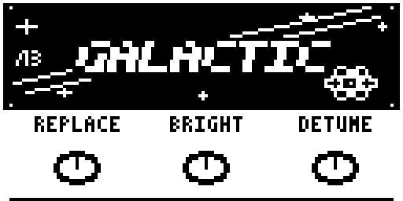

# Galactic

## Overview

Airwindows' lush Galactic reverb, its wet path boosted for pedal levels.

## Controls

| Control | Default | Function |
| --- | ---: | --- |
| Repl | 50 | Airwindows A. Reverb replacement/regeneration balance. Range 0–100. |
| Brght | 50 | Airwindows B. Reverb brightness/lowpass. Range 0–100. |
| Detun | 50 | Airwindows C. Predelay vibrato drift. Range 0–100. |
| Size | 100 | Airwindows D. Delay-network size. Range 0–100. |
| Mix | 50 | Dry/wet crossfade. Renamed from 'DryWet' so every effect in the pack ends with the same control. Range 0–100. |

## Usage

Play a short chord and listen to the modulated stereo reverb tail.

### Quick tutorial

1. Add Galactic from the Delay group to a spare patch.
2. Play a short chord and listen to the modulated stereo reverb tail.
3. Use the page buttons to reach the remaining controls.

## Compatibility and limitations

Hardware untested on the original MS-70CDR with OS 2.10. This build has startup knob initialization disabled. Check saved settings after recalling a patch.

## Tests and measurements

Ziddle passed the loader check and rendered 22,050 stereo frames. The compiled file passed the stock-code scan and MS-70CDR size limits. Hardware untested. [Verification](TESTING.md)

## Authorship and licences

Roman Rusinov and the ZoomMultistompZDL contributors; Airwindows / Chris Johnson (source or inspiration). [Source](https://github.com/themanro/ZoomMultistompZDL/tree/aee98c53d7b568cbb55bb927aefbdc9b4e739f3e/src/airwindows/galactic) · [Licences](LICENSE)

## Screens and audio

