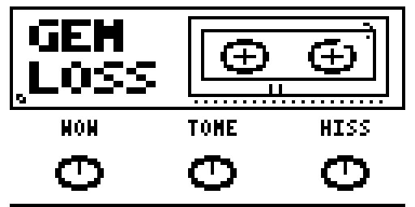

# GenLoss

## Overview

Tape and VHS generation loss: wow, a head-bump tone shift and hiss.

## Controls

| Control | Default | Function |
| --- | ---: | --- |
| Wow | 72 | params[5]. Wow & flutter + pitch instability. Range 0–100. |
| Tone | 52 | params[6]. Bandwidth / brightness (low-pass). Range 0–100. |
| Hiss | 2 | params[7]. Tape hiss / noise-floor level. Range 0–100. |
| Mix | 50 | Dry/wet crossfade. GenLoss previously had NO level or mix control at all -- its last knob was Hiss, a noise amount -- so it was the one effect you could not sit against the dry signal. Range 0–100. |

## Usage

Hold a chord and listen for the degraded, unstable tape sound.

### Quick tutorial

1. Add GenLoss from the Delay group to a spare patch.
2. Hold a chord and listen for the degraded, unstable tape sound.
3. Use the page buttons to reach the remaining controls.

## Compatibility and limitations

Hardware untested on the original MS-70CDR with OS 2.10. This build has startup knob initialization disabled. Check saved settings after recalling a patch.

## Tests and measurements

Ziddle passed the loader check and rendered 22,050 stereo frames. The compiled file passed the stock-code scan and MS-70CDR size limits. Hardware untested. [Verification](TESTING.md)

## Authorship and licences

Roman Rusinov and the ZoomMultistompZDL contributors. [Source](https://github.com/themanro/ZoomMultistompZDL/tree/aee98c53d7b568cbb55bb927aefbdc9b4e739f3e/src/custom/genloss) · [Licences](LICENSE)

## Screens and audio

