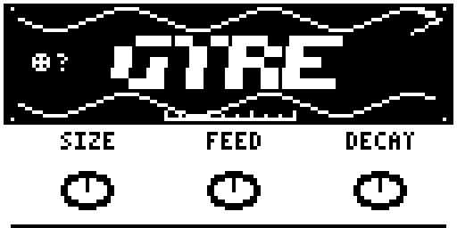

# Gyre

## Overview

A loop you hold that keeps spiralling: two grains half a window apart make it unity-gain, so Decay at 0 holds for ever and Rise climbs or sinks it each pass.

## Controls

| Control | Default | Function |
| --- | ---: | --- |
| Size | 45 | Loop length, ~40 ms to ~2.9 s, squared so the short end -- where it reads as a stutter rather than a phrase -- gets most of the travel. On knob 1: verbatim-stock LineSel handler, and the control you reach for first. Range 0–100. |
| Feed | 60 | How much of what you play enters the loop. At 0 the loop is sealed and what is already captured is all there is; turn it up and the loop keeps absorbing. This is the record control. Range 0–100. |
| Decay | 0 | 0 holds forever -- the loop neither grows nor fades, because the two-grain window sums to exactly 1. Above 0 it fades, squared so the bottom of the knob is a very slow bloom and the top a short tail. This is the way out, and it always works. Range 0–100. |
| Rise | 50 | Per-pass pitch ratio: 0 is an octave down, 50 unity, 100 an octave up. The shift COMPOUNDS around the loop, so the held audio climbs or sinks endlessly instead of sitting still. Range 0–100. |
| Glide | 0 | Depth of an onset-triggered ramp on that ratio. A new phrase resets the ramp, so the loop starts at pitch and drifts away over Span. Range 0–100. |
| Span | 50 | How long the Glide ramp takes, ~0.19 s to ~8 s. Cubic in the knob so the long end keeps its resolution. Range 0–100. |
| Tone | 55 | Low-pass inside the loop. This is what makes a held loop darken as it circulates rather than repeating identically forever. Range 0–100. |
| Mix | 50 | Dry/wet crossfade. Range 0–100. |

## Usage

Play a short phrase and check how the captured grains replay.

### Quick tutorial

1. Add Gyre from the Delay group to a spare patch.
2. Play a short phrase and check how the captured grains replay.
3. Use the page buttons to reach the remaining controls.

## Compatibility and limitations

Hardware untested on the original MS-70CDR with OS 2.10. This build has startup knob initialization disabled. Check saved settings after recalling a patch.

## Tests and measurements

Ziddle passed the loader check and rendered 22,050 stereo frames. The compiled file passed the stock-code scan and MS-70CDR size limits. Hardware untested. [Verification](TESTING.md)

## Authorship and licences

Roman Rusinov and the ZoomMultistompZDL contributors. [Source](https://github.com/themanro/ZoomMultistompZDL/tree/aee98c53d7b568cbb55bb927aefbdc9b4e739f3e/src/custom/gyre) · [Licences](LICENSE)

## Screens and audio

