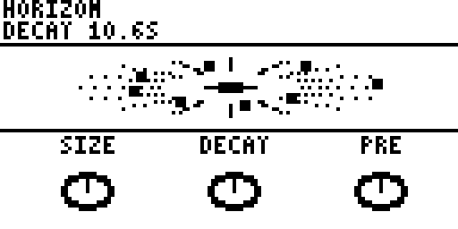

# Horizon

## Overview

A huge, spacey reverb: eight long, slowly moving lines, from a room to a cathedral, a minute-long tail and a hold, a swell that blooms each note in.

## Controls

| Control | Default | Function |
| --- | ---: | --- |
| Size | 70 | params[5]. The space, a room to a cathedral (the delay lines x0.35 .. x1.52); turning it bends the pitch of the tail. Range 0–100. |
| Decay | 60 | params[6]. Reverb time, about 0.8 s to a minute; 100 holds the tail forever and stops taking new sound. Range 0–100. |
| Pre | 15 | params[7]. Pre-delay, 0 .. 370 ms. Range 0–100. |
| Mod | 35 | params[8]. Slow movement of the delay lines: chorus in the tail, shimmer at the top. Range 0–100. |
| Lo | 20 | params[9]. Low cut inside the tail, 20 .. 600 Hz. Range 0–100. |
| Hi | 55 | params[10]. High cut inside the tail, 1.5 .. 16 kHz: dark to bright. Range 0–100. |
| Swell | 0 | params[11]. Each note blooms into the reverb, over up to 2 s; 0 off. Range 0–100. |
| Width | 80 | params[12]. Stereo width of the tail, mono .. extra wide. Range 0–100. |
| Mix | 45 | params[13]. Dry/wet. Range 0–100. |

## Usage

Send a short pulse and then a sustained chord. Listen to the reverb tail for crackles.

### Quick tutorial

1. Add Horizon from the Delay group to a spare patch.
2. Send a short pulse and then a sustained chord. Listen to the reverb tail for crackles.
3. Use the page buttons to reach the remaining controls.

## Compatibility and limitations

Hardware untested on the original MS-70CDR with OS 2.10. This build has startup knob initialization disabled. Check saved settings after recalling a patch.

## Tests and measurements

Ziddle passed the loader check and rendered 22,050 stereo frames. The compiled file passed the stock-code scan and MS-70CDR size limits. Hardware untested. [Verification](TESTING.md)

## Authorship and licences

Roman Rusinov and the ZoomMultistompZDL contributors. [Source](https://github.com/themanro/ZoomMultistompZDL/tree/aee98c53d7b568cbb55bb927aefbdc9b4e739f3e/src/custom/horizon) · [Licences](LICENSE)

## Screens and audio

