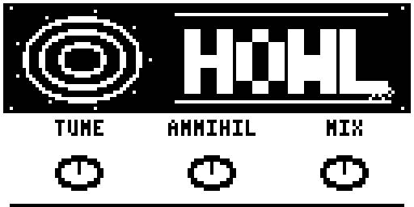

# Howl

## Overview

A Total Sonic Annihilation-style feedback loop that self-oscillates on demand.

## Controls

| Control | Default | Function |
| --- | ---: | --- |
| Tune | 17 | params[5]. Oscillation/resonant frequency. Range 0–100. |
| Anhil | 34 | params[6]. Pole radius: short ring -> long howl. Range 0–100. |
| Mix | 50 | Dry/wet crossfade. Renamed from 'Level' so every effect in the pack ends with the same control. Range 0–100. |

## Usage

Use short notes and bring feedback up gradually to hear when it starts sustaining.

### Quick tutorial

1. Add Howl from the Delay group to a spare patch.
2. Use short notes and bring feedback up gradually to hear when it starts sustaining.
3. Compare the effect with bypass using the footswitch.

## Compatibility and limitations

Hardware untested on the original MS-70CDR with OS 2.10. This build has startup knob initialization disabled. Check saved settings after recalling a patch.

## Tests and measurements

Ziddle passed the loader check and rendered 22,050 stereo frames. The compiled file passed the stock-code scan and MS-70CDR size limits. Hardware untested. [Verification](TESTING.md)

## Authorship and licences

Roman Rusinov and the ZoomMultistompZDL contributors. [Source](https://github.com/themanro/ZoomMultistompZDL/tree/aee98c53d7b568cbb55bb927aefbdc9b4e739f3e/src/custom/howl) · [Licences](LICENSE)

## Screens and audio

