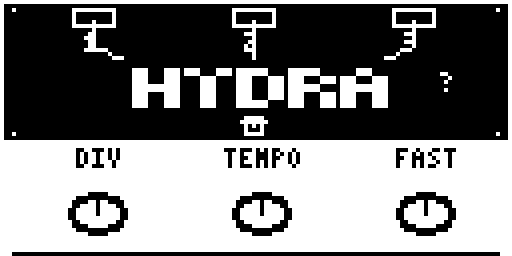

# Hydra

## Overview

Two extra playheads on one delay: a double-time ghost an octave up and a half-time drag an octave down, locked to tempo. Built for drums.

## Controls

| Control | Default | Function |
| --- | ---: | --- |
| Div | 42 | Re-trigger length as a division of Tempo. Position 0 is Grain: a fixed 256-sample window, free-running, which is the granular octave-shifter mode the tempo ladder cannot reach. Above that: 1/32, 1/16T, 1/16, 1/8T, 1/8, dotted 1/8, 1/4. Default 42 = 1/16 (DSP range 32-43); 1/8T starts at 44. Range 0–100. |
| Tempo | 120 | BPM, read straight off the knob. Clamped to 40..240 in the DSP. Ignored when Div is at Grain. Range 0–240. |
| Fast | 70 | Level of the 2x head: double-time ghost, octave up. Range 0–100. |
| Slow | 55 | Level of the 0.5x head: half-time drag, octave down. Range 0–100. |
| Tone | 45 | Low-pass on the two layers only; the dry stays open. Range 0–100. |
| Mix | 50 | Dry/wet. Range 0–100. |

## Usage

Play a short drum loop and listen for separate high double-speed and low half-speed taps.

### Quick tutorial

1. Add Hydra from the Delay group to a spare patch.
2. Play a short drum loop and listen for separate high double-speed and low half-speed taps.
3. Use the page buttons to reach the remaining controls.

## Compatibility and limitations

Hardware untested on the original MS-70CDR with OS 2.10. This build has startup knob initialization disabled. Check saved settings after recalling a patch.

## Tests and measurements

Ziddle passed the loader check and rendered 22,050 stereo frames. The compiled file passed the stock-code scan and MS-70CDR size limits. Hardware untested. [Verification](TESTING.md)

## Authorship and licences

Roman Rusinov and the ZoomMultistompZDL contributors. [Source](https://github.com/themanro/ZoomMultistompZDL/tree/aee98c53d7b568cbb55bb927aefbdc9b4e739f3e/src/custom/hydra) · [Licences](LICENSE)

## Screens and audio

