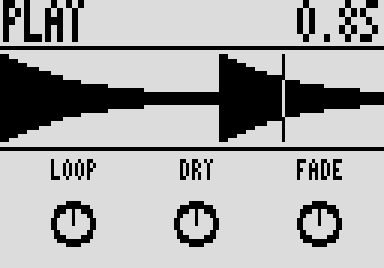

# Loop

A looper for the Zoom MS-70CDR, by Roman Rusinov (Manro): record, play,
overdub, undo and redo from the footswitch. Version 0.3.0 lists his Loop 0.03,
built with no code from Zoom's effects.

## Overview

Loop records what comes into its slot, plays it back, and lets you overdub,
undo and redo. The footswitch becomes the looper's button: each press flips
the effect's on/off LED, but the loop plays either way, so ignore the LED.
Fade lets older layers die away on each overdub lap, like a delay's feedback.
Set Tempo and Beats before you record and the loop snaps to whole bars, with
an optional click on the output that is never recorded.

| You're in | Single press | Double press (within about 0.45 s) |
| --- | --- | --- |
| READY (empty) | start recording | cancel the recording |
| REC | close the loop and play it from the top | close the loop and stop |
| PLAY | start an overdub | stop (and drop the overdub the first press began) |
| DUB | back to PLAY: the overdub ends | stop, keeping the overdub |
| STOP | play from the top | clear the loop (back to READY) |

The first press acts at once, so your timing is exact. A loop under 0.15 s
counts as a mistaken press and is thrown away. An on/off message over MIDI
counts as a press too.

## Controls

| Page | Knob | Default | What it does |
| --- | --- | --- | --- |
| 1 | Loop | 100 | Loop playback level. |
| 1 | Dry | 100 | Your live signal. |
| 1 | Fade | 100 | How much of the loop survives each overdub lap: 100 keeps everything, lower values let older layers fade. |
| 2 | Undo | 0 | Flip it either way to undo the last overdub, then again to redo. Flipping it during an overdub throws that overdub away. |
| 2 | Long | Off | Experimental long loops (about 23 s instead of about 5 s) in extra RAM, on Zoom's 2.10 without MIDISTOMP only. Set it while the looper is empty. |
| 2 | Tempo | 120 | BPM for quantize and the click, 40 to 250. |
| 3 | Beats | Off | Beats per bar: Off = free length, 1 = snap to beats, 2 to 12 = snap to bars of that many beats. |
| 3 | Click | 50 | Metronome level, 0 = silent; only with Beats set. |

Tempo and Beats are taken when recording starts, so turning them later
applies to the next loop.

## Usage

Add Loop to a patch from the effect list (Delay group) and put it in the last
slot, so it records everything before it. Add it to your set and sync the set
from the pedal page over USB, or install it with Zoom Effect Manager, then
power-cycle the pedal.

### Quick tutorial

1. Put Loop in the last slot of a patch, so it records everything before it, and press the footswitch to start recording.
2. Press it again to close the loop: it plays from the top. Press once more to overdub, and again to go back to playing.
3. Double press to stop. Double press again while it is stopped to clear the loop.

## Compatibility and limitations

- Tested on an MS-70CDR running MIDISTOMP V2.0.1 (Zoom's 2.10 underneath).
  Its screen needs the MS-70CDR 2.10.
- This build has the init path off: a recalled patch plays the knobs' defaults
  until you touch a knob, while the screen shows the saved values.
- Long is for Zoom's 2.10 without MIDISTOMP. Leave it off with MIDISTOMP.
- There is no external sync: the tempo is the Tempo knob's.
- DSP 8 of the patch's 225 (300 with MIDISTOMP 2).

## Tests and measurements

See [TESTING.md](TESTING.md): the release file has no code from Zoom's effects,
passes Ziddle's loader check, renders in Ziddle with the same audio as the
earlier build, and ran on an MS-70CDR on 9 November 2026.

## Authorship and licences

Loop's DSP and screen are by Roman Rusinov (Manro), in ZoomMultistompZDL
(MIT, Roman Rusinov and Jannik Aßfalg). The file is built with Leemuzhko's
effect runtime (MIT), whose three call helpers are TI's RTS source
(BSD-3-Clause). Every licence is in [LICENSE](LICENSE). Source:
[src/custom/loop at 32f3d68](https://github.com/repeat98/ZoomMultistompZDL/tree/32f3d6877d892409c6defeeeec57040ad004d31f/src/custom/loop);
release: [loop-0.03](https://github.com/repeat98/ZoomMultistompZDL/releases/tag/loop-0.03).

## Screens and audio

Loop's own screen while it plays, rendered from its source by
ZoomMultistompZDL's `zvis_host.py` (an emulator capture, not a photo of the
pedal). Top left the state (READY, REC, PLAY, DUB or STOP), top right the
time, in the middle the loop's waveform with a playhead.
