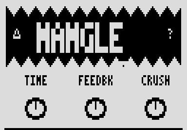

# Mangle

A delay whose repeats get crushed, pulsed or shimmered a little more on every pass. By Roman Rusinov (Manro); version 9.0.0 lists his Mangle 9.00, built with no code from Zoom's effects.

## Overview

Mangle is a feedback delay with three mutations you can blend. Crush degrades each repeat and Tremolo makes it pulse, both inside the feedback so they compound with every pass; Pitch adds an octave-down grain shimmer to the output. With all three at 0 it is a clean delay.

## Controls

| Knob | Default | What it does |
| --- | --- | --- |
| Time | 40 | Delay length, about 23 ms to 1.3 s. |
| Feedbk | 45 | Feedback: how many repeats. |
| Crush | 0 | Degradation in the feedback (sample-rate reduction, bit crush, darkening); 0 = off. |
| Tremolo | 0 | An amplitude wobble of about 4.5 Hz in the feedback, so repeats pulse harder each pass; 0 = off. |
| Pitch | 0 | Octave-down grain shimmer on the output; 0 = off. |
| Mix | 50 | Dry and wet blend. |

## Usage

Add Mangle to a patch from the effect list (Delay group). Add it to your set in the library and sync the set from the pedal page over USB, or install the file with Zoom Effect Manager; then power-cycle the pedal.

### Quick tutorial

1. Put Mangle in a patch: with Crush, Tremolo and Pitch at 0 it is a clean delay.
2. Set Time and Feedbk, then raise Crush, Tremolo or Pitch to change every repeat.
3. Mix blends the repeats with your dry signal.

## Compatibility and limitations

- Built with the init path off: a recalled patch plays the knobs' defaults until you touch a knob.
- DSP 20 of the patch's 225 (300 with MIDISTOMP 2), as the effect declares it.

## Tests and measurements

See [TESTING.md](TESTING.md): the file has no code from Zoom's effects, passes Ziddle's loader check and renders in Ziddle. It has not run on a pedal yet.

## Authorship and licences

Mangle is by Roman Rusinov (Manro), in ZoomMultistompZDL (MIT, Roman Rusinov and Jannik Aßfalg). The file is built with Leemuzhko's effect runtime (MIT), whose three call helpers are TI's RTS source (BSD-3-Clause). Every licence is in [LICENSE](LICENSE). Source: [src/custom/mangle at 32f3d68](https://github.com/repeat98/ZoomMultistompZDL/tree/32f3d6877d892409c6defeeeec57040ad004d31f/src/custom/mangle).

## Screens and audio

The cover picture inside the release file itself, decoded from its Zoom RLE: what the pedal shows for this effect.
