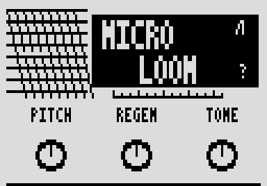

# Microloom

A granular shimmer cloud: pitched grains fed back on themselves, so it builds rather than repeats. By Roman Rusinov (Manro); version 2.0.0 lists his Microlm 2.00, built with no code from Zoom's effects.

## Overview

Microloom cuts what you play into short grains, shifts their pitch and feeds them back, so a held note grows into a cloud instead of echoing. Pitch sets the shift from an octave down to an octave up, Regen how long the cloud builds, Tone how dark or bright it is, and Mix how much of it you hear.

## Controls

| Knob | Default | What it does |
| --- | --- | --- |
| Pitch | 100 | Shimmer shift: 0 = an octave down, about 33 = unison, 100 = an octave up. |
| Regen | 72 | Feedback: how long the cloud builds. |
| Tone | 55 | Output low-pass, dark to bright. |
| Mix | 50 | Dry and wet blend. |

## Usage

Add Microlm to a patch from the effect list (Delay group). Add it to your set in the library and sync the set from the pedal page over USB, or install the file with Zoom Effect Manager; then power-cycle the pedal.

### Quick tutorial

1. Put Microloom in a patch and play a held note.
2. Pitch sets the shimmer (an octave up at 100), Regen how long the cloud builds.
3. Tone darkens or brightens it, Mix blends it in.

## Compatibility and limitations

- Built with the init path off: a recalled patch plays the knobs' defaults until you touch a knob.
- DSP 20 of the patch's 225 (300 with MIDISTOMP 2), as the effect declares it.

## Tests and measurements

See [TESTING.md](TESTING.md): the file has no code from Zoom's effects, passes Ziddle's loader check and renders in Ziddle. It has not run on a pedal yet.

## Authorship and licences

Microloom is by Roman Rusinov (Manro), in ZoomMultistompZDL (MIT, Roman Rusinov and Jannik Aßfalg). The file is built with Leemuzhko's effect runtime (MIT), whose three call helpers are TI's RTS source (BSD-3-Clause). Every licence is in [LICENSE](LICENSE). Source: [src/custom/microloom at 32f3d68](https://github.com/repeat98/ZoomMultistompZDL/tree/32f3d6877d892409c6defeeeec57040ad004d31f/src/custom/microloom).

## Screens and audio

The cover picture inside the release file itself, decoded from its Zoom RLE: what the pedal shows for this effect.
